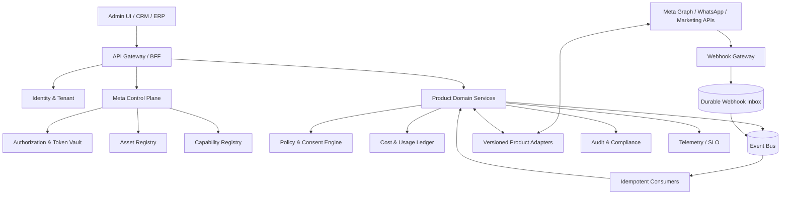

# 05 — Arquitectura objetivo

## 1. Estilo
Arquitectura modular por dominios, event-driven y hexagonal/ports-and-adapters. Decisión vigente: modular monolith con procesos API/worker separables desde el mismo codebase. No desplegar microservicios por endpoint; extraer bounded contexts solo cuando métricas de carga, seguridad, aislamiento, ownership o ciclo de despliegue lo justifiquen. La especificación normativa está en [30-RECOMMENDED-ARCHITECTURE.md](30-RECOMMENDED-ARCHITECTURE.md).

## 2. Context map
| Bounded context | Responsabilidad |
|---|---|
| Identity & Tenant | usuarios, organizaciones, roles, aislamiento |
| Meta App & Authorization | OAuth, app config, scopes, token lifecycle |
| Asset Registry | WABA, phone, Page, IG account, ad account, forms, datasets |
| Capability Registry | capacidades habilitadas por cuenta/versión/permisos |
| WhatsApp Messaging | mensajes, medios, delivery, templates, Flows |
| Facebook Engagement | Pages, Messenger, comments, moderation |
| Instagram Engagement | publishing, messaging, comments, insights |
| Lead Acquisition | Lead Ads, retrieval, normalization, dedupe |
| Advertising | campaign/adset/ad/creative/insights |
| Conversion Measurement | CAPI, deduplication, attribution |
| Policy & Consent | opt-in, opt-out, suppression, windows, policy |
| Billing & Cost Ledger | rate cards, usage, estimates, reconciliation |
| Webhook Gateway | verification, durable inbox, routing |
| Audit & Compliance | immutable audit, export/deletion evidence |
| Integration Operations | retries, DLQ, health, rate limits |

## 3. Component diagram

## 4. Flujos críticos
### Conexión de cliente
1. Admin inicia OAuth con state/PKCE donde aplique.
2. Backend valida state, redirect URI y actor.
3. Intercambia code server-side; nunca expone app secret.
4. Resuelve scopes y activos visibles.
5. Persiste grant/asset y token cifrado en vault.
6. Suscribe webhooks y verifica callback.
7. Sincroniza capabilities; deja capacidad disabled si falta permiso.
8. Registra auditoría y muestra limitaciones al tenant.

### Comando de envío
1. API valida tenant/actor/ownership.
2. Policy Engine valida consentimiento, ventana, template, canal y suppression.
3. Capability Registry selecciona adapter y ruta.
4. Outbox registra comando con idempotency key.
5. Adapter llama Meta con timeout y correlation ID.
6. Respuesta se guarda como accepted/unknown/rejected; no como delivered.
7. Webhook actualiza estado de entrega; reconciliación cubre estados ausentes.

### Webhook
1. Verificar challenge/firma según producto.
2. Aplicar límite de tamaño y parseo seguro.
3. Persistir payload cifrado/filtrado y fingerprint.
4. Responder rápido según contrato Meta.
5. Publicar evento interno; dedupe consumer.
6. Enriquecer, actualizar agregado y emitir auditoría.
7. Fallos a DLQ; replay autorizado y rastreable.

### Publicidad
1. Construcción en draft.
2. Validación de objetivo, targeting, creativo, presupuesto, moneda, cuenta y permisos.
3. Simulación/dry-run.
4. Aprobación de actor con rol adecuado.
5. Creación/activación explícita.
6. Seguimiento de review/delivery/spend.
7. Pausa automática por guardrails/kill switch.
8. Conciliación de Insights y gasto.

## 5. Despliegue lógico
- Edge/API Gateway: autenticación, rate limit, routing, WAF.
- Control Plane: autorización y metadatos.
- Domain services: reglas propias de cada bounded context.
- Workers: operaciones asíncronas, sync y backfill.
- Event bus: partición por tenant/product/asset; orden solo donde sea requerido.
- Persistence: OLTP relacional, object storage cifrado, cache aislada por tenant.
- Secrets: KMS/HSM y secret manager.
- Observability: logs estructurados, metrics, traces y audit trail separados.

## 6. Reglas de límites
- Ningún servicio de canal consulta tablas internas ajenas directamente.
- Comunicación síncrona para validaciones críticas; eventos para procesos largos.
- Contratos OpenAPI/AsyncAPI versionados.
- Esquema de eventos con compatibilidad backward/forward.
- Outbox/inbox para consistencia eventual.
- Cada servicio declara owner, SLO, datos, clasificación y runbook.

## 7. Decisiones técnicas y operativas
Las decisiones de lenguaje/framework, base de datos, broker, monorepo, despliegue inicial e identidad se adoptaron en ADR-011..020 y se documentaron en docs/30 y docs/33. Su validez operativa debe confirmarse mediante TASK-039 y TASK-060. Multi-region, topología HA definitiva, presupuesto, SLA comercial y RPO/RTO comprometidos siguen condicionados por requisitos y mediciones.

## 8. Baseline técnica posterior a respuestas del propietario

El propietario autorizó al arquitecto a recomendar stack y confirmó despliegue en VPS. La propuesta detallada se encuentra en [30-RECOMMENDED-ARCHITECTURE.md](30-RECOMMENDED-ARCHITECTURE.md). Esta propuesta complementa este documento y no congela proveedores/versiones hasta completar el architecture spike.

Contextos de CRM, Inbox, Automation e AI Assistance se incorporan como dominios de primera clase. La entrega por fases está definida en [31-MASTER-DELIVERY-PLAN.md](31-MASTER-DELIVERY-PLAN.md).

## 9. Decisión de despliegue y consistencia actualizada (2026-11-06)

- Los bounded contexts son límites lógicos y de propiedad, no equivalen inicialmente a un proceso/microservicio cada uno.
- NestJS modular monolith, Angular web, PostgreSQL, Redis, RabbitMQ y OIDC/Keycloak forman la baseline adoptada en docs/30.
- PostgreSQL es fuente de verdad; transactional outbox/inbox y RabbitMQ gestionan la entrega asíncrona. Redis es efímero.
- Multi-tenancy compartido usa tenant_id + autorización backend + RLS transaccional. DB/cluster dedicado queda como tier de aislamiento enterprise.
- Docker Compose es para desarrollo/piloto single-node, no una declaración de HA. Topología productiva requiere redundancia y pruebas de failover.
- Los ADR-011..020 están aceptados como dirección técnica por delegación, pero TASK-039 debe medir footprint, build, pooling/RLS, queue, backup y restore antes de scaffold de producción.
- La estructura y responsabilidades concretas están detalladas en [30-RECOMMENDED-ARCHITECTURE.md](30-RECOMMENDED-ARCHITECTURE.md); no mantener contradicciones con esta decisión posterior.

## 10. Campaign Intelligence and agent gateway
Campaigns & Measurement incluye Campaign Intelligence and Creative Lab. Campaign Intelligence receives Insights snapshots, CRM/CAPI business events and experiment results; it emits OptimizationRecommendations and budget proposals. Creative Lab stores source/rights/brand/provenance, variants, previews, approvals and test-cell relationships. Meta delivery AI remains external; we do not access Andromeda/GEM scores.

External AI tools (Meta Ads MCP, Meta Business Agent, WhatsBusiness MCP) are adapters behind a single Agent Tool Gateway. The gateway enforces actor/tenant/purpose/asset capabilities, policy, budget cap PD-024, approval, idempotency and audit. Agents cannot possess unrestricted API tokens or mutate Meta directly.

See docs/36-CAMPAIGN-INTELLIGENCE-AND-GUARDED-SCALING.md and ADR-021/022 in docs/33.
