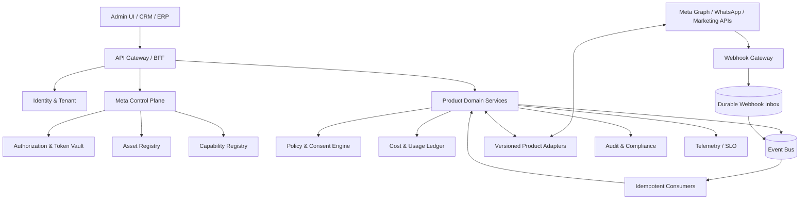

# 05 — Arquitectura objetivo

## 1. Estilo
Arquitectura de microservicios orientada a dominios, event-driven, hexagonal/ports-and-adapters, con límites explícitos. No fragmentar prematuramente por endpoint; separar por bounded context y carga/seguridad/ciclo de vida.

## 2. Context map
| Bounded context | Responsabilidad |
|---|---|
| Identity & Tenant | usuarios, organizaciones, roles, aislamiento |
| Meta App & Authorization | OAuth, app config, scopes, token lifecycle |
| Asset Registry | WABA, phone, Page, IG account, ad account, forms, datasets |
| Capability Registry | capacidades habilitadas por cuenta/versión/permisos |
| WhatsApp Messaging | mensajes, medios, delivery, templates, Flows |
| Facebook Engagement | Pages, Messenger, comments, moderation |
| Instagram Engagement | publishing, messaging, comments, insights |
| Lead Acquisition | Lead Ads, retrieval, normalization, dedupe |
| Advertising | campaign/adset/ad/creative/insights |
| Conversion Measurement | CAPI, deduplication, attribution |
| Policy & Consent | opt-in, opt-out, suppression, windows, policy |
| Billing & Cost Ledger | rate cards, usage, estimates, reconciliation |
| Webhook Gateway | verification, durable inbox, routing |
| Audit & Compliance | immutable audit, export/deletion evidence |
| Integration Operations | retries, DLQ, health, rate limits |

## 3. Component diagram

## 4. Flujos críticos
### Conexión de cliente
1. Admin inicia OAuth con state/PKCE donde aplique.
2. Backend valida state, redirect URI y actor.
3. Intercambia code server-side; nunca expone app secret.
4. Resuelve scopes y activos visibles.
5. Persiste grant/asset y token cifrado en vault.
6. Suscribe webhooks y verifica callback.
7. Sincroniza capabilities; deja capacidad disabled si falta permiso.
8. Registra auditoría y muestra limitaciones al tenant.

### Comando de envío
1. API valida tenant/actor/ownership.
2. Policy Engine valida consentimiento, ventana, template, canal y suppression.
3. Capability Registry selecciona adapter y ruta.
4. Outbox registra comando con idempotency key.
5. Adapter llama Meta con timeout y correlation ID.
6. Respuesta se guarda como accepted/unknown/rejected; no como delivered.
7. Webhook actualiza estado de entrega; reconciliación cubre estados ausentes.

### Webhook
1. Verificar challenge/firma según producto.
2. Aplicar límite de tamaño y parseo seguro.
3. Persistir payload cifrado/filtrado y fingerprint.
4. Responder rápido según contrato Meta.
5. Publicar evento interno; dedupe consumer.
6. Enriquecer, actualizar agregado y emitir auditoría.
7. Fallos a DLQ; replay autorizado y rastreable.

### Publicidad
1. Construcción en draft.
2. Validación de objetivo, targeting, creativo, presupuesto, moneda, cuenta y permisos.
3. Simulación/dry-run.
4. Aprobación de actor con rol adecuado.
5. Creación/activación explícita.
6. Seguimiento de review/delivery/spend.
7. Pausa automática por guardrails/kill switch.
8. Conciliación de Insights y gasto.

## 5. Despliegue lógico
- Edge/API Gateway: autenticación, rate limit, routing, WAF.
- Control Plane: autorización y metadatos.
- Domain services: reglas propias de cada bounded context.
- Workers: operaciones asíncronas, sync y backfill.
- Event bus: partición por tenant/product/asset; orden solo donde sea requerido.
- Persistence: OLTP relacional, object storage cifrado, cache aislada por tenant.
- Secrets: KMS/HSM y secret manager.
- Observability: logs estructurados, metrics, traces y audit trail separados.

## 6. Reglas de límites
- Ningún servicio de canal consulta tablas internas ajenas directamente.
- Comunicación síncrona para validaciones críticas; eventos para procesos largos.
- Contratos OpenAPI/AsyncAPI versionados.
- Esquema de eventos con compatibilidad backward/forward.
- Outbox/inbox para consistencia eventual.
- Cada servicio declara owner, SLO, datos, clasificación y runbook.

## 7. Decisiones pendientes antes del código
DB/ORM, broker, lenguaje/framework, despliegue cloud, API gateway, multi-region, RPO/RTO y SLA deben decidirse con ADR basado en requisitos cuantificados; no fijarlos por preferencia personal.
