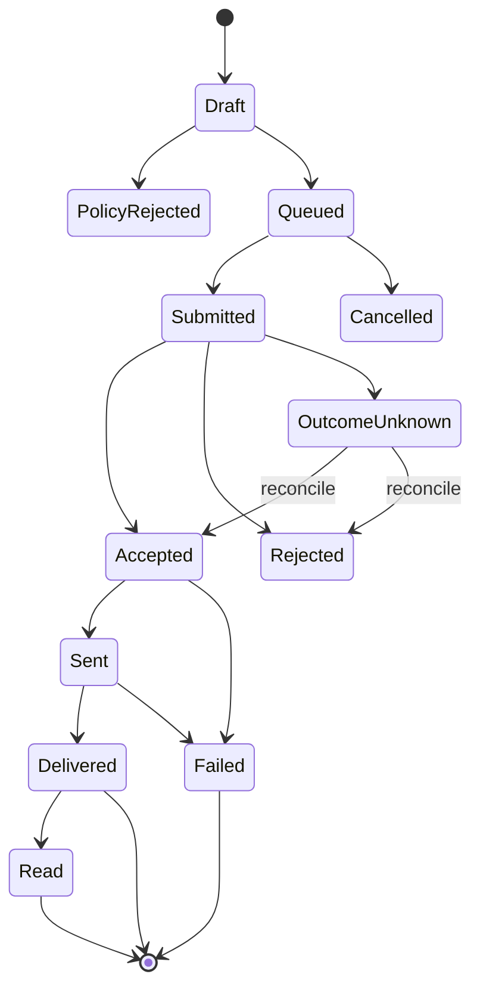
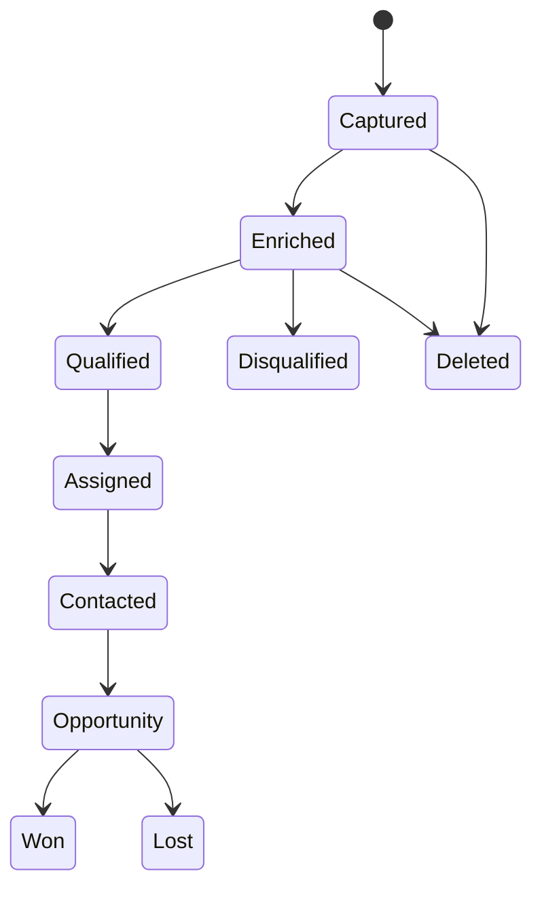

# 06 — Dominio y lógica de negocio

## 1. Agregados
Tenant, User, Role, MetaApp, AuthorizationConnection, TokenCredentialRef, Asset, AssetGrant, CapabilitySnapshot, WebhookSubscription, Contact, ChannelIdentity, ConsentRecord, SuppressionEntry, Conversation, ConversationWindow, Message, DeliveryReceipt, Template, TemplateRevision, Flow, Lead, LeadAttribution, Campaign, AdSet, Creative, Ad, ConversionEvent, RateCard, UsageRecord, CostLedgerEntry, AuditEvent.

## 2. Invariantes
- Todo recurso de cliente está ligado a tenant; queries sin tenant scope fallan closed.
- Un token se asocia a conexión/app/tenant y grants explícitos, nunca a un usuario global implícito.
- Asset ID externo no demuestra propiedad: verificar grant en cada operación sensible.
- Capability = producto + operación + versión + scopes + asset tasks + estado de cuenta + elegibilidad.
- Consentimiento es granular por propósito/canal/origen/fecha/versión de aviso.
- Opt-out tiene precedencia sobre automatizaciones y campañas.
- Ventanas se calculan desde eventos válidos del usuario y reglas específicas del canal.
- Plantilla debe estar aprobada, categoría/idioma compatible y variables validadas.
- Presupuesto nunca supera límites de tenant/campaña/cuenta sin nueva aprobación.
- Eventos externos se procesan al menos una vez con efecto idempotente.

## 3. Máquina de estados de mensaje

Estados internos deben conservar estado original y timestamp de proveedor; transiciones tardías no pueden hacer retroceder el estado final sin regla explícita.

## 4. Consentimiento y contacto
Modelo: subject + tenant + channel + purpose + legal basis + source + capturedAt + noticeVersion + evidenceRef + status + revokedAt. No inferir consentimiento desde que el contacto escribió, salvo que la regla legal y de plataforma lo permita para el propósito concreto. Mantener suppression list por canal y scope.

## 5. Lead lifecycle

Cada transición registra actor, timestamp, reason, source, attribution, fields version y auditoría. No alterar lead original al enriquecer: conservar snapshots/provenance.

## 6. Campaign lifecycle
Draft → Validated → AwaitingApproval → Approved → Submitted → InReview → Active → Paused/Completed/Rejected/Archived. Meta puede modificar estado externamente; sincronización debe reconciliar estado remoto y local. Crear no equivale a activar. Acciones de gasto requieren autorización separada.

## 7. Cost ledger
- RateCard: país/mercado, moneda, categoría, effectiveFrom/To, fuente y versión.
- Usage: unidad facturable, asset, producto, fecha local/UTC, quantity.
- Estimate: cálculo preliminar claramente etiquetado.
- ProviderReported: coste/analytics devuelto por Meta.
- Reconciled: conciliación contra factura/estado de cuenta.
- No inventar precio fijo por mensaje; soportar cambios y exenciones.
- Guardar moneda original y conversiones FX como snapshots con proveedor/fecha.

## 8. Polimorfismo del dominio
No usar herencia rígida basada solo en canal. Usar discriminated unions y composición de capacidades:
- MessageContent: text, template, media, interactive, location, contacts, product, flow, native.
- ChannelAdapter: WhatsApp, Messenger, Instagram.
- Capability: sendText, sendTemplate, uploadMedia, readInsights, publishReel, retrieveLead, createCampaign, etc.
- Native extension: producto, API version, raw schema version, payload ref.
Un comando se valida contra capabilities disponibles; no exponer operación que el tenant no puede ejecutar.

## 9. CRM, Inbox y automatización — agregados adicionales
- OrganizationMembership, Team, TeamMembership, Entitlement, Plan, SubscriptionRef, SupportAccessGrant.
- Contact, ContactIdentity, ContactFieldDefinition, ContactFieldValue, ContactMerge, Company, Lead, Opportunity, Pipeline, PipelineStage, Activity, Task, Note, Tag, Assignment.
- Conversation, ConversationParticipant, ChannelAccountRef, Message, MessagePart, AttachmentRef, DeliveryReceipt, ConversationAssignment, InternalNote, Handoff, PresenceLease.
- WorkflowDefinition, WorkflowVersion, WorkflowTrigger, WorkflowCondition, WorkflowAction, WorkflowExecution, WorkflowStepExecution, WorkflowSchedule, AutomationLimit.
- AIProviderConfig, AIModelCapability, PromptTemplate, PromptVersion, AIInvocation, AISuggestion, AIFeedback, AIBudgetLedger.

## 10. Invariantes CRM/Inbox/IA
- Contact identity is tenant-scoped and provider-scoped; merging identities must be auditable and reversible.
- Canonical conversation/message types preserve channel-specific capabilities and native payload references; no false feature parity.
- Internal notes, agent metadata and prompts never enter outbound provider payloads.
- Message composer checks channel capability, recipient state, consent, policy window and asset grants at send time.
- A conversation may have one active assignment policy at a time; concurrent agent sends use idempotency and conflict detection.
- Automation definitions are versioned; executions pin an immutable version and record input/output references, retries and decisions.
- Automation re-evaluates permissions, consent and policy at execution time; approval at design time is not blanket execution permission.
- AI output is untrusted content. It cannot override system policy, authorization, consent or tenant boundaries.
- AI suggestions are drafts by default. Sending, publishing, spend, deletion and permission changes require explicit human authorization.
- AI provider calls enforce tenant budgets, data minimization, retention controls, timeout, fallback and kill switch.
