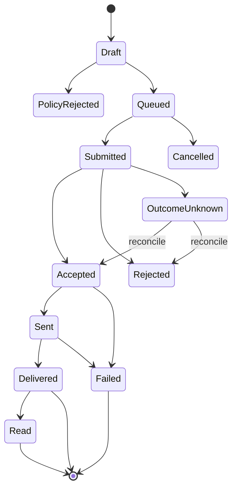
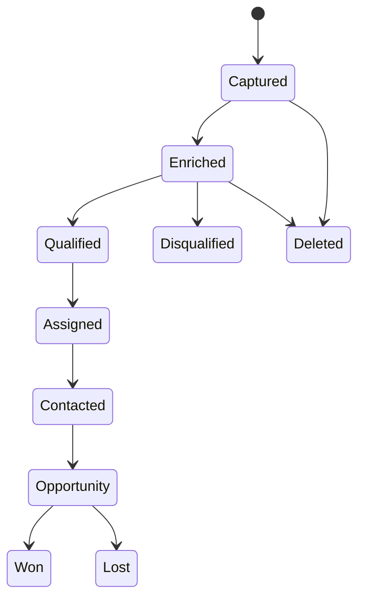

# 06 — Dominio y lógica de negocio

## 1. Agregados
Tenant, User, Role, MetaApp, AuthorizationConnection, TokenCredentialRef, Asset, AssetGrant, CapabilitySnapshot, WebhookSubscription, Contact, ChannelIdentity, ConsentRecord, SuppressionEntry, Conversation, ConversationWindow, Message, DeliveryReceipt, Template, TemplateRevision, Flow, Lead, LeadAttribution, Campaign, AdSet, Creative, Ad, ConversionEvent, RateCard, UsageRecord, CostLedgerEntry, AuditEvent.

## 2. Invariantes
- Todo recurso de cliente está ligado a tenant; queries sin tenant scope fallan closed.
- Un token se asocia a conexión/app/tenant y grants explícitos, nunca a un usuario global implícito.
- Asset ID externo no demuestra propiedad: verificar grant en cada operación sensible.
- Capability = producto + operación + versión + scopes + asset tasks + estado de cuenta + elegibilidad.
- Consentimiento es granular por propósito/canal/origen/fecha/versión de aviso.
- Opt-out tiene precedencia sobre automatizaciones y campañas.
- Ventanas se calculan desde eventos válidos del usuario y reglas específicas del canal.
- Plantilla debe estar aprobada, categoría/idioma compatible y variables validadas.
- Presupuesto nunca supera límites de tenant/campaña/cuenta sin nueva aprobación.
- Eventos externos se procesan al menos una vez con efecto idempotente.

## 3. Máquina de estados de mensaje

Estados internos deben conservar estado original y timestamp de proveedor; transiciones tardías no pueden hacer retroceder el estado final sin regla explícita.

## 4. Consentimiento y contacto
Modelo: subject + tenant + channel + purpose + legal basis + source + capturedAt + noticeVersion + evidenceRef + status + revokedAt. No inferir consentimiento desde que el contacto escribió, salvo que la regla legal y de plataforma lo permita para el propósito concreto. Mantener suppression list por canal y scope.

## 5. Lead lifecycle

Cada transición registra actor, timestamp, reason, source, attribution, fields version y auditoría. No alterar lead original al enriquecer: conservar snapshots/provenance.

## 6. Campaign lifecycle
Draft → Validated → AwaitingApproval → Approved → Submitted → InReview → Active → Paused/Completed/Rejected/Archived. Meta puede modificar estado externamente; sincronización debe reconciliar estado remoto y local. Crear no equivale a activar. Acciones de gasto requieren autorización separada.

## 7. Cost ledger
- RateCard: país/mercado, moneda, categoría, effectiveFrom/To, fuente y versión.
- Usage: unidad facturable, asset, producto, fecha local/UTC, quantity.
- Estimate: cálculo preliminar claramente etiquetado.
- ProviderReported: coste/analytics devuelto por Meta.
- Reconciled: conciliación contra factura/estado de cuenta.
- No inventar precio fijo por mensaje; soportar cambios y exenciones.
- Guardar moneda original y conversiones FX como snapshots con proveedor/fecha.

## 8. Polimorfismo del dominio
No usar herencia rígida basada solo en canal. Usar discriminated unions y composición de capacidades:
- MessageContent: text, template, media, interactive, location, contacts, product, flow, native.
- ChannelAdapter: WhatsApp, Messenger, Instagram.
- Capability: sendText, sendTemplate, uploadMedia, readInsights, publishReel, retrieveLead, createCampaign, etc.
- Native extension: producto, API version, raw schema version, payload ref.
Un comando se valida contra capabilities disponibles; no exponer operación que el tenant no puede ejecutar.

## 9. CRM, Inbox y automatización — agregados adicionales
- OrganizationMembership, Team, TeamMembership, Entitlement, Plan, SubscriptionRef, SupportAccessGrant.
- Contact, ContactIdentity, ContactFieldDefinition, ContactFieldValue, ContactMerge, Company, Lead, Opportunity, Pipeline, PipelineStage, Activity, Task, Note, Tag, Assignment.
- Conversation, ConversationParticipant, ChannelAccountRef, Message, MessagePart, AttachmentRef, DeliveryReceipt, ConversationAssignment, InternalNote, Handoff, PresenceLease.
- WorkflowDefinition, WorkflowVersion, WorkflowTrigger, WorkflowCondition, WorkflowAction, WorkflowExecution, WorkflowStepExecution, WorkflowSchedule, AutomationLimit.
- AIProviderConfig, AIModelCapability, PromptTemplate, PromptVersion, AIInvocation, AISuggestion, AIFeedback, AIBudgetLedger.

## 10. Invariantes CRM/Inbox/IA
- Contact identity is tenant-scoped and provider-scoped; merging identities must be auditable and reversible.
- Canonical conversation/message types preserve channel-specific capabilities and native payload references; no false feature parity.
- Internal notes, agent metadata and prompts never enter outbound provider payloads.
- Message composer checks channel capability, recipient state, consent, policy window and asset grants at send time.
- A conversation may have one active assignment policy at a time; concurrent agent sends use idempotency and conflict detection.
- Automation definitions are versioned; executions pin an immutable version and record input/output references, retries and decisions.
- Automation re-evaluates permissions, consent and policy at execution time; approval at design time is not blanket execution permission.
- AI output is untrusted content. It cannot override system policy, authorization, consent or tenant boundaries.
- AI suggestions are drafts by default. Sending, publishing, spend, deletion and permission changes require explicit human authorization.
- AI provider calls enforce tenant budgets, data minimization, retention controls, timeout, fallback and kill switch.

## 11. Modelo comercial y tenants adoptado (PD-012..PD-017)

### Segmentación
- ICP inicial propuesto: PYMES ecuatorianas de comercio y servicios que reciben consultas y gestionan ventas/soporte en canales Meta.
- Segmento secundario: agencias que operan varios negocios.
- Hipótesis de posicionamiento, no investigación cuantitativa. Validar entrevistas, pilotos, activación, retención y disposición a pagar antes de calcular mercado o fijar roadmap comercial.

### Revenue model
- Subscription per tenant para capacidades base.
- Seats/usuarios como unidad adicional de valor/coste.
- Metered usage para funcionalidades con coste variable o capacidad limitada.
- Usage ledger, subscription ledger y Meta external-cost ledger separados.
- Cargos Meta mostrados/conciliados como coste externo independiente; no mezclarlo con ingreso de plataforma. No aplicar markup/precio sin decisión comercial explícita.
- Planes/entitlements configurables. Evitar if/else por nombre de plan; utilizar entitlements y feature limits versionados.

### Agency/Partner
- Agency es organización/partner con usuarios, no super-tenant con acceso automático.
- Acceso a tenant cliente mediante grant con agencia, tenant, scopes/roles, assets, acciones, finalidad, expiración, aprobador, creación y revocación.
- Denegar por defecto si grant expiró/revocó o no cubre operación/asset.
- El cliente puede revocar el acceso; todo acceso se audita y se identifica la agencia de origen.
- La relación comercial no autoriza usar datos de otro cliente.

### Localization
- Defaults: es-EC, USD, America/Guayaquil.
- Tenant puede configurar locale, timezone IANA y moneda ISO-4217 permitida.
- Persistir timestamps UTC y mostrar en zona del tenant.
- Money amounts siempre con currency code y decimal rules; nunca float binario en ledger.
- Fechas de facturación, obligaciones fiscales y comprobantes locales se implementan tras requisitos tributarios validados.

## 12. Modelo de costes y billing
Separar:
1. Subscription ledger: plan, ciclo, invoice reference, credits/discounts si se aprueban.
2. Seat ledger: usuarios facturables y periodo.
3. Usage ledger: unidad, cantidad, tenant, recurso, timestamp, rate card interno y versión.
4. Meta external-cost ledger: currency, market, product, category, rate source/version, estimate, max/upper bound, provider-reported actual, reconciled statement.
5. Infrastructure cost ledger: coste real de compute, storage, broker, observability y backups.

Conservar moneda original, vigencia y fuente de FX si hay conversión. Ningún estimate es invoice ni un max price es charge final.

## 13. Campaign Intelligence y Creative Lab
Agregados adicionales:
- CampaignPlan, CampaignSnapshot, AdSetSnapshot, AdSnapshot, CreativeAsset, CreativeVariant, CreativeFeatureEnrollment.
- CreativeReview, BrandKit, ClaimEvidence, AssetLicense/ConsentReference, CreativePreview.
- Experiment, TestCell, ExperimentAssignment, ExperimentMetric, ExperimentResult.
- OptimizationRecommendation, RecommendationEvidence, ApprovalRequest, BudgetChangeGuardrail, BudgetReferenceWindow, CampaignActionExecution.
- ProviderInsightSnapshot, BusinessOutcomeEvent, AttributionRecord, IncrementalityStudy.

Invariantes:
- El delivery model de Meta (Andromeda/GEM/ranking) no pertenece a nuestro bounded context; la plataforma no inventa score interno ni afirma control directo.
- Campaign Intelligence consume eventos e Insights mediante contratos versionados y snapshots con provenance/API version/time range/currency/attribution setting.
- CRM outcome events y CAPI son datos separados de Meta-attributed results; reported ROAS no equivale a incremental profit.
- Cada test declara hipótesis, control, variante, variable, budget, sample/stop rule, window y primary KPI.
- El anuncio ganador queda protegido; los nuevos creativos se prueban en test cells aisladas o mecanismo oficial A/B disponible.
- Creative asset tiene provenance, rights, brand policy, claim evidence, prompt/model version, preview and approval state.
- BudgetIncrease se calcula por objeto presupuestario y rolling 24h; cap per operation +20% y cumulative +20%. Los agentes no pueden fragmentar el cambio ni resetear baseline.
- El LLM genera recomendaciones y borradores; no accede a token vault ni invoca Ads API writes directamente.
- Todo cambio externo vuelve a validar scope/grant/tier, account spend cap, policy, approval, state and idempotency justo antes de ejecutar.
