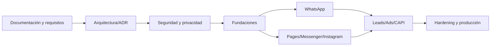

# 15 — Roadmap y control de avances

## Fase 0 — Definición documental (actual)
- [ ] Descomponer investigación en sistema documental.
- [ ] Revisar consistencia, enlaces y trazabilidad.
- [ ] Aprobar alcance, historias y prioridades.
- [ ] Cerrar ADR de arquitectura base.
- [ ] Validar APIs/permisos/eligibilidad con fuentes oficiales.
- [ ] Aprobar threat model, privacy y data lifecycle.
- [ ] Aprobar decisiones tecnológicas y SLO/RPO/RTO.
**Salida:** gates G0–G2 aprobados. No hay código fuente en esta fase.

## Fase 1 — Fundaciones de plataforma
Tenant, IAM, audit, secrets, asset registry, capability registry, webhook gateway, event bus, observability.
**Salida:** US-001..004, US-014..016 con QA/security pass.

## Fase 2 — WhatsApp completo
Onboarding, management, Cloud API, templates, media, Flows, Marketing Messages, policy, cost ledger.
**Salida:** US-005..008 end-to-end y elegibilidad real.

## Fase 3 — Facebook/Messenger e Instagram
Pages, Messenger, Instagram login modes, publishing, comments, DM, insights.
**Salida:** US-009..010 con permisos y pruebas.

## Fase 4 — Leads, Ads y CAPI
Lead Ads, retrieval, campaign lifecycle, spend guardrails, conversions, attribution.
**Salida:** US-011..013 con conciliación.

## Fase 5 — Extensión y hardening
Threads, capacidades elegibles adicionales, performance, chaos, pentest, DR, runbooks.
**Salida:** US-017 y G3–G8 aprobados.

## Dependencias de secuencia

## Control de avance
| Indicador | Estado inicial | Evidencia |
|---|---|---|
| Ramas solicitadas | completado | AUD-001/002 |
| Documentación modular | en curso | docs/ |
| Historias definidas | borrador | 10-USER-STORIES |
| Tareas y controles | borrador | 11-TASK-BACKLOG |
| Arquitectura aprobada | pendiente | ADR/gates |
| Threat model validado | pendiente | security review |
| API access/App Review | no verificado | Meta dashboard |
| Código fuente | bloqueado | decisión de fase 0 |

No usar porcentaje de avance sin denominador. Reportar tareas done / tareas totales por fase y adjuntar evidencia.
