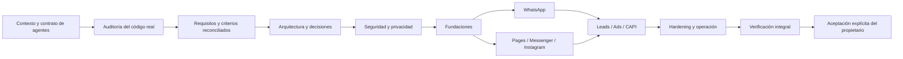

# 15 — Roadmap y control de avances

## Principio de avance
El roadmap mide implementación y verificación, no cantidad de documentación o commits. Cada estado debe tener IDs y evidencia en la matriz de trazabilidad. Una solicitud explícita del propietario para implementar/corregir habilita el trabajo correspondiente aunque existan otros gates pendientes; los gates de seguridad y producción siguen siendo obligatorios para liberar o ejecutar acciones de alto impacto.

## Fase 0 — Definición y sistema de agentes
- [x] Descomponer la investigación en documentos temáticos.
- [x] Crear contrato común para Codex, Claude, Copilot y agentes compatibles.
- [x] Crear grafo de dependencias y matriz de trazabilidad.
- [x] Definir handoff, estados y criterios de aceptación final.
- [ ] Auditar el repositorio real y reconciliar las 33 tareas con código/tests.
- [ ] Validar alcance, historias, arquitectura y decisiones pendientes con el propietario.
- [ ] Validar APIs/permisos/eligibilidad con fuentes oficiales y cuenta de prueba.
- [ ] Aprobar threat model, privacidad, decisiones tecnológicas y SLO/RPO/RTO.
**Salida:** contexto autónomo para agentes y baseline verificado. La documentación creada no implica producto implementado.

## Fase 1 — Fundaciones de plataforma
Tenant, IAM, audit, secrets, asset registry, capability registry, webhook gateway, event bus, observability.
**Salida:** US-001..004, US-014..016 implementadas y verificadas con QA/security.

## Fase 2 — WhatsApp completo
Onboarding, management, Cloud API, templates, media, Flows, Marketing Messages, policy, cost ledger.
**Salida:** US-005..008 end-to-end y elegibilidad real.

## Fase 3 — Facebook/Messenger e Instagram
Pages, Messenger, Instagram login modes, publishing, comments, DM, insights.
**Salida:** US-009..010 con permisos y pruebas.

## Fase 4 — Leads, Ads y CAPI
Lead Ads, retrieval, campaign lifecycle, spend guardrails, conversions, attribution.
**Salida:** US-011..013 con conciliación.

## Fase 5 — Extensión y hardening
Threads, capacidades elegibles adicionales, performance, chaos, pentest, DR, runbooks.
**Salida:** US-017 y gates de release aprobados.

## Grafo de fases

## Control de avance
| Indicador | Estado | Evidencia |
|---|---|---|
| Ramas | creadas | AUD-001/002; environment/local activa |
| Documentación temática | creada | docs/00..16 |
| Contrato universal y puentes de agentes | creado | AGENTS.md, CLAUDE.md, GEMINI.md, .github/copilot-instructions.md |
| Grafo y trazabilidad | creados | docs/18 y docs/19 |
| Criterios de producto terminado | definidos | docs/20 |
| Auditoría del código fuente | pendiente | siguiente paso técnico |
| TASK-001..033 | plan inicial; estado de código sin reconciliar | docs/11 |
| APIs/permisos/App Review | no verificado | Meta app/business |
| Producto implementado | no declarado | requiere auditoría y evidencia |
| Aceptación final | pendiente | exclusiva del propietario |

## Reglas de reporte
- Reportar tareas verificadas / total de tareas del alcance.
- Reportar criterios aprobados / total de criterios.
- Separar implementado, verificado, aceptado, bloqueado y no iniciado.
- Mostrar defectos abiertos por severidad y pruebas omitidas/flaky.
- No estimar porcentajes si el denominador o evidencia no existe.
- Cada sesión actualiza este documento, memoria corta, backlog y matriz de trazabilidad.
