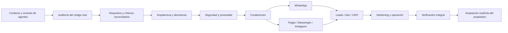

# 15 — Roadmap y control de avances

## Principio de avance
El roadmap mide implementación y verificación, no cantidad de documentación o commits. Cada estado debe tener IDs y evidencia en la matriz de trazabilidad. Una solicitud explícita del propietario para implementar/corregir habilita el trabajo correspondiente aunque existan otros gates pendientes; los gates de seguridad y producción siguen siendo obligatorios para liberar o ejecutar acciones de alto impacto.

## Fase 0 — Definición y sistema de agentes
- [x] Descomponer la investigación en documentos temáticos.
- [x] Crear contrato común para Codex, Claude, Copilot y agentes compatibles.
- [x] Crear grafo de dependencias y matriz de trazabilidad.
- [x] Definir handoff, estados y criterios de aceptación final.
- [x] Auditar inicialmente el repositorio real y establecer el inventario de código/tests existente (AUD-046..052); reconciliación integral TASK-001..080 sigue en curso.
- [ ] Validar alcance, historias, arquitectura y decisiones pendientes con el propietario.
- [ ] Validar APIs/permisos/eligibilidad con fuentes oficiales y cuenta de prueba.
- [ ] Aprobar threat model, privacidad, decisiones tecnológicas y SLO/RPO/RTO.
**Salida:** contexto autónomo para agentes y baseline verificado. La documentación creada no implica producto implementado.

## Fase 1 — Fundaciones de plataforma
Tenant, IAM, audit, secrets, asset registry, capability registry, webhook gateway, event bus, observability.
**Salida:** US-001..004, US-014..016 implementadas y verificadas con QA/security.

## Fase 2 — WhatsApp completo
Onboarding, management, Cloud API, templates, media, Flows, Marketing Messages, policy, cost ledger.
**Salida:** US-005..008 end-to-end y elegibilidad real.

## Fase 3 — Facebook/Messenger e Instagram
Pages, Messenger, Instagram login modes, publishing, comments, DM, insights.
**Salida:** US-009..010 con permisos y pruebas.

## Fase 4 — Leads, Ads y CAPI
Lead Ads, retrieval, campaign lifecycle, spend guardrails, conversions, attribution.
**Salida:** US-011..013 con conciliación.

## Fase 5 — Extensión y hardening
Threads, capacidades elegibles adicionales, performance, chaos, pentest, DR, runbooks.
**Salida:** US-017 y gates de release aprobados.

## Grafo de fases

## Control de avance
| Indicador | Estado | Evidencia |
|---|---|---|
| Ramas | creadas | AUD-001/002; environment/local activa |
| Documentación temática | creada | docs/00..16 |
| Contrato universal y puentes de agentes | creado | AGENTS.md, CLAUDE.md, GEMINI.md, .github/copilot-instructions.md |
| Grafo y trazabilidad | creados | docs/18 y docs/19 |
| Criterios de producto terminado | definidos | docs/20 |
| Auditoría del código fuente | parcial | AUD-046..052; falta revisión independiente y reconciliación integral |
| TASK-001..080 | TASK-001/002/004/005 con slices implementados y CI-verified; TASK-003 y resto pendientes | docs/11, docs/58 |
| APIs/permisos/App Review | no verificado | Meta app/business |
| Producto implementado | foundation slices parciales; producto completo no declarado | Source CI #16/#47/#67/#112; docs/58 |
| Aceptación final | pendiente | exclusiva del propietario |

## Reglas de reporte
- Reportar tareas verificadas / total de tareas del alcance.
- Reportar criterios aprobados / total de criterios.
- Separar implementado, verificado, aceptado, bloqueado y no iniciado.
- Mostrar defectos abiertos por severidad y pruebas omitidas/flaky.
- No estimar porcentajes si el denominador o evidencia no existe.
- Cada sesión actualiza este documento, memoria corta, backlog y matriz de trazabilidad.

## Roadmap actualizado tras respuestas del propietario

La propuesta completa y los gates están en [31-MASTER-DELIVERY-PLAN.md](31-MASTER-DELIVERY-PLAN.md). Sustituye como secuenciación detallada al resumen previo de fases, manteniendo los principios de seguridad y aceptación de docs/20.

- Fase 0: descubrimiento y arquitectura.
- Fase 1: plataforma y developer experience.
- Fase 2: Meta Control Plane.
- Fase 3: WhatsApp + Inbox base.
- Fase 4: CRM y automatización básica/IA asistiva.
- Fase 5: Facebook Pages y Messenger.
- Fase 6: Instagram y Threads.
- Fase 7: Leads, Marketing API y CAPI.
- Fase 8: hardening, operación y producción.

Tareas nuevas TASK-034..041 en docs/11. Todas propuestas; ninguna implementada ni verificada. El owner confirmó greenfield, por lo que la auditoría técnica de código heredado queda cerrada como "no aplica"; se requiere auditoría de estructura/build/seguridad al crear la primera implementación.

## Baseline aplicada por delegación del propietario (2026-11-06)
La matriz PD-001..PD-023 y los ADR-011..020 adoptados están consolidados en docs/29 y docs/30. El plan detallado actual y normativo es docs/31 (fases 0–8); las fases resumidas anteriores deben interpretarse subordinadas a ese plan.

### Cambios incorporados
- Modelo SaaS: Ecuador SMEs commerce/services como hipótesis de entrada, agencias como segmento secundario.
- Suscripción tenant + seats + usage; cargos Meta separados; pricing sin definir hasta unit economics.
- es-EC/USD/America-Guayaquil; multi-tenant tenant_id + backend auth + RLS; agency grants.
- Modular monolith/API-worker; no microservicios prematuros.
- Meta v27 por adapter, Embedded Signup v4 evaluado, BSUID, WAAC/PMA, Marketing Messages API para marketing con sunset Cloud API 2027-10-13.
- OWASP ASVS 5.0.0, WCAG 2.2 AA, configurable retention y LOPDP review pendiente.
- SLO candidate 99.9%, RPO 15m, RTO 4h, no SLA y pendiente de benchmark/restore drills.

### Avance verdadero
| Área | Estado | Evidencia / pendiente |
|---|---|---|
| Decisiones de producto | baseline adoptada | docs/29 PD-001..023 |
| Investigación externa | registrada con fecha y fuentes | docs/32; revalidar al implementar |
| Arquitectura | dirección técnica adoptada | docs/30 ADR-011..020; TASK-039 spike pendiente |
| Roadmap por gates | definido | docs/31 |
| Backlog | ampliado | TASK-053..065 propuestas |
| Código de producto | no iniciado | Greenfield; no hay apps/packages de producto |
| Tests/benchmarks | no ejecutados | TASK-039/060/061 |
| Meta App Review/cuentas | no verificado | depende de app/Business reales |
| LOPDP revisión especializada | pendiente | no tratar datos reales en producción antes del gate |
| Producción/aceptación | no iniciada | exclusiva del propietario |

No calcular porcentaje global hasta que exista denominador de requisitos reconciliados y evidencia por criterio.

## Campaign Intelligence milestone
Fase 7 incluye Campaign Intelligence (US-029), Creative Lab (US-030), Meta agent interoperability (US-031) y Meta API/policy intelligence (US-032). Dependencias y gates están en docs/31, docs/18 and docs/36. TASK-067..080 remain proposed. No direct Andromeda control is assumed.

## Final handoff after Meta Ads AI research
- Docs 34–36 document Meta advertising AI, reference repositories and Campaign Intelligence design.
- US-029..032 and TASK-067..080 are the new proposed scope.
- PD-024 and ADR-021/022 define the owner-approved 20% budget safeguard and separation between Meta delivery AI and WhatsBusiness learning engine.
- Current code implementation remains not started; documentation commits do not count toward software completion.

## Kickoff readiness reconciliation — 2026-11-06

La fase resumida antigua de este archivo queda subordinada al plan normativo docs/31 y al paquete docs/46. Las decisiones PD-001..PD-024 ya están consolidadas en docs/29; no volver a presentarlas como preguntas sin respuesta.

Estado actual:
- Preparación documental TASK-034..038: especificaciones creadas en docs/37..41; falta review independiente, no desarrollo funcional.
- Contratos y modelo lógico: primera base en docs/42..43 y contracts/; faltan lint, contract review y pruebas ejecutables.
- Threat model: versión inicial docs/44; falta revisión independiente y test mapping final.
- TASK-039/G0: pendiente de ejecutar SP-01..07 en entorno con Docker y recursos medibles.
- TASK-041/060/061: sin presupuesto VPS aprobado, benchmark ni restore drill.
- Meta, LOPDP, proveedor IA y producción: gates externos específicos; no bloquean la preparación sintética.

## Actualización — Identity foundation (2026-11-07)

- GO-CODE vigente exclusivamente en environment/local.
- Source y Contract CI pasaron en el scaffold anterior; este cambio amplía source CI con migración PostgreSQL y RLS integration.
- Identity foundation incorpora OIDC/JWKS, identidad issuer+subject, User/Tenant/Membership y PLT-003..005 read-only.
- TASK-001/002/004 siguen in_progress hasta workflows verdes de este slice y review independiente.
- Siguiente dependencia: provisioning/membership lifecycle, RBAC/ABAC, audit/outbox y worker tenant context antes de habilitar mutaciones.
- G0-PRODUCTION continúa NO-GO.

## Actualización — Tenant Context / TASK-002 (2026-11-07)

- TASK-001: implementada y CI-verified (migración 0002, ownership y lifecycle). Review independiente y acceptance pendientes.
- TASK-002: implementada y CI-verified (migración 0003, autorización tenant fail-closed, guard por propósito, contexto inmutable, authzVersion y pruebas de revocación/concurrencia). Review independiente y acceptance pendientes.
- Evidencia TASK-002: Source CI run #47 [42383524043](https://github.com/JhonnyMinian92/WhatsBusiness/actions/runs/42383524043), commit `74febd28056043cda15221f29c8c5b71290ca06c`.
- Siguiente dependencia de autorización: TASK-004 RBAC/ABAC. TASK-003 debe cubrir jobs, cache, files y telemetry con namespaces tenant-safe. TASK-005 depende de TASK-004.
- No calcular porcentaje global: la matriz completa de requisitos, criterios y evidencias aún no está reconciliada para todo el producto. G0-PRODUCTION permanece NO-GO.
## Actualización — RBAC/ABAC / TASK-004 (2026-11-07)

- TASK-004 incorpora migration 0004, catálogo tipado de permisos, role templates tenant least-privilege, policy evaluator RBAC/ABAC, guard declarativo HTTP y protección de asignación contra self-escalation.
- Source CI run #67 [42385036275](https://github.com/JhonnyMinian92/WhatsBusiness/actions/runs/42385036275) — SUCCESS, commit `53e50dc00daccc7c64c7931e468e6ef0af132940`.
- Estado técnico: núcleo implemented y CI-verified; no se declara tarea accepted/verified mientras estén pendientes review independiente, assignments persistentes y audit/approval workflows.
- IAM-007..020 siguen catalog-only. No se añadieron rutas ni escrituras HTTP.
- Próximo tramo: TASK-005 para step-up, aprobación independiente, append-only audit/outbox y protección de acciones privilegiadas; TASK-003 mantiene aislamiento operativo jobs/cache/files/telemetry pendiente.
## Actualización — TASK-005 Approval / Step-up / Audit (2026-11-07)

- Migration 0005 crea solicitudes/decisiones de aprobación y ledger append-only hash-chain por tenant, con RLS, grants limitados y transiciones restringidas por triggers.
- Backend: step-up OIDC con claims firmados y allowlist fail-closed; approval workflow idempotente/hash-bound/quorum; self-approval bloqueada; consumo transaccional; auditoría sensible/denegaciones.
- Source CI run #112 [42387272987](https://github.com/JhonnyMinian92/WhatsBusiness/actions/runs/42387272987) — SUCCESS, commit `b38b78ab52dbb96262dc8078518fdf4f55fc5a2c`, integración PostgreSQL efímera activa.
- Limitaciones: sin IdP real ni ACR/AMR allowlist activa, IAM-018..020 catalog-only, sin outbox/consumers de negocio y sin revisión/anclaje externo del hash-chain. No se permiten acciones externas.
- TASK-001/002/004/005 tienen slices implementados y CI-verified; no están accepted/verified globalmente. TASK-003 (aislamiento jobs/cache/files/telemetry), assignments persistentes, grants agency/JIT y workers permanecen en backlog.
## Estado real de plataforma — 2026-11-07

| Tarea | Estado técnico actual | Evidencia | Límites para cerrar |
|---|---|---|---|
| TASK-001 | Slice Tenant ownership/lifecycle implementado y CI-verified | Source CI #16; docs/58 §7 | Review independiente, aislamiento operativo y aceptación |
| TASK-002 | Tenant context fail-closed, propósito y authzVersion implementados y CI-verified | Source CI #47; docs/58 §8 | Cobertura de todos los recursos/workers y review independiente |
| TASK-003 | Slices de aislamiento multi-tenant, runtime durable, endpoint HTTP Prometheus y gauges PostgreSQL agregados implementados; estado global `in_progress` | Source CI #42433941375 para runtime y #42434224485 para endpoint; docs/60 y docs/63. CI de migración/reader/gauges pendiente | Métricas broker queue depth/consumer lag/DLQ, dashboards/alertas/SLO, DLQ operator workflow/replay, handler real e2e, topology broker desplegado, Secret Manager/rotación, carga/DR y review independiente/owner acceptance |
| TASK-004 | Core RBAC/ABAC, catálogo/roles declarativos y anti-escalation implementados y CI-verified | Source CI #67; docs/58 §9 | Persistir assignments/administración y review independiente |
| TASK-005 | Core step-up/approval/audit implementado y CI-verified con PostgreSQL efímero | Source CI #112; docs/58 §10 | IdP real, outbox/consumer, contratos IAM, auditoría/review independiente y owner acceptance |

**Interpretación:** tener un slice implementado y pasar CI no completa US-001/002. El producto sigue en construcción y GO-PRODUCTION permanece NO-GO. No se declara porcentaje global mientras no se reconcilien todos los AC de US/TASK con módulos, tests y evidencias independientes.