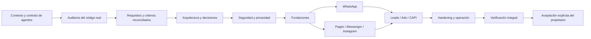

# 15 — Roadmap y control de avances

## Principio de avance
El roadmap mide implementación y verificación, no cantidad de documentación o commits. Cada estado debe tener IDs y evidencia en la matriz de trazabilidad. Una solicitud explícita del propietario para implementar/corregir habilita el trabajo correspondiente aunque existan otros gates pendientes; los gates de seguridad y producción siguen siendo obligatorios para liberar o ejecutar acciones de alto impacto.

## Fase 0 — Definición y sistema de agentes
- [x] Descomponer la investigación en documentos temáticos.
- [x] Crear contrato común para Codex, Claude, Copilot y agentes compatibles.
- [x] Crear grafo de dependencias y matriz de trazabilidad.
- [x] Definir handoff, estados y criterios de aceptación final.
- [ ] Auditar el repositorio real y reconciliar TASK-001..080 con código/tests.
- [ ] Validar alcance, historias, arquitectura y decisiones pendientes con el propietario.
- [ ] Validar APIs/permisos/eligibilidad con fuentes oficiales y cuenta de prueba.
- [ ] Aprobar threat model, privacidad, decisiones tecnológicas y SLO/RPO/RTO.
**Salida:** contexto autónomo para agentes y baseline verificado. La documentación creada no implica producto implementado.

## Fase 1 — Fundaciones de plataforma
Tenant, IAM, audit, secrets, asset registry, capability registry, webhook gateway, event bus, observability.
**Salida:** US-001..004, US-014..016 implementadas y verificadas con QA/security.

## Fase 2 — WhatsApp completo
Onboarding, management, Cloud API, templates, media, Flows, Marketing Messages, policy, cost ledger.
**Salida:** US-005..008 end-to-end y elegibilidad real.

## Fase 3 — Facebook/Messenger e Instagram
Pages, Messenger, Instagram login modes, publishing, comments, DM, insights.
**Salida:** US-009..010 con permisos y pruebas.

## Fase 4 — Leads, Ads y CAPI
Lead Ads, retrieval, campaign lifecycle, spend guardrails, conversions, attribution.
**Salida:** US-011..013 con conciliación.

## Fase 5 — Extensión y hardening
Threads, capacidades elegibles adicionales, performance, chaos, pentest, DR, runbooks.
**Salida:** US-017 y gates de release aprobados.

## Grafo de fases

## Control de avance
| Indicador | Estado | Evidencia |
|---|---|---|
| Ramas | creadas | AUD-001/002; environment/local activa |
| Documentación temática | creada | docs/00..16 |
| Contrato universal y puentes de agentes | creado | AGENTS.md, CLAUDE.md, GEMINI.md, .github/copilot-instructions.md |
| Grafo y trazabilidad | creados | docs/18 y docs/19 |
| Criterios de producto terminado | definidos | docs/20 |
| Auditoría del código fuente | pendiente | siguiente paso técnico |
| TASK-001..066 | plan consolidado; estado de código sin reconciliar | docs/11 |
| APIs/permisos/App Review | no verificado | Meta app/business |
| Producto implementado | no declarado | requiere auditoría y evidencia |
| Aceptación final | pendiente | exclusiva del propietario |

## Reglas de reporte
- Reportar tareas verificadas / total de tareas del alcance.
- Reportar criterios aprobados / total de criterios.
- Separar implementado, verificado, aceptado, bloqueado y no iniciado.
- Mostrar defectos abiertos por severidad y pruebas omitidas/flaky.
- No estimar porcentajes si el denominador o evidencia no existe.
- Cada sesión actualiza este documento, memoria corta, backlog y matriz de trazabilidad.

## Roadmap actualizado tras respuestas del propietario

La propuesta completa y los gates están en [31-MASTER-DELIVERY-PLAN.md](31-MASTER-DELIVERY-PLAN.md). Sustituye como secuenciación detallada al resumen previo de fases, manteniendo los principios de seguridad y aceptación de docs/20.

- Fase 0: descubrimiento y arquitectura.
- Fase 1: plataforma y developer experience.
- Fase 2: Meta Control Plane.
- Fase 3: WhatsApp + Inbox base.
- Fase 4: CRM y automatización básica/IA asistiva.
- Fase 5: Facebook Pages y Messenger.
- Fase 6: Instagram y Threads.
- Fase 7: Leads, Marketing API y CAPI.
- Fase 8: hardening, operación y producción.

Tareas nuevas TASK-034..041 en docs/11. Todas propuestas; ninguna implementada ni verificada. El owner confirmó greenfield, por lo que la auditoría técnica de código heredado queda cerrada como "no aplica"; se requiere auditoría de estructura/build/seguridad al crear la primera implementación.

## Baseline aplicada por delegación del propietario (2026-11-06)
La matriz PD-001..PD-023 y los ADR-011..020 adoptados están consolidados en docs/29 y docs/30. El plan detallado actual y normativo es docs/31 (fases 0–8); las fases resumidas anteriores deben interpretarse subordinadas a ese plan.

### Cambios incorporados
- Modelo SaaS: Ecuador SMEs commerce/services como hipótesis de entrada, agencias como segmento secundario.
- Suscripción tenant + seats + usage; cargos Meta separados; pricing sin definir hasta unit economics.
- es-EC/USD/America-Guayaquil; multi-tenant tenant_id + backend auth + RLS; agency grants.
- Modular monolith/API-worker; no microservicios prematuros.
- Meta v27 por adapter, Embedded Signup v4 evaluado, BSUID, WAAC/PMA, Marketing Messages API para marketing con sunset Cloud API 2027-10-13.
- OWASP ASVS 5.0.0, WCAG 2.2 AA, configurable retention y LOPDP review pendiente.
- SLO candidate 99.9%, RPO 15m, RTO 4h, no SLA y pendiente de benchmark/restore drills.

### Avance verdadero
| Área | Estado | Evidencia / pendiente |
|---|---|---|
| Decisiones de producto | baseline adoptada | docs/29 PD-001..023 |
| Investigación externa | registrada con fecha y fuentes | docs/32; revalidar al implementar |
| Arquitectura | dirección técnica adoptada | docs/30 ADR-011..020; TASK-039 spike pendiente |
| Roadmap por gates | definido | docs/31 |
| Backlog | ampliado | TASK-053..065 propuestas |
| Código de producto | no iniciado | Greenfield; no hay apps/packages de producto |
| Tests/benchmarks | no ejecutados | TASK-039/060/061 |
| Meta App Review/cuentas | no verificado | depende de app/Business reales |
| LOPDP revisión especializada | pendiente | no tratar datos reales en producción antes del gate |
| Producción/aceptación | no iniciada | exclusiva del propietario |

No calcular porcentaje global hasta que exista denominador de requisitos reconciliados y evidencia por criterio.

## Campaign Intelligence milestone
Fase 7 incluye Campaign Intelligence (US-029), Creative Lab (US-030), Meta agent interoperability (US-031) y Meta API/policy intelligence (US-032). Dependencias y gates están en docs/31, docs/18 and docs/36. TASK-067..080 remain proposed. No direct Andromeda control is assumed.
