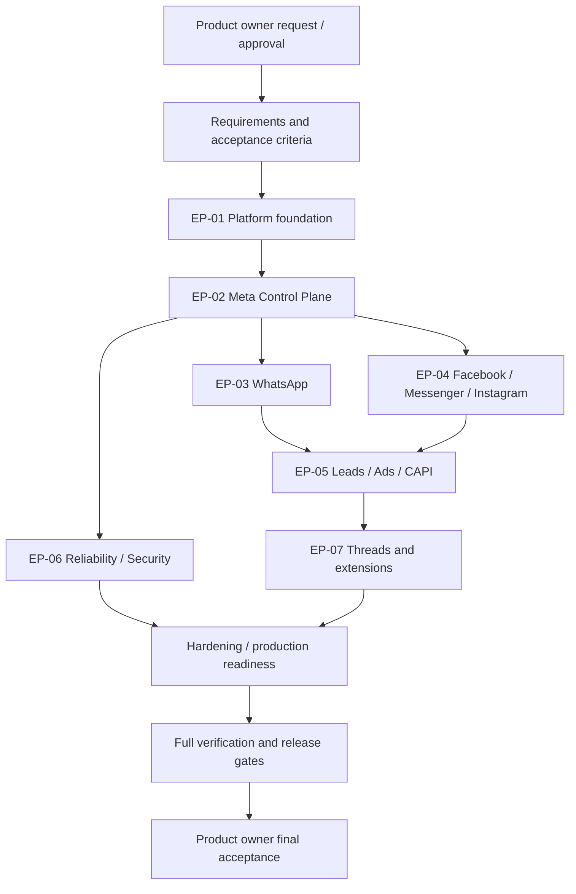
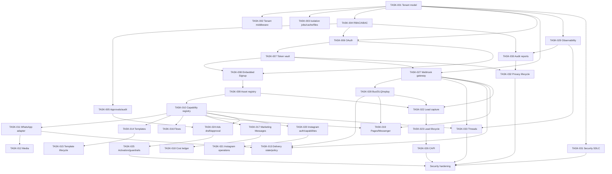

# 18 — Execution graph and dependency navigation

## 1. How agents use this graph
Start from the requested outcome, find its story/task node, walk **upstream** for prerequisites and **downstream** for regression impact. Do not execute a task while a blocking prerequisite is unresolved unless the user explicitly accepts the risk and the work is safe. After changing dependencies, update this graph and the backlog in the same change.

Graph nodes use stable IDs: EP (epic), US (user story), TASK (implementation task), ADR (decision), CR (change), BUG (defect), API (provider capability), MOD (code module discovered in repository), TEST (automated/manual test), REL (release gate). Do not invent MOD/TEST IDs before inspecting source.

## 2. Product dependency graph

## 3. Task dependency DAG (current baseline)

## 4. Execution waves (parallelism guidance)
- **Wave A — shared foundations:** TASK-001, TASK-004, TASK-027, TASK-029, TASK-031 can be analyzed in parallel; implementation must respect actual dependencies and shared schema ownership.
- **Wave B — control plane:** TASK-002/003/005/006/007/008/009/010 after their prerequisites.
- **Wave C — channel adapters:** WhatsApp, Facebook/Messenger, Instagram may proceed in parallel only after contracts, capabilities, webhook and policy foundations are stable.
- **Wave D — acquisition and measurement:** Leads, Ads and CAPI after asset registry, permissions, eventing and consent.
- **Wave E — hardening:** load, resilience, penetration, disaster recovery, runbooks and operational evidence.
These are planning waves, not permission to ignore DAG edges.

## 5. Task selection algorithm
1. Filter tasks explicitly requested by the owner or required to satisfy that request.
2. Exclude tasks already verified with current evidence.
3. Select tasks whose dependencies are verified/accepted; prioritize critical-path and security blockers.
4. If a prerequisite is missing, either implement it first or mark the dependent task blocked with a clear reason.
5. For parallel work, partition by bounded context/files and define integration contracts before concurrent edits.
6. Recompute downstream impact after each change.

## 6. Graph integrity
- Every TASK has exactly one primary parent story (or documented cross-cutting ownership), a dependency list, and acceptance criteria.
- No dependency cycles. Dependencies must reference existing IDs.
- A task cannot be verified if a required upstream node is blocked.
- A task's downstream tests and release gates must be listed in the traceability matrix.
- Graph is a navigational model; inspect real code to map logical nodes to concrete paths.
- If task decomposition changes materially, update Mermaid graph and task table together.
