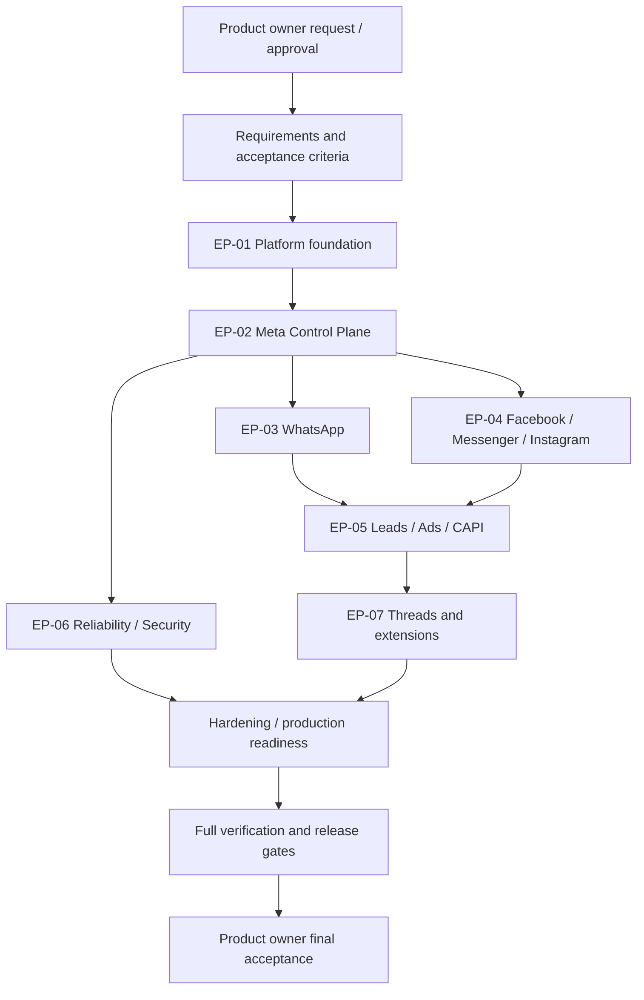
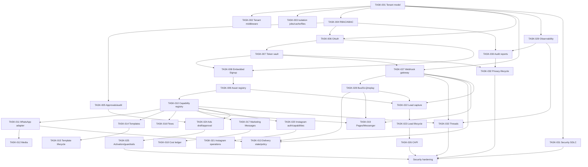
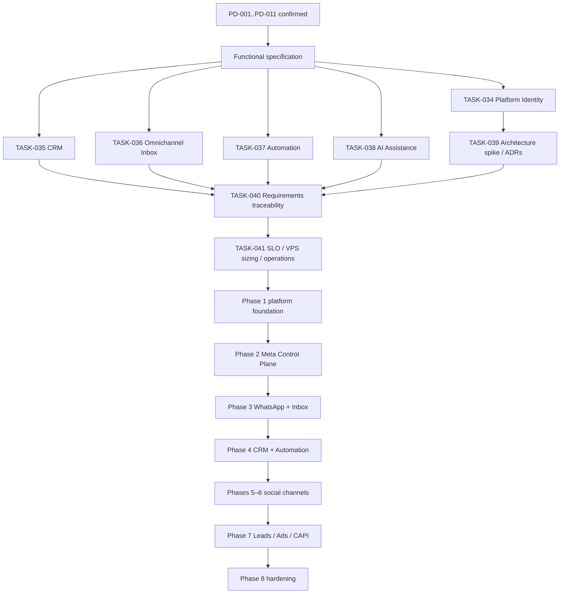

# 18 — Execution graph and dependency navigation

## 1. How agents use this graph
Start from the requested outcome, find its story/task node, walk **upstream** for prerequisites and **downstream** for regression impact. Do not execute a task while a blocking prerequisite is unresolved unless the user explicitly accepts the risk and the work is safe. After changing dependencies, update this graph and the backlog in the same change.

Graph nodes use stable IDs: EP (epic), US (user story), TASK (implementation task), ADR (decision), CR (change), BUG (defect), API (provider capability), MOD (code module discovered in repository), TEST (automated/manual test), REL (release gate). Do not invent MOD/TEST IDs before inspecting source.

## 2. Product dependency graph

## 3. Task dependency DAG (current baseline)

## 4. Execution waves (parallelism guidance)
- **Wave A — shared foundations:** TASK-001, TASK-004, TASK-027, TASK-029, TASK-031 can be analyzed in parallel; implementation must respect actual dependencies and shared schema ownership.
- **Wave B — control plane:** TASK-002/003/005/006/007/008/009/010 after their prerequisites.
- **Wave C — channel adapters:** WhatsApp, Facebook/Messenger, Instagram may proceed in parallel only after contracts, capabilities, webhook and policy foundations are stable.
- **Wave D — acquisition and measurement:** Leads, Ads and CAPI after asset registry, permissions, eventing and consent.
- **Wave E — hardening:** load, resilience, penetration, disaster recovery, runbooks and operational evidence.
These are planning waves, not permission to ignore DAG edges.

## 5. Task selection algorithm
1. Filter tasks explicitly requested by the owner or required to satisfy that request.
2. Exclude tasks already verified with current evidence.
3. Select tasks whose dependencies are verified/accepted; prioritize critical-path and security blockers.
4. If a prerequisite is missing, either implement it first or mark the dependent task blocked with a clear reason.
5. For parallel work, partition by bounded context/files and define integration contracts before concurrent edits.
6. Recompute downstream impact after each change.

## 6. Graph integrity
- Every TASK has exactly one primary parent story (or documented cross-cutting ownership), a dependency list, and acceptance criteria.
- No dependency cycles. Dependencies must reference existing IDs.
- A task cannot be verified if a required upstream node is blocked.
- A task's downstream tests and release gates must be listed in the traceability matrix.
- Graph is a navigational model; inspect real code to map logical nodes to concrete paths.
- If task decomposition changes materially, update Mermaid graph and task table together.

## 7. Fases greenfield y nuevos work packages

TASK-034..041 se incorporan al DAG. Las tareas de especificación pueden avanzar en paralelo con ownership separado; TASK-039 depende de requisitos técnicos mínimos y no autoriza compromisos de gasto.

## 7. Dependencias añadidas tras investigación y decisiones PD-012..PD-023

TASK-039 architecture spike → TASK-053 identity/WAAC/PMA, TASK-054 Embedded Signup v4, TASK-056 Meta API version/access-tier registry.
TASK-056 → TASK-055 Marketing Messages API migration/readiness → TASK-057 Max Pricing and cost ledger.
TASK-034 platform/tenant spec + TASK-004 authorization → TASK-058 agency partner grants.
TASK-031 security + TASK-032 data rights → TASK-059 privacy lifecycle and LOPDP controls.
TASK-039 + TASK-041 SLO/RPO/RTO → TASK-060 load/capacity benchmark → TASK-061 DR and restore drills.
TASK-027 webhook ingress + TASK-028 event platform → TASK-062 public API and signed webhooks.
TASK-052 tenant/entitlement lifecycle + TASK-060 capacity → TASK-063 billing and usage.
TASK-046 Inbox UI → TASK-064 WCAG 2.2 AA audit.
TASK-056 → TASK-065 Meta change/deprecation operations.

Todos TASK-053..065 permanecen proposed. El grafo es dependencia lógica, no calendario ni ejecución realizada.

TASK-066 market/ICP validation → pricing/packaging decision and commercial launch planning. TASK-066 may run in parallel with engineering spike and foundational product specifications; it is a gate before final pricing and commercial forecast, not a blocker for independent architecture/security work.

## 8. Campaign Intelligence execution dependencies (2026-11-06)
- TASK-024/025/056 (Ads adapters, execution policy and capability registry) + TASK-039 architecture spike → TASK-072 Insights ingestion/snapshots.
- TASK-023/026/042/044/059 (Lead lifecycle, CAPI, CRM and privacy rights) → TASK-068 closed-loop business outcome signals.
- TASK-072 + TASK-068 + TASK-070 experiments → TASK-067 Campaign Intelligence diagnostics/recommendations → TASK-071 guarded budget optimizer.
- TASK-069 Creative Lab metadata/rights/brand → TASK-073 Meta Advantage+ creative/preview APIs → TASK-079 fatigue-to-new-variant pipeline → TASK-070 controlled experiment.
- TASK-004 permissions/approval + TASK-024 Ads API + TASK-067 recommendations → TASK-074 Meta Ads MCP draft/approval connector.
- TASK-036/045/047 Inbox + TASK-050/051 AI + TASK-058 partner grants → TASK-075 Meta Business Agent conversation ownership/handoff.
- TASK-056/065 API and policy registry → TASK-076 policy/feature drift monitor → affected adapter tests/migration tasks.
- TASK-026/068/070 → TASK-077 incrementality and attribution framework → TASK-078 dashboard/health reporting.

TASK-067..080 remain proposed. No autonomous spend, publication, or live WhatsApp actions are authorized by this documentation change.

TASK-004 permissions/approval + TASK-029 observability/audit + TASK-067 Campaign Intelligence + TASK-074 Meta Ads MCP + TASK-075 Business Agent handoff → TASK-080 Agent Tool Gateway/MCP server. TASK-080 is a shared control boundary and must be complete before any AI agent performs external write operations.

## 7. Estado observado — US-013 / TASK-026 (2026-11-08)

TASK-026 cuenta con un slice de dominio en `apps/api/src/marketing/conversions` y suites integradas en `api:test`; permanece `in_progress`, porque las dependencias TASK-023/031 no están verificadas, el consentimiento TASK-032 carece de adapter y CAPI-001..004 siguen catalog-only. El DAG no cambia: el gateway persistente/outbox/adapter se implementará después de satisfacer esos gates. No existe external write ni integración de producción.
