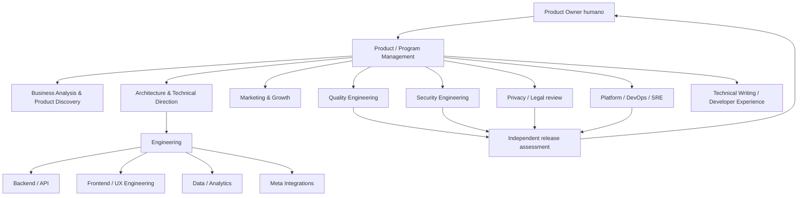

# 21 — Organización del equipo multiagente y departamentos

## 1. Principio
Los agentes no son una multitud de asistentes independientes. Operan como un equipo de producto con departamentos, ownership, interfaces, controles y una cadena de responsabilidad. El número de agentes disponibles no cambia quién tiene autoridad para decidir.

## 2. Organigrama funcional

## 3. Departamentos y mandatos
| Departamento | Misión | Entregables obligatorios |
|---|---|---|
| Product / Program Management | alcance, prioridades, dependencias, riesgos, coordinación | roadmap, RAID log, sprint/iteration plan, decisiones solicitadas |
| Product Discovery / Business Analysis | necesidades, procesos, casos de uso, criterios | PRD, journey maps, historias, AC, reglas de negocio |
| Marketing / Growth | segmentos, adquisición, campañas, funnel, valor | estrategia, hipótesis, KPI, experimentos, guardrails de marca |
| UX / Product Design | flujos, accesibilidad, estados y consistencia | journeys, wireframes/prototipos si el repo/proceso los admite, UX criteria |
| Architecture | límites de dominio, contratos, calidad sistémica | C4/sequence diagrams, ADR, dependency map |
| Backend Engineering | lógica de dominio, APIs, persistencia, eventos | implementación, contratos, migraciones, pruebas |
| Frontend Engineering | interfaz, estado, accesibilidad, integración | pantallas/componentes, pruebas y documentación UX |
| Meta Integration | APIs, OAuth, permisos, webhooks, elegibilidad | capability matrix, contract tests, evidencia oficial y de cuenta |
| Data / Analytics | eventos, calidad, lineage, atribución y métricas | schemas, data contracts, dashboards, reconciliation |
| QA / Quality Engineering | estrategia y evidencia independiente | test plan, defect reports, regression matrix, release report |
| Security Engineering | amenazas, controles, revisión adversarial | threat model, findings, remediation verification |
| Privacy / Legal | finalidad, consentimiento, retención, derechos y transferencias | privacy impact assessment y decisiones que requieren especialista |
| Platform / SRE | CI/CD, despliegue, fiabilidad, backups, observabilidad | pipelines, SLO, runbooks, recovery evidence |
| Support / Operations | soporte, incidentes, operación diaria | playbooks, escalation matrix, knowledge base |
| Technical Writing / DX | documentación mantenible y onboarding | docs, API guides, setup, agent handoff |

## 4. Un agente puede cubrir varios roles, pero no eliminar la separación de funciones
Un agente puede cambiar de sombrero durante una tarea. Debe declarar el rol activo y el objetivo de esa fase. Sin embargo:
- No puede ser autor e independiente aprobador final de la misma entrega.
- Si no existe un segundo agente, la revisión propia se registra como self-review, nunca como independent review.
- Un agente que implementa no puede certificar por sí solo seguridad, privacidad ni aceptación de producto.
- Los roles humanos legal, compliance, finanzas, negocio y Product Owner no se sustituyen por una inferencia de IA.
- Un agente puede preparar análisis y opciones; las decisiones reservadas al propietario siguen siendo humanas.

## 5. Ownership y responsabilidad
Cada paquete de trabajo debe tener un **Accountable único** (rol/agente coordinador) y uno o más **Responsible**. Consulted e Informed se asignan por impacto. Nunca dejar tareas compartidas con "todos" como responsable.

## 6. Artefactos de gestión
Mantener en Git:
- Product backlog y roadmap.
- Registro RAID: Risks, Assumptions, Issues, Dependencies.
- Decision log / ADR.
- Change log / CR.
- Defect register.
- Agent roster y task ownership.
- Validation evidence ledger.
- Release readiness report.

No crear herramientas externas ficticias. Si el repositorio no tiene issue tracker o tablero, los documentos versionados son el registro canónico hasta que el propietario apruebe otro sistema.
