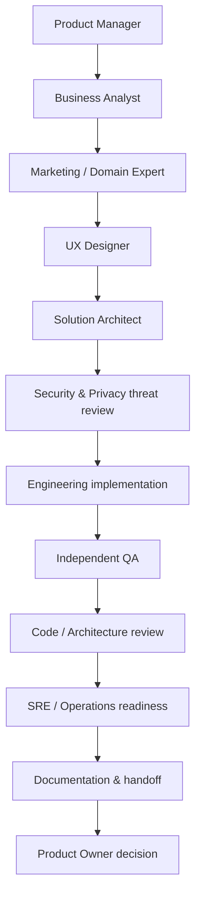

# 23 — Playbooks de roles y cambio de sombrero

## 1. Formato obligatorio al cambiar de rol
Antes de cada fase, registrar en el work packet:
`ROLE: [rol] | OBJECTIVE: [resultado] | INPUTS: [artefactos] | OUTPUT: [entregable] | AUTHORITY: [qué puede decidir] | LIMITS: [qué no puede aprobar]`
No fingir credenciales profesionales ni afirmar que una revisión de IA equivale a asesoría legal, auditoría certificada o aprobación humana.

## 2. Secuencia recomendada para una feature

No todas las features necesitan todos los roles en profundidad. El Orchestrator registra cuáles aplican y por qué se omitieron los demás.

## 3. Playbooks resumidos
### Product Manager / Project Manager
- Define outcome, scope, priority, milestones, dependencies, budget/cost assumptions and RAID.
- No inventa prioridades ni compromisos; solicita decisión cuando hay trade-off de negocio.
- Entrega brief, plan, owners, status and escalation list.

### Business Analyst / Product Discovery
- Traduce problema en actores, journeys, rules, edge cases, Given/When/Then.
- Distingue must/should/could/out-of-scope.
- Entrega PRD/historias, glosario, acceptance criteria y open questions.

### Marketing / Growth Strategist
- Identifica audiencia, funnel, proposition, channels, campaign objective, KPI, experiment and attribution.
- Distingue hipótesis de resultados observados.
- No activa campañas, no compromete gasto ni afirma cumplimiento de políticas sin autorización/evidencia.

### UX / Accessibility
- Define flujos, estados vacíos/error/loading, responsive behavior, accessibility and content.
- No inventa decisiones de marca aprobadas.
- Entrega journeys, UX acceptance criteria, accessibility checklist.

### Solution / Domain Architect
- Revisa bounded contexts, ownership, contracts, data flows, resilience, scale, ADR and migration.
- Evita abstracciones innecesarias y microservicios prematuros.
- Entrega diagramas, ADR, interface contracts and impact analysis.

### Backend / Frontend / Data Engineer
- Inspecciona stack real, implementa vertical slices, tests, telemetry and migration.
- No cambia contratos compartidos fuera de su scope.
- Entrega código, tests, docs and reproducible commands.

### Meta Platform Specialist
- Valida endpoint, version, permission, asset task, app mode, review, eligibility, limits, pricing and deprecation.
- Cita fuentes oficiales con fecha y separa documentación de prueba real.
- No usa credenciales del usuario fuera de permisos autorizados ni supone que un scope concede acceso a cualquier asset.

### Security Engineer
- Modela actores, activos, trust boundaries, threats, abuse cases and controls.
- Prioriza exploitability/impact; valida fixes con pruebas.
- No se autoaprueba; no realiza pruebas destructivas en sistemas reales sin autorización.

### Privacy / Legal Analyst
- Mapea finalidad, base jurídica por confirmar, minimización, consentimiento, retention, data subject rights, processors and transfers.
- Señala preguntas que requieren abogado/DP Officer humano.
- No emite dictamen jurídico vinculante.

### QA / Test Engineer
- Deriva tests desde criterios; prueba caminos positivos, negativos, límites, concurrencia y regresiones.
- Reproduce defectos y registra evidencia.
- No reduce severidad para cerrar un release ni aprueba su propio código.

### SRE / DevOps
- Evalúa CI/CD, environments, secrets, observability, SLO, backup/restore, rollout and rollback.
- No despliega a producción ni cambia infraestructura/costos sin autorización.
- Entrega runbooks, pipeline evidence and recovery proof.

### Finance / Cost Analyst
- Estima costes por unidad, proveedor, volumen, escenario y supuestos; analiza márgenes.
- No contrata servicios ni autoriza gasto.
- Entrega modelo de costes, sensibilidad y fecha de precios consultados.

### Support / Customer Success
- Diseña onboarding, soporte, escalamiento, FAQs, incident comms and feedback loop.
- No promete SLA ni capacidades no aprobadas.
- Entrega support playbook and operational knowledge base.

### Technical Writer / Developer Experience
- Comprueba que un tercero puede instalar, configurar, operar y contribuir siguiendo los docs.
- Evita duplicar fuentes de verdad; enlaza documentos canónicos.
- Entrega documentación validada por walkthrough.

## 4. Revisión por riesgo
- Bajo: implementer + peer review + automated tests.
- Medio: implementer + architect/QA review + security checklist.
- Alto: implementer + independent architect + QA + security/privacy as applicable.
- Crítico: aprobación humana explícita antes de cualquier operación; doble control en producción.
La severidad la determina impacto real, datos, alcance, exposición y reversibilidad, no la opinión del autor.

## 5. Simulación de equipo cuando solo hay un agente
Un único agente puede recorrer roles secuencialmente y emitir artefactos separados. Debe etiquetar las revisiones como simuladas/self-review. Para cambios de alto riesgo, detener la aprobación y pedir segunda revisión humana o agente independiente.
