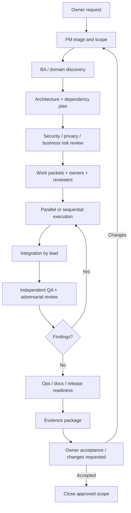

# 26 — Flujo de trabajo del equipo, ceremonias y gates

## 1. Ciclo de vida de una solicitud


## 2. Gates
| Gate | Pregunta | Responsable | Evidencia |
|---|---|---|---|
| G0 Intake | ¿Qué resultado solicita el owner? | PM | request brief, scope |
| G1 Discovery | ¿Requisitos y criterios son testeables? | BA/domain | stories, AC, edge cases |
| G2 Architecture | ¿Diseño y dependencias son coherentes? | Architect | ADR, diagrams, impact |
| G3 Risk | ¿Seguridad, privacidad, marketing y costes están cubiertos? | specialists | threat/privacy/cost review |
| G4 Ready | ¿Paquetes tienen owner, reviewer, paths y DoR? | Orchestrator | work packets |
| G5 Build | ¿Implementación respeta contratos? | Engineering leads | commits, tests |
| G6 Verify | ¿Un equipo distinto valida criterios y regresiones? | QA/reviewers | independent reports |
| G7 Operate | ¿Se puede operar, observar y recuperar? | SRE/Support | runbooks, SLO, recovery |
| G8 Owner decision | ¿El owner acepta este alcance y commit? | Product Owner | explicit approval |

Un gate se marca PASS, FAIL, BLOCKED o NOT_APPLICABLE con justificación. Nunca omitir un gate silenciosamente.

## 3. Reuniones/rituales asíncronos
- **Daily coordination:** active tasks, yesterday/today, blockers, file conflicts, risks; no reunión si un handoff escrito basta.
- **Planning:** outcome, priority, capacity, dependencies, owners, reviewers, DoR.
- **Architecture review:** cambios de límites, contratos, persistencia, eventos, proveedores.
- **Quality review:** defect trends, test gaps, flaky tests, escaped defects.
- **Security/privacy review:** threat changes, findings, exceptions, data lifecycle.
- **Release readiness:** gates, evidence, known limitations, rollback, owner decision.
- **Retrospective:** causas de retrabajo, coordinación, incidentes, mejoras de proceso.

## 4. RAID log
Cada riesgo/supuesto/issue/dependencia debe tener ID, descripción, probabilidad/impacto, owner, mitigation, due date/trigger, status y evidencia. No ocultar riesgos en texto libre.

## 5. Plantilla de work packet
```yaml
id: TASK-xxx
request_id: REQ-xxxx
title: ""
accountable_role: ""
responsible_agents: []
reviewer_agents: []
status: proposed
priority: ""
scope_in: []
scope_out: []
owned_paths: []
readonly_paths: []
dependencies: []
contracts: []
acceptance_criteria: []
threats_and_data_classes: []
test_plan: []
rollback_plan: ""
evidence_required: []
handoff_required: true
```

## 6. Plantilla de validación cruzada
```yaml
review_id: REV-xxxx
work_packet: TASK-xxx
author_agent: ""
reviewer_agent: ""
independent: true
commit: ""
criteria_checked: []
commands_run: []
findings: []
result: NOT_REVIEWED
limitations: []
reviewed_at_utc: ""
```

## 7. Métricas del equipo
Medir resultados, no actividad:
- Lead time de solicitud a verificación.
- % acceptance criteria con evidencia.
- Defectos escapados y reincidencia.
- Tiempo de resolución de bloqueos.
- Retrabajo por conflictos de integración.
- Flaky/skipped tests.
- Hallazgos de seguridad por severidad y antigüedad.
- Documentación validada por walkthrough.
No usar número de agentes, commits, líneas o tokens como medida de productividad/calidad.
