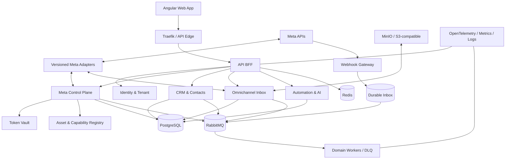

# 30 — Arquitectura recomendada y propuesta de stack

**Estado:** propuesta técnica; pendiente de revisar presupuesto, escala y operación.  
**Base:** decisiones PD-001..PD-011.

## 1. Recomendación ejecutiva

Adoptar TypeScript de extremo a extremo:
- Backend: NestJS sobre Node.js, organizado por bounded contexts, puertos/adaptadores y contratos explícitos.
- Frontend web: Angular con arquitectura por dominios/features y design system.
- Datos transaccionales: PostgreSQL.
- Cache/rate-limit/coordinación efímera: Redis.
- Mensajería asíncrona: RabbitMQ con outbox/inbox y dead-letter queues.
- Archivos/media: almacenamiento S3-compatible; MinIO en VPS si el footprint operativo resulta viable.
- Identidad: OIDC; Keycloak como candidato self-hosted sujeto a evaluación.
- API edge: Traefik como reverse proxy/API ingress inicial.
- Contenedores: Docker; Docker Compose para primer despliegue VPS. Kubernetes no es requisito inicial.
- Observabilidad: OpenTelemetry, Prometheus, Grafana y logs/traces centralizados (Loki/Tempo o equivalentes).
- Contratos: OpenAPI para HTTP y AsyncAPI/JSON Schema para eventos.
- Calidad: unit, integration, contract, E2E, SAST, SCA, secret scanning, DAST y pruebas de carga.

Es una recomendación, no una afirmación de que estas tecnologías estén instaladas. Validar con un architecture spike antes de congelar versiones.

## 2. Justificación

| Criterio | Justificación |
|---|---|
| Lenguaje común | Reduce duplicación de modelos/validaciones y facilita transferencia |
| NestJS | Módulos, DI, guards, pipes, interceptors, OpenAPI y workers |
| Angular | Panel empresarial con dominios, formularios, permisos, rutas y componentes estructurados |
| PostgreSQL | Transacciones, integridad, JSONB, índices y row-level security |
| RabbitMQ | Colas durables, routing, retries/DLQ y cargas asíncronas |
| Redis | Aceleración y coordinación efímera; nunca fuente de verdad |
| Docker Compose | Operación portable y sencilla para VPS |
| OpenTelemetry | Correlación entre API, workers, Meta y webhooks |

## 3. Topología lógica

## 4. Bounded contexts y propiedad

| Contexto | Responsabilidad | Datos/contratos |
|---|---|---|
| Platform Identity | usuarios, tenants, membresías, roles, sesiones | tenant, user, membership, policy |
| Meta Control Plane | OAuth, app, conexiones, grants, token lifecycle | connection, grant, credential reference |
| Asset & Capability | activos Meta y capacidades efectivas | asset, capability snapshot |
| Channel Integrations | adaptadores por producto/versión Meta | provider request/response/error |
| Messaging & Inbox | conversaciones, mensajes, estados, asignación, handoff | conversation, message, receipt |
| CRM | contactos, identidades, etiquetas, notas, pipeline, actividades | contact, identity, lead, opportunity |
| Automation | reglas, triggers, workflows y ejecuciones | workflow, version, execution |
| AI Assistance | proveedores, prompts, sugerencias, evaluación y coste | model config, prompt version, invocation |
| Campaigns & Measurement | Ads, CAPI, insights y conciliación | campaign, spend guardrail, conversion |
| Policy & Consent | consentimiento, supresión, ventanas y políticas | consent, suppression, policy decision |
| Billing & Usage | planes, límites, consumo y ledger | subscription, usage, rate card |
| Webhook & Event Platform | verificación, inbox/outbox, replay, DLQ | webhook event, event envelope |
| Audit & Compliance | auditoría, derechos de datos y evidencias | audit event, deletion/export case |
| Operations | health, quotas, retries, reconciliation | operational job, incident, quota |

No crear un microservicio por endpoint. Cada contexto evoluciona sin acceso directo a tablas privadas de otro contexto.

## 5. Estrategia de despliegue

- Diseñar límites de microservicios desde el dominio, pero iniciar con un conjunto reducido de deployables cohesivos si el VPS/equipo no justifica muchos procesos.
- Extraer procesos separados según carga, aislamiento, ownership, seguridad o ciclo de despliegue; no por estética.
- Un PostgreSQL cluster inicial puede alojar bases/schemas separados por servicio con usuarios y permisos distintos. No compartir tablas ni hacer joins cross-service.
- Cada servicio posee migraciones, configuración, health checks, métricas, logs y runbook.
- Compose no equivale a alta disponibilidad. Documentar límites single-node y preparar backup/restore.
- Configuración por entorno; secretos fuera de Git e imágenes.

## 6. Multi-tenancy y seguridad

- Tenant context obligatorio en request, job, evento, cache key, object key y operación de datos.
- PostgreSQL RLS como defensa adicional cuando sea compatible con pooling; nunca sustituye autorización de aplicación.
- Identidad OIDC; membresía/roles y políticas viven en el dominio de plataforma.
- Credenciales Meta cifradas con envelope encryption y claves fuera de DB; rotación/revocación.
- RBAC + ABAC: actor, tenant, asset, action, purpose, consent, Meta scope/grant y capability.
- Audit append-only, redacción de PII/secrets, threat modeling y revisión de permisos.
- Gasto, campañas, mensajes masivos, borrado irreversible y producción requieren aprobación/guardrails.
- Retención final requiere decisión del propietario y validación legal.

## 7. API, eventos y contratos

- API pública versionada /api/v1; contratos OpenAPI generados/revisados en CI.
- Eventos versionados con envelope: event_id, tenant_id, aggregate_id, type, schema_version, occurred_at, correlation_id, causation_id, payload_ref.
- Outbox transaccional para publicar cambios; Inbox idempotente para consumidores.
- Reintentos con backoff+jitter, DLQ, replay autorizado y reconciliación.
- Compatibilidad backward/forward probada antes de desplegar productores y consumidores.
- Payloads nativos Meta conservados cifrados/limitados por retención y vinculados a modelos canónicos.

## 8. Frontend web

- core/: bootstrap, auth, tenant context, interceptors, guards, telemetry.
- shared/: design system, componentes reutilizables y utilidades sin lógica de dominio.
- platform/: administración global, tenants, planes, seguridad y operaciones.
- features/: identity, meta-connections, assets, inbox, crm, automation, campaigns, analytics, billing y settings.
- Cada feature separa pages, components, data-access, domain, models y routes según complejidad real.
- Prohibido importar internals de otra feature; usar APIs públicas/facades.
- Panel responsive; no implica app móvil nativa.

## 9. IA inicial, extensible y segura

- Primera entrega: builder de reglas/chatbot acotado y sugerencias de respuesta.
- AI Gateway con adaptadores; ningún proveedor embebido en el dominio.
- Registrar modelo/proveedor, versión de prompt, tenant, propósito, tokens/coste, latencia, resultado y evaluación, sin secretos ni contenido sensible innecesario.
- Separar generación de sugerencia de ejecución de acción.
- Por defecto la IA propone; un humano envía mensajes o aprueba acciones sensibles.
- Límites por tenant, rate limit, budget cap, fallback, timeout, circuit breaker y kill switch.
- RAG, agentes autónomos, voz y entrenamiento propio quedan como extensiones no comprometidas.

## 10. Riesgos y validaciones antes de congelar ADR

1. Capacidad/coste VPS y HA: falta presupuesto, carga y SLO.
2. Keycloak/MinIO/RabbitMQ/observabilidad agregan carga operativa: medir footprint.
3. Microservicios pueden ser excesivos al inicio: validar deployables en architecture spike.
4. Revisar LOPDP, residencia y transferencias internacionales con asesoría competente.
5. Verificar cada producto, versión, scopes, pricing y elegibilidad Meta con fuentes oficiales y app/business reales.
6. Seleccionar proveedor/modelo IA después de decidir datos, región, coste y condiciones.
7. Fijar versiones de runtime/framework en lockfiles y política de actualización al crear código.

## 11. ADRs propuestos

- ADR-011: TypeScript + NestJS para backend.
- ADR-012: Angular para panel web.
- ADR-013: PostgreSQL con ownership por servicio y RLS complementaria.
- ADR-014: RabbitMQ + transactional outbox/inbox.
- ADR-015: Docker Compose para primer VPS; crecimiento posterior.
- ADR-016: OIDC/Keycloak candidato para identidad.
- ADR-017: AI Gateway desacoplado con aprobación humana por defecto.

Todos permanecen proposed hasta completar spike técnico y revisión de presupuesto/operación. Autorizar recomendar stack no equivale a aceptar coste recurrente o proveedor comercial.
