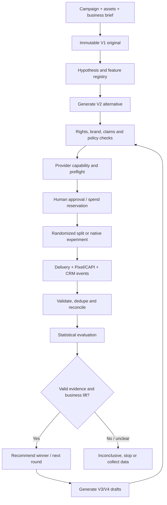

# 95 — Expansión multicanal: TikTok, ChatGPT Ads y aprendizaje automático de campañas

> **Tipo:** especificación funcional, técnica y de arquitectura; ampliación del backlog existente.  
> **Fecha de auditoría:** 2026-11-09.  
> **Rama de referencia:** `environment/local`.  
> **Estado:** propuesta documentada para ejecución; no equivale a implementación, habilitación de proveedores ni autorización de gasto.  
> **Propietario del producto:** Product Owner de WhatsBusiness.  
> **Áreas:** Product, Marketing/Growth, Ads Operations, Data Science, Backend, Frontend, Security, Privacy/Legal, QA y SRE.

---

## 1. Resumen ejecutivo

WhatsBusiness evolucionará desde una plataforma de integraciones Meta hacia una plataforma multicanal de gestión, experimentación y optimización de marketing. El producto deberá integrar las APIs oficiales de TikTok y la API oficial de anunciantes de OpenAI para publicidad en ChatGPT; conservará los adaptadores Meta existentes y agregará un motor transversal que permita crear, medir, comparar y mejorar campañas con evidencia.

Cada campaña publicitaria que WhatsBusiness envíe a un proveedor mediante API deberá tener, obligatoriamente, dos versiones relacionadas e inmutables y un experimento registrado antes de ejecutar cualquier escritura externa:

- **Versión 1 — Original / Control:** copia fiel de la campaña fuente aprobada. No se sobrescribe ni se modifica para fabricar una comparación.
- **Versión 2 — Alternativa / Variante:** propuesta alternativa generada o seleccionada por Creative Lab. La hipótesis y la variable primaria modificada quedan registradas.

Las versiones se asignarán a grupos experimentales mediante un mecanismo aleatorio o una función nativa del proveedor, cuando esté disponible y autorizado. El sistema conservará la asignación para evitar que una misma unidad experimental cambie repetidamente entre control y variante. La proporción inicial recomendada es 50/50, pero el reparto efectivo de audiencia y presupuesto debe respetar el método admitido por cada plataforma, sus políticas, la elegibilidad de la cuenta y el diseño estadístico.

El propósito final no es solamente identificar qué anuncio recibe más clics. WhatsBusiness debe descubrir qué combinación de contenido, creatividad, contexto, experiencia y oferta consigue mejores resultados comerciales sostenibles: leads cualificados, oportunidades, compras, ingresos netos, margen, recurrencia y valor de vida del cliente, según los datos disponibles.

**Ampliación de producto:** Campaign Intelligence y Creative Lab se convierten en un motor de experimentación omnicanal. El A/B testing será el núcleo que gobierna cómo se crean variantes, se asignan personas, se ejecutan campañas, se capturan interacciones y se deciden las siguientes versiones. Este motor cubre paid media y canales propios como WhatsApp, email, SMS, voz, Telegram y otros, sin asumir que todos ofrecen el mismo control o medición. La plataforma registra las limitaciones y nunca inventa eventos que el canal no exponga.

El motor podrá recomendar y preparar automáticamente nuevas versiones. La activación de anuncios, las publicaciones, los cambios de presupuesto y cualquier operación externa con coste continuarán sujetos a permisos, límites, políticas y aprobaciones configuradas por el propietario y el tenant. La automatización de generación no equivale a autorización de publicación ni de gasto.

## 2. Objetivos y resultados de negocio

1. Administrar campañas y activos publicitarios de Meta, TikTok y ChatGPT desde una experiencia unificada, sin perder las capacidades específicas de cada plataforma.
2. Publicar contenido orgánico de TikTok mediante las APIs oficiales y permisos explícitos de cada cuenta.
3. Administrar campañas publicitarias en TikTok y ChatGPT mediante sus respectivas APIs oficiales y únicamente cuando la cuenta y la aplicación sean elegibles.
4. Crear el par original/alternativa de forma reproducible, auditable y comparable.
5. Recolectar señales de entrega, creatividad, contexto, interacción y resultado comercial, conservando origen, granularidad, zona horaria y ventana de atribución.
6. Diferenciar correlación, atribución informada por la plataforma e incremento causal medido mediante experimento válido.
7. Aprender qué elementos funcionan por sector, producto, objetivo, país, audiencia, canal y etapa del funnel, sin asumir que una combinación ganadora en un canal será ganadora en otro.
8. Recomendar y generar nuevas variantes con explicaciones, confianza, riesgos, evidencia y límites de aplicabilidad.
9. Proteger presupuesto, cuentas, credenciales, derechos de uso, datos personales, marca y reputación del cliente.
10. Hacer que la plataforma sea extensible: añadir futuros proveedores sin rehacer el dominio compartido ni acoplar toda la lógica a Meta.

### Fuera de alcance o no asumido

- No se promete acceso automático a todas las APIs privadas, restringidas, académicas o sujetas a aprobación de TikTok, OpenAI o Meta.
- “Todas las APIs” significa un inventario versionado y cobertura de todas las operaciones oficiales pertinentes para las funciones comerciales aprobadas, con estado de elegibilidad. No significa implementar endpoints sin utilidad, sin acceso, retirados o legalmente restringidos.
- La API de OpenAI para anunciantes no es la API de modelos, Responses API ni un mecanismo para insertar publicidad en respuestas conversacionales generadas por modelos. El alcance es administrar anuncios del producto publicitario oficial de ChatGPT.
- No se presupone acceso a usuarios individuales, contenido privado, señales internas de ranking ni algoritmos propietarios de ninguna plataforma.
- No se asumirá que ChatGPT Ads, TikTok Ads y Meta Ads tienen igualdad de formatos, objetivos, targeting, métricas o controles.
- No se habilita publicación, activación ni gasto real por el hecho de completar contratos o código. Los gates de producción del proyecto siguen vigentes.

## 3. Auditoría del estado actual del repositorio

La revisión se realizó contra archivos y rutas de `environment/local`, no solamente contra las historias o casillas del backlog.

### 3.1 Estructura y frontend

| Hallazgo verificado | Situación actual | Decisión propuesta |
|---|---|---|
| `apps/` contiene más de una aplicación | Existe `apps/api` y `apps/web` | No renombrar ni mover el directorio padre completo. Conservar `apps/api` y mover únicamente el frontend Angular a `app-meta-ecuapp/`. |
| Angular se identifica como `web` | `angular.json` usa la clave `web`; Nx usa `name: web`; los comandos hacen `ng build web` / `ng serve web` | Renombrar el proyecto Nx/Angular a `app-meta-ecuapp` y actualizar todas las rutas, targets, cachés y pipelines. |
| Monorepo pnpm | `pnpm-workspace.yaml` incluye `apps/*`, `libs/*` y `microservices-meta-ecuapp` | Mantener `apps/*` para el backend y añadir `app-meta-ecuapp` como workspace explícito. |
| API modular | `apps/api` es NestJS | Mantener el backend y sus límites por bounded context. |
| Paquete Meta | `microservices-meta-ecuapp` está nombrado y empaquetado para Meta | No convertirlo en un conector genérico de terceros. Mantener Meta aislado y crear módulos/adapters TikTok y OpenAI Ads independientes. |

**Estructura objetivo:**

```text
/
├── app-meta-ecuapp/                 # Angular: interfaz del producto multicanal
├── apps/
│   └── api/                         # NestJS: API, dominios y casos de uso
├── microservices-meta-ecuapp/       # Integraciones y runtime Meta existentes
├── integrations/
│   ├── tiktok/                      # Propuesto: adapters TikTok por producto API
│   └── openai-ads/                  # Propuesto: Advertiser API de ChatGPT Ads
├── libs/                            # Contratos, utilidades y librerías compartidas
├── contracts/                       # OpenAPI, AsyncAPI y JSON Schemas versionados
└── docs/
```

La ubicación física `integrations/` es una dirección arquitectónica que debe contrastarse con el grafo real de Nx y el ownership actual antes de crear nuevos proyectos. También es válido ubicar los adapters bajo `apps/api/src/<bounded-context>/infrastructure/providers/` si el monolito modular actual ofrece mejores límites; la decisión debe registrarse en ADR antes de implementar.

### 3.2 Campañas, experimentos e inteligencia existentes

| Código o documento observado | Evidencia | Estado real que debe preservarse |
|---|---|---|
| `apps/api/src/ads/campaigns/domain/` | Existen dominio de ciclo de vida, validación, dinero y guardrails de presupuesto | Hay reglas de dominio; no se debe suponer que existe una integración externa end-to-end. |
| `apps/api/src/ads/creative-lab/domain/creative-variant.ts` | Variante con concepto, oferta, hook, formato, CTA, placement, provenance, rights, claims y lifecycle | Slice de dominio existente; faltan providers reales de derechos, marca y claims, además de gates de integración. |
| `apps/api/src/ads/creative-lab/domain/creative-experiment.ts` | Control y variantes, variable primaria, KPI, presupuesto decimal, particiones de audiencia, ventana, muestra y stop rules | Existe modelo de test cell. No equivale a asignación aleatoria persistente ni a ejecución A/B end-to-end. |
| `apps/api/src/ads/creative-lab/application/creative-provider.adapter.ts` | Adapter de creatividad específico de Marketing API Meta, con capability evidence y transporte fail-closed | Reutilizar el patrón, no fingir paridad con TikTok ni OpenAI. Crear contratos y adapters separados. |
| `docs/36-CAMPAIGN-INTELLIGENCE-AND-GUARDED-SCALING.md` | Define aprendizaje con CRM/CAPI, protección de ganadores, Creative Lab, atribución y presupuesto +20% | Reutilizar como norma de producto y extenderla a los canales nuevos. |
| `docs/11-TASK-BACKLOG.md` y `docs/53-TASK-WORK-PACKAGES.md` | Ya existen TASK-067..080 para Campaign Intelligence, Creative Lab, medición, herramientas y Meta agents | Los paquetes nuevos deben depender de estas tareas y extenderlas, no crear duplicados. |
| `docs/18-EXECUTION-GRAPH.md` y `docs/19-TRACEABILITY-MATRIX.md` | Existen dependencias de Insights, CAPI, Creative Lab, test cells y recomendaciones | Agregar las dependencias multicanal y sus criterios de aceptación. |

**Estado de las tareas existentes al corte documental:** TASK-069, TASK-070, TASK-073 y TASK-079 tienen un primer slice en progreso. Los demás elementos de Campaign Intelligence/Agent Interoperability mantienen dependencias y gates pendientes según los documentos existentes. El documento de trazabilidad registra evidencia histórica de suites Creative Lab (26/26 en un run anterior), pero esa ejecución no acredita el HEAD actual ni reemplaza la validación integral del commit que se vaya a aceptar. No se declara que estas historias estén terminadas.

### 3.3 Gaps de producto detectados

1. El catálogo `docs/09-API-INTEGRATION-CATALOG.md` está enfocado en Meta; falta un catálogo transversal de proveedores que separe Meta, TikTok y OpenAI Ads.
2. El adapter de creatividad Meta está especializado en `marketing_api`; falta un modelo compartido de capacidades por proveedor, producto, cuenta, operación, versión y vigencia.
3. No existe en la documentación vigente una especificación de integración TikTok end-to-end.
4. No existe en la documentación vigente una especificación de integración de OpenAI Advertiser API end-to-end.
5. El modelo de Creative Experiment no garantiza por sí solo exposición equilibrada, asignación persistente, detección de Sample Ratio Mismatch, atribución común ni causalidad.
6. No hay una taxonomía multicanal completa y unificada de atributos creativos, de experiencia, calendario, oferta y resultados comerciales.
7. El repositorio requiere una decisión explícita sobre el nombre `app-meta-ecuapp`: aunque conserve la palabra Meta por solicitud del propietario, el frontend debe representar el producto multicanal y no acoplar su interfaz a un único proveedor.
8. Los adaptadores nuevos necesitan una estrategia común de autenticación, scopes, revocación, rotación, webhook verification, rate limits, idempotencia, retries y reconciliación.
9. Se requiere un feature store/registro de experimentos con linaje, calidad, retención y protección de datos; no basta con guardar métricas sueltas en tablas de campaña.
10. La atribución de cada plataforma debe separarse de las ventas verificadas por CRM y del uplift causal. Sin esta separación el motor podría aprender conclusiones equivocadas.

### 3.4 Mejoras adicionales de alto valor identificadas en la auditoría

Estas mejoras se incorporan al alcance de esta especificación aunque no aparezcan como una tarea completa en el backlog actual:

- **Provider Capability Registry multicanal:** elegibilidad por tenant, cuenta, país, producto, endpoint, versión, scope, asset grant, tier, fecha de comprobación y expiración. Estado `unknown` debe bloquear escrituras.
- **Campaign/Spend Ledger unificado:** presupuestos autorizados, límites de cuenta, gasto reportado por proveedor, moneda, conciliación, reservas de presupuesto por test cell y discrepancias.
- **Assignment Integrity:** unidad experimental estable, asignación reproducible, control de contaminación entre grupos, detección de bots/fraude y alerta ante desbalance inesperado de muestra.
- **Experiment Registry y preregistro:** hipótesis, variable primaria, KPI primario, métricas de protección, tamaño de muestra, MDE, duración, ventanas, reglas de parada y análisis antes de mirar resultados.
- **Creative Rights & Brand Governance:** licencia, consentimiento, fecha de expiración, autorización de uso comercial, música/audio, imagen de personas, marca, claims y revisión por país/industria.
- **Measurement Quality Service:** deduplicación entre pixel y servidor, reconciliación de eventos, frescura, eventos faltantes, conversiones repetidas y discrepancias de atribución.
- **Calendar & Context Intelligence:** festivos locales, estacionalidad, zona horaria de cuenta, jornada del negocio, eventos sectoriales y ventanas promocionales. Guardar fuentes y no asumir que una fecha funciona igual en todos los países.
- **Guardrails de economía unitaria:** margen, coste de producto/servicio, descuentos, impuestos cuando correspondan, devoluciones, cancelaciones, coste de operación y calidad de lead; evitar elegir una creatividad por ROAS reportado que no represente rentabilidad.
- **Observabilidad por proveedor:** freshness y latencia de Insights, consumo de cuota, rate limits, errores OAuth, webhooks, serving issues, gasto, colas, reconciliación y salud de cada conector.
- **API/Policy Drift Monitor:** alertas de cambios de versiones, deprecaciones, scopes y políticas con tareas de migración sugeridas; nunca autopublicar o autoaprobar una migración externa.
- **Experimentación accesible y segura:** accesibilidad del contenido/landing, lectura móvil, contraste, velocidad de destino, lenguaje/localización y compatibilidad con formatos por placement.

## 4. Cambio 1 — Renombrar el frontend a `app-meta-ecuapp`

### 4.1 Requisito

El proyecto Angular actualmente ubicado en `apps/web` debe pasar a llamarse `app-meta-ecuapp`. El backend no debe ser movido ni renombrado como consecuencia accidental de este cambio.

### 4.2 Migración requerida

1. Mover `apps/web/` a `app-meta-ecuapp/`, preservando historia Git cuando la herramienta de migración lo permita.
2. Cambiar el `name` del proyecto Nx a `app-meta-ecuapp` y actualizar `angular.json` para usar la misma clave de proyecto.
3. Actualizar `root`, `sourceRoot`, `index`, `browser`, `styles`, `assets`, `tsConfig` y `outputPath` a las rutas nuevas.
4. Actualizar los targets y comandos: `ng build app-meta-ecuapp`, `ng serve app-meta-ecuapp`, `nx build app-meta-ecuapp` y `nx serve app-meta-ecuapp`, según los targets finales del workspace.
5. Actualizar `pnpm-workspace.yaml`, tags Nx, project references, imports relativos, alias TypeScript, configuración de tests, snapshots y pruebas E2E.
6. Actualizar Dockerfiles, Compose, scripts de desarrollo, CI, cache keys, path filters, artefactos, deployment manifests y documentación que haga referencia a `apps/web` o al proyecto `web`.
7. Ajustar la salida de build, presupuestos Angular, sourcemaps, rutas estáticas, proxy de API, rutas base y variables por ambiente.
8. Ejecutar `pnpm install --lockfile-only` o el mecanismo documentado del repositorio, revisar `pnpm-lock.yaml` y exigir `pnpm install --frozen-lockfile` limpio.
9. Mantener `apps/api` sin cambios de ubicación y probar que los comandos raíz Nx sigan descubriendo ambas aplicaciones.
10. No mantener aliases obsoletos indefinidamente. Si algún pipeline externo requiere transición, documentar la compatibilidad y su fecha de retirada.

### 4.3 Criterios de aceptación

- No queda frontend Angular operativo bajo `apps/web`; su código fuente reside en `app-meta-ecuapp/`.
- Nx y Angular reconocen el nombre exacto `app-meta-ecuapp`.
- `apps/api` continúa compilando y ejecutándose desde su ubicación original.
- `pnpm install --frozen-lockfile`, build, typecheck y tests pasan en el mismo commit.
- CI, Docker, scripts, rutas de assets y configuración de despliegue no conservan referencias rotas.
- El nombre visible y los metadatos del producto se actualizan donde corresponda sin alterar secretos ni URLs OAuth registradas hasta revisar cada proveedor.

## 5. Cambio 2 — Integración oficial completa de TikTok

### 5.1 Principio de integración

Construir un conjunto de adapters oficiales separados por producto TikTok. Marketing API, Organic API, Content Posting API, Display API, Login Kit y Business Messaging API tienen casos de uso, autorizaciones y semánticas diferentes. No implementar un “TikTok API client” monolítico ni asumir que un token habilita todos los productos.

### 5.2 Inventario de APIs y capacidades

| Producto / familia | Capacidades que debe cubrir la plataforma | Condición y límites que se deben verificar |
|---|---|---|
| TikTok API for Business — Marketing API | Ad accounts, Business Center/activos elegibles, campañas, ad groups, ads, creatives, objetivos, targeting, presupuestos, pujas, estados, gestión de assets, catálogos, audiencias, leads, reportes y operaciones de medición soportadas | Scopes, autorización de advertiser, app review, región, API version, access level, endpoint habilitado, tier y elegibilidad por cuenta. |
| Upgraded Smart+ APIs | Flujos de creación y administración de campañas Smart+ que sustituyan los flujos Legacy Manual cuando el objetivo/versión lo requiera | Migración obligatoria de flujos afectados antes del 2027-01-01 según el aviso vigente de TikTok para Sales, App Promotion y Lead Generation. |
| Super Split Test API | Crear/administrar experimentos nativos cuando TikTok lo habilite para la cuenta, objetivo y tipo de campaña; recuperar definición/resultados | Confirmar versión, endpoint, elegibilidad y restricciones. No fingir soporte nativo si la cuenta no califica. |
| Reporting / Insights | Informes síncronos y asíncronos, paginación, breakdowns por tiempo/campaña/ad group/ad/creative y métricas disponibles | Guardar request, filtros, attribution window, timezone, currency, estado de reporte, freshness y API version. |
| Audience / Catalog / Lead Generation | Audiencias y exclusiones, catálogos/product sets, formularios/leads y sincronización de resultados cuando exista permiso | Minimización de PII, consentimiento, lead access, retención, supresión y reconciliación de eventos. |
| Organic API | Accounts, Mentions, TikTok One (TTO) Creator Marketplace, Discovery y Spark Ads Recommendation | Los permisos y funcionalidades pueden diferir por producto, región, cuenta y tipo de usuario. |
| Business Messaging API | Mensajes directos y conversaciones de negocio, eventos/webhooks, routing hacia Inbox y handoff humano | Habilitación y aprobación del producto, autorización del usuario/cuenta, políticas de mensajería y límites de QPS. |
| Login Kit | OAuth/autorización de usuarios, exchange, refresh, scopes concedidos, revocación y reconexión | Consentimiento por scope; token exchange y almacenamiento en backend; rotación y expiración. |
| Content Posting API — Direct Post | Publicar video/foto/contenido soportado al perfil TikTok autorizado; caption, hashtags, privacidad y opciones admitidas | Aprobación del scope `video.publish`, autorización explícita del titular, auditoría del cliente y restricciones de visibilidad de clientes no auditados. |
| Content Posting API — Upload to Draft | Subir contenido como borrador para que la persona lo revise y publique desde TikTok | Preservar propiedad/consentimiento del usuario y reportar claramente que subir no significa publicar. |
| Display API | Perfil y lista/detalle de videos del usuario autorizado para mostrarlos en la aplicación | Scope `user.info.basic`, `video.list` u otros scopes realmente aprobados. No usarla para scraping. |
| Share Kit / herramientas de integración | Compartir contenido desde una experiencia móvil/web cuando corresponda y esté soportado | Evaluar por plataforma cliente; no asumir equivalencia a Content Posting API. |
| Commercial Content API | Investigación/consulta de contenido comercial y transparencia cuando el programa permita el uso | Verificar elegibilidad legal y técnica. No confundirla con acceso a todas las publicaciones ni con Ads Management API. |
| Research API | No formar parte del flujo comercial estándar | Excluirla de la entrega comercial salvo que una entidad separada y elegible cumpla de forma verificable los criterios académicos/no lucrativos y términos de TikTok. |

El inventario es una cobertura funcional objetivo. Al implementar cada operación debe existir una ficha con endpoint/método oficial, versión, fecha y URL fuente, scopes, app mode, access level, permisos de cuenta, payload request/response, errores, límites, paginación, idempotencia, webhook asociado, datos tratados, retención, coste y pruebas de contrato.

### 5.3 Funcionalidades de usuario

- Conectar y desconectar una o varias cuentas TikTok con autorización explícita y estado visible por cuenta.
- Sincronizar la identidad de cuenta, advertiser IDs, Business Center y activos únicamente cuando las APIs concedidas lo permitan.
- Crear, duplicar como borrador, validar, previsualizar, programar, pausar, reanudar y consultar campañas, ad groups y ads, según los permisos del endpoint.
- Subir y administrar imágenes, videos, textos y otros assets compatibles; registrar checksum, formato, tamaño, duración, licencia, origen y revisión de seguridad.
- Administrar contenido orgánico: cargar borrador, preview, solicitud de publicación, Direct Post y consulta posterior de estado cuando la API y autorización lo permitan.
- Consultar métricas y diagnósticos con cortes compatibles y refresco indicado.
- Sincronizar leads y eventos de mensajes hacia CRM e Inbox con source/provider ID, idempotencia, consentimiento y audit.
- Utilizar TikTok One/Creator Marketplace solo para flujos de colaboración autorizados, con contrato, permisos y derechos de uso del contenido.
- Detectar cambios de estado, rechazos, restricciones, límites de entrega, tokens vencidos y problemas de facturación/operación.

### 5.4 Condición especial de migración 2027

TikTok anunció que desde el **1 de enero de 2027** ciertos endpoints Legacy Manual Flow (`campaign/create`, `campaign/copy/task/create`, `adgroup/create`, `ad/create` y `ad/aco/create`) dejan de crear/copiar determinados flujos de campañas Sales, App Promotion y Lead Generation. El diseño debe priorizar las APIs Upgraded Smart+ para los casos afectados, mantener adapters por generación de API y crear una tarea de migración con pruebas de regresión. No codificar un endpoint legacy como ruta principal para nuevos flujos afectados.

### 5.5 Criterios de aceptación TikTok

- Existe una matriz por producto/API/versión/scope/país/cuenta y operación con estado `available`, `unavailable` o `unknown` y evidencia vigente.
- Login Kit, Marketing API, Organic API, Business Messaging, Content Posting y Display APIs están encapsuladas en adapters independientes.
- Una cuenta solo ve y opera activos que le pertenecen o que tiene concedidos mediante grants válidos.
- Las campañas, posts, leads, insights y mensajes conservan identificadores y payloads de proveedor, sin perder la normalización compartida.
- Los posts nunca se marcan publicados hasta recibir confirmación verificable; uploads a borrador se identifican como borrador.
- Una app no auditada o sin scope `video.publish` no puede activar Direct Post público; se informa al usuario de la limitación real.
- Webhooks verifican firma/secret según producto, timestamp, replay protection, tamaño, idempotencia, durabilidad y dead-letter/replay controlado.
- Los flujos afectados por el cambio del 2027-01-01 usan Upgraded Smart+ con pruebas de contrato; la API legacy queda limitada a los casos explícitamente permitidos.
- Ninguna capacidad se presenta como habilitada por el solo hecho de que exista la interfaz TypeScript.

## 6. Cambio 3 — Integración oficial de publicidad en ChatGPT (OpenAI Ads)

### 6.1 Producto y API correcta

La integración debe consumir **OpenAI Advertiser API / Ads API**, el producto oficial para que anunciantes y partners creen y administren campañas de anuncios de ChatGPT desde sistemas propios. No debe confundirse con OpenAI Platform API, la API de modelos, la generación de contenido ni con una función para inyectar anuncios en conversaciones de ChatGPT.

### 6.2 Capacidades de API requeridas

| Recurso o familia | Funciones a integrar |
|---|---|
| Authentication / API keys | Validar credencial, cuenta publicitaria, scopes/entitlements disponibles, rotación y revocación. La clave de Ads permanece en backend. |
| Ad Account | Identidad de cuenta, estado, moneda, timezone, límites y revisiones pendientes. |
| Audit Logs | Consultar cambios y asociarlos al command/actor/approval interno. |
| Campaigns | Crear, listar, consultar, actualizar, pausar, activar y cambiar estado cuando la referencia lo permita; objetivos, presupuesto, calendario y targeting disponible. |
| Ad Groups | Crear y gestionar grupos, bidding configuration, contexto, audiencia/product selection u opciones documentadas. |
| Ads | Crear y gestionar anuncios, contenido creativo, destinos, imágenes/archivos, preview, review/serving issues, activar o pausar. |
| Files / Assets | Subir/consultar archivos y reutilizarlos donde la API lo permita; conservar MIME, checksum, procedencia, derechos y asociación. |
| Product Feeds | Administración y sincronización de feeds y productos, validación de feeds, errores, orden y versionado. |
| Insights / Reporting | Insights de cuenta, campaña, ad group y ad; datos de delivery, coste, producto y conversiones atribuidas; paginación, granularidad y freshness. |
| Conversion Setup | Crear o consultar data sources, Pixel, conversion event settings y asociación a campañas. |
| Measurement Pixel | Instalar/emitir eventos web desde frontend con controles de consentimiento. Nunca exponer API keys de anunciante o CAPI en navegador. |
| Conversions API | Envío server-to-server de leads, compras y otros eventos; batch, validación, retries y claves específicas. Deduplicar con Pixel usando Pixel ID, nombre y event ID compartido. |
| Preview / Serving Issues | Previsualizar anuncios, revisar aprobación/serving issues y mostrar por qué un anuncio no entrega cuando la API exponga esa información. |

La integración debe respetar la jerarquía real de recursos de OpenAI: cuenta → campaña → ad group → ad. La API documenta bidding types como impressions, clicks y conversions, además de budgets, targeting y landing page tracking según el endpoint y la cuenta. Se debe mantener la granularidad nativa y no mapear mecánicamente todos los campos a un modelo Meta.

### 6.3 Seguridad y medición

- `OPENAI_ADS_API_KEY` (o el nombre/credencial vigente definido por OpenAI) se almacena solo en secret manager del backend, nunca en browser, build, logs o repositorio.
- La Conversions API usa una credencial separada de eventos, de alcance mínimo, además de un Pixel ID. No mezclar credenciales de administración y medición.
- Crear campañas inicialmente en estado **paused** cuando lo permita la API; revisar targeting, país, moneda, timezone, presupuesto, creative review, destinos y serving issues antes de solicitar activación.
- Usar `Idempotency-Key` en operaciones de creación compatibles. Reutilizar la misma clave solo para el mismo intento lógico; reconciliar una escritura de estado desconocido antes de repetirla.
- Medir Pixel con controles de consentimiento; enviar desde servidor eventos confirmados por el backend. No duplicar una compra emitida desde browser y servidor: reutilizar el mismo event ID, event name y Pixel ID según el contrato oficial.
- Capturar referencias de clic como `oppref` si están presentes y el contrato oficial lo admite; no fabricarlas ni enviar datos no autorizados.
- Mantener por separado click-through y view-through, ventanas de atribución y métricas de conversión. Respetar latencia/frescura documentadas para reportes.
- Los endpoints de historial/eventos de depuración pueden tener restricciones de disponibilidad por cuenta; ausencia de acceso se registra como `unknown` o `unavailable`, no como cero eventos.
- La activación debe requerir capability evidence vigente, ad account elegible, aprobaciones internas y presupuesto libre.

### 6.4 A/B y limitaciones

La documentación pública consultada de OpenAI Advertiser API describe administración de campañas, ad groups, ads, reporting y conversion tracking; no se debe presuponer que existe un endpoint nativo de A/B testing equivalente al de otras plataformas. El motor de WhatsBusiness definirá el experimento y seleccionará el mecanismo admitido: partición de audiencias, estructura separada o asignación compatible con las restricciones de targeting y entrega. Si la plataforma no permite garantizar aleatorización comparable, el resultado debe etiquetarse como observacional o no causal.

### 6.5 Criterios de aceptación OpenAI Ads

- Cuenta, moneda, timezone, estado y revisiones se verifican antes de cualquier acción.
- Se puede realizar un recorrido completo de sandbox/simulación: cuenta, draft paused, ad group, ad, asset, preview/serving review, Insights y conversión sintética.
- Las claves de Ads y CAPI están separadas, cifradas, rotables y solo son accesibles desde servicios backend autorizados.
- Los comandos externos tienen idempotencia, audit, actor, tenant, approval hash, proveedor, request ID, estado y reconciliación.
- El estado de una campaña se deriva de respuesta de proveedor y reconciliación, no de una intención local.
- Pixel y Conversions API respetan consentimiento y deduplicación; se mantiene fuente original y se evita duplicar ingresos.
- No se publica ni activa un anuncio hasta cumplir la aprobación configurada y la elegibilidad real de la cuenta.

## 7. Requisito central — dos versiones y distribución experimental

### 7.1 Definición de V1 y V2

Toda campaña que se incorpore al módulo de experimentación creará un `CampaignExperiment` con al menos dos versiones:

| Propiedad | V1 — Original / Control | V2 — Alternativa / Tratamiento |
|---|---|---|
| Fuente | Snapshot fiel de la campaña original aprobada | Derivada explícitamente de V1 y de una hipótesis identificada |
| Identidad | `variant_role=control`, `version_number=1` | `variant_role=treatment`, `version_number=2` |
| Mutabilidad | Inmutable después del preregistro; nuevas correcciones generan nueva versión | Inmutable una vez aprobada/preregistrada; nuevas mejoras generan nuevas versiones |
| Propósito | Baseline para comparar | Medir el impacto de una alternativa definida |
| Aprobación | Conservar aprobación original y validar su vigencia | Requiere validación de derechos, marca, políticas y aprobación según riesgo |
| Presupuesto | Parte del budget total reservado para el experimento | Parte del mismo budget total reservado; no implica duplicarlo |
| Resultado | Conserva exposición, delivery y outcomes propios | Conserva exposición, delivery y outcomes propios |

La V1/V2 y el registro de experimento son obligatorios para toda campaña publicitaria paga que WhatsBusiness envíe a un proveedor mediante API. No existe exclusión silenciosa por canal, presupuesto o preferencia operativa. La campaña no se activa si no se puede crear el par, validar los permisos y ejecutar una asignación aleatoria verificable mediante split nativo o partición de audiencia compatible. Si una limitación técnica, regulatoria o de seguridad impide el split, se bloquea el lanzamiento experimental; solo el Product Owner puede autorizar una excepción manual, con motivo, alcance, aprobadores y audit, etiquetada `manual_non_experimental` y excluida de la optimización A/B automática. La V2 debe existir incluso mientras espera revisión; si no está aprobada, no se inicia el experimento. Antes de duplicar o modificar recursos se valida que el proveedor soporte una estructura experimental equivalente.

Cada ronda posterior debe conservar el lineage: V1/V2 iniciales no se sobrescriben; el siguiente experimento puede comparar el campeón anterior contra una nueva variante V3, V4, etc. El sistema debe distinguir `version_number` dentro de una campaña de `experiment_round` y rol experimental.

### 7.2 Distribución aleatoria

- Default conceptual: 50% control y 50% alternativa. La proporción real debe configurarse por experimento, pero ambos grupos han de tener presupuesto y volumen suficiente para detectar el efecto buscado.
- Preferir el mecanismo nativo de split test del proveedor cuando esté disponible y la cuenta cumpla requisitos. Ejemplo: Super Split Test de TikTok, cuando la API, el objetivo y la cuenta lo admitan.
- Si no hay mecanismo nativo, usar asignación estable y verificable con unidad experimental apropiada (usuario, sesión, lead, cuenta o cluster geográfico); no alternar la creatividad en cada request ni asignar la misma persona a ambos grupos.
- El servicio de asignación debe utilizar un hash/HMAC determinístico con secreto server-side, `experiment_id`, unidad seudonimizada y versión del algoritmo. Persistir asignación, exposición, momento y versión de la regla. Nunca enviar el secreto al frontend.
- Excluir, cuando corresponda, bots, tráfico interno, QA, empleados, conversiones duplicadas y audiencias no elegibles. Registrar la razón de exclusión.
- Comprobar que control y variante son mutuamente excluyentes y que no existe contaminación material entre grupos. Si no puede demostrarse, bloquear la declaración de causalidad.
- Vigilar **Sample Ratio Mismatch (SRM)**: si la proporción observada se desvía significativamente de la distribución esperada, pausar la inferencia y analizar pérdida de eventos, elegibilidad o delivery desigual.
- Una asignación de 50/50 en la aplicación no garantiza 50/50 impresiones: los algoritmos de entrega pueden optimizar exposición y gasto de manera desigual. Registrar assignment, eligible population, served impressions, reach y spend por separado.
- Si la API/plataforma no permite garantizar asignación aleatoria válida o un split nativo equivalente, WhatsBusiness bloquea el lanzamiento como experimento A/B. No se envía la pareja como si el reparto fuese aleatorio. El Product Owner puede autorizar una excepción manual fuera de la automatización A/B; cualquier análisis posterior se etiqueta como observacional y no causal.
- Las particiones de audiencia, presupuesto, bids, calendario y placements deben ser equivalentes o diseñadas expresamente para la hipótesis. Evitar cambios simultáneos no registrados.
- Guardar la configuración real devuelta por el proveedor y reconciliarla periódicamente.

### 7.3 Variables experimentales y catálogo de atributos

El Feature Registry debe soportar al menos las siguientes familias. Un atributo debe ser `supported`, `unsupported`, `not_applicable`, `not_exposed_by_provider` o `provider_managed`; nunca inventar que se cambió una propiedad que la API no ofrece.

| Familia | Campos/variables a capturar y evaluar |
|---|---|
| Color y composición | Paleta, color principal/secundario/fondo, contraste, saturación, balance visual, jerarquía, composición, espacios, densidad, estilo gráfico y consistencia de marca. |
| Imágenes | Asset ID/hash, tipo, origen, licencia, presencia de producto/persona, composición, crop, ratio, resolución, calidad, miniatura, contexto y ubicación de producto. |
| Video y audio | Duración, relación de aspecto, resolución, FPS cuando disponible, primeros 1–3 segundos/hook, ritmo de escenas, subtítulos, idioma, voz, música, audio original/licencia, silencios y CTA final. |
| Texto y tipografía | Headline, primary text, caption, descripción, longitud, idioma, tono, legibilidad, familia/tamaño/peso de tipografía si controlable, alineación, claims, emojis, hashtags y evidencia de cada claim. |
| Botones y CTA | Tipo, etiqueta, color, tamaño, posición, orden, destino, acción, microcopy y función (comprar, cotizar, reservar, WhatsApp, llamar, registrarse, descargar, visitar, etc.). |
| Landing y experiencia | URL, velocidad, móvil/escritorio, continuidad mensaje-anuncio, formulario, número de campos, fricción, accesibilidad, disponibilidad, checkout y conversión por paso. |
| Oferta y producto | SKU, precio, descuento aprobado, bundle, envío, financiación, stock, beneficio, garantía, vigencia, margen y restricciones comerciales. |
| Segmento y audiencia | Segmento/ICP, etapa de funnel, país/ciudad cuando sea lícito y necesario, intereses o criterios permitidos, exclusiones, tamaño, solapamiento, idioma y elegibilidad. |
| Ubicación y formato | Feed/story/reels/short video/search/placement u opción específica del proveedor, dispositivo, placement, formato y especificaciones. |
| Tiempo y calendario | Día de semana, fecha local, hora, zona horaria de la cuenta, temporada, festivo, evento local, horario del negocio, franja de atención y duración de campaña. |
| Estructura y delivery | Objetivo, optimization event, bid strategy, presupuesto, pacing, estado de aprendizaje/entrega, frecuencia, alcance, impresiones y cambios de configuración. |
| Canal/proveedor | TikTok/Meta/ChatGPT, producto API, API version, cuenta, formato nativo, ad type, endpoint, restricciones, cuenta/país elegible y serving issues. |
| Resultado | Vistas, retención, completitud de video, likes, comentarios, compartidos, guardados, clics, CTR, CPC, CPM, leads, leads cualificados, oportunidades, compras, CPA, ingresos, margen, devoluciones y LTV cuando la fuente lo soporte. |

Los campos de fuente y contexto deben ser versionados para que un análisis histórico no compare métricas distintas bajo un mismo nombre. Guardar las métricas nativas sin reescribirlas y, además, mapearlas a una taxonomía común documentando transformaciones y pérdidas de semántica.

### 7.4 Una hipótesis primaria por experimento

Por defecto se modifica una sola variable primaria entre V1 y V2, por ejemplo:

- misma imagen y mismo copy, distinto color/contraste;
- misma oferta y texto, fotografía A contra fotografía B;
- mismo creativo, CTA “Comprar” contra CTA “Solicitar cotización”;
- mismo anuncio, hook de los primeros segundos alternativo;
- mismo anuncio, hora de publicación distinta;
- misma landing, variante de formulario con menos campos.

Cambiar color, foto, botón, texto, horario, segmentación y presupuesto todo a la vez no permite atribuir la mejora a una causa. Para probar varias variables simultáneamente se requiere un diseño factorial/multivariante con tamaño muestral, control de interacciones y corrección por comparaciones múltiples. El motor debe explicarlo antes de lanzar.

### 7.5 Presupuesto y control de riesgo

- El budget total del experimento se divide entre celdas; no se duplica por crear V1 y V2.
- Respetar la política PD-024 existente: máximo de aumento de 20% por operación y acumulado sobre baseline rolling 24h; cambios por debajo del límite también requieren permisos y evidencia.
- No repartir artificialmente un aumento grande en varias llamadas para evadir el límite.
- Las operaciones que generan gasto necesitan approval, budget reservation, idempotency, audit y reconciliación.
- Si una plataforma controla la entrega y consume el budget de modo no uniforme, el panel muestra inversión real por variante y no solo el presupuesto solicitado.
- Definir caps por tenant, cuenta, campaña, experimento, celda, canal y periodo; soportar límites inferiores al máximo global.
- Nunca aumentar gasto automáticamente por una predicción aislada ni sin aprobación/opt-in explícito y controles aprobados por el propietario.

## 8. Diseño estadístico y reglas para decidir ganadores

### 8.1 Preregistro del experimento

Antes de observar resultados, guardar:

- pregunta de negocio e hipótesis falsable;
- población elegible y unidad de aleatorización;
- control, tratamientos y variante exacta de cada asset;
- única variable primaria (o diseño multivariante formal);
- KPI primario y métricas de guardia;
- baseline histórico y ventana de referencia;
- efecto mínimo detectable (MDE), confianza/potencia o criterio bayesiano predefinido;
- tamaño de muestra necesario por grupo;
- gasto máximo, fecha inicial/final y duración mínima;
- stop rules, riesgo de daño y ventana de maduración de conversión;
- método de asignación, plataforma, ad account, API version y evidencia de audiencia;
- attribution window y timezone de cada sistema.

### 8.2 Métricas de negocio

El KPI primario se selecciona según el objetivo real: coste por lead cualificado, tasa de lead a oportunidad, coste por compra, ingreso neto, margen de contribución, tasa de reserva, ROAS reconciliado o LTV cuando haya datos fiables. CTR, CPC, CPM, views y engagement sirven como diagnósticos/leading indicators, pero no deben sustituir el resultado comercial.

Las métricas mínimas de guardia incluyen gasto, frecuencia, rechazo/restricción, tasa de devolución/cancelación, calidad del lead, margen, experiencia de destino y señales de fraude. Un ganador de CTR que destruye margen o trae leads de mala calidad no es ganador de negocio.

### 8.3 Inferencia y decisiones

- Calcular estimaciones por grupo con denominador y ventana claros, diferencias absolutas/relativas e intervalos de confianza o intervalos creíbles.
- Definir previamente el método de inferencia (frecuentista o bayesiano) y evitar cambiarlo después de ver los datos.
- Controlar múltiples comparaciones si se prueban varios creativos, subgrupos o métricas.
- Corregir por maduración de conversión, latencia de reporting y cohortes todavía abiertas.
- Aplicar reglas de parada secuencial válidas o evitar detener el experimento por observación repetida no planificada.
- Distinguir `winner`, `loser`, `inconclusive`, `invalid`, `stopped_for_safety` y `not_causal`.
- Un ganador necesita superar umbral estadístico/práctico y guardrails comerciales; no basta con mayor cantidad bruta de conversiones si tuvo más impresiones o inversión.
- Si la muestra es pequeña, los datos están retrasados, existe SRM, cambió la audiencia o la plataforma no permite aleatorización controlada, el resultado queda inconcluso/observacional.
- No extrapolar automáticamente resultados entre canales, regiones, audiencias, categorías de producto, objetivos o temporadas.

### 8.4 Atribución e incremento causal

El sistema mostrará tres perspectivas separadas:

1. **Delivery/Insights del proveedor:** lo que la plataforma reporta dentro de su definición y ventana de atribución.
2. **Outcome first-party:** acciones confirmadas por el backend/CRM (lead, oportunidad, cierre, ingreso, margen, devolución), con deduplicación y consentimiento.
3. **Incrementalidad:** diferencia atribuible al tratamiento bajo un diseño experimental válido, grupo de control adecuado y supuestos transparentes.

No sumar ni comparar directamente métricas de plataformas diferentes sin armonizar definición, ventanas, zona horaria, moneda, evento y granularidad. Cuando sea posible realizar conversion lift/holdout nativo, registrar el reporte del proveedor como evidencia distinta del split aleatorio interno.

## 9. Motor de aprendizaje y optimización automática

### 9.1 Pipeline objetivo



### 9.2 Servicios lógicos

- **Campaign Snapshot Service:** captura inmutable y diff de cada cambio externo.
- **Creative Variant Service:** crea variantes con provenance, derechos, claims, brand kit, similarity fingerprint y enlaces entre generaciones.
- **Experiment Registry:** preregistro, celdas, asignación, exposure events, hipótesis, MDE y stop rules.
- **Experiment Assignment Service:** randomización estable, persistencia y detección SRM/contaminación.
- **Provider Measurement Ingestion:** recupera métricas nativas, eventos, report jobs, webhooks y snapshots por plataforma.
- **First-party Outcome Collector:** eventos server-side de CRM, pagos, ecommerce, agenda o fuente empresarial con idempotencia.
- **Feature Store:** features por creative, placement, contexto, audiencia, negocio y tiempo con linaje, calidad, frescura y privacidad.
- **Experiment Evaluation Engine:** análisis estadístico, comparación control/tratamiento, intervalos, control múltiple y conclusión.
- **Recommendation Engine:** ranking de recomendaciones por uplift esperado, confianza, coste, impacto en margen, riesgo y aplicabilidad.
- **Creative Generation Gateway:** redacta/genera propuestas mediante proveedores IA aprobados; no recibe credenciales de plataformas ni publica directamente.
- **Policy & Approval Gateway:** derechos, consentimiento, brand, claims, regulación, presupuesto, tenant, scopes y aprobación.
- **Execution/Reconciliation Worker:** publica únicamente commands aprobados, procesa estados, retries, unknown outcomes, reconcile y rollback/pause.

### 9.3 Generación y recomendación

El motor debe soportar dos modos:

- **Recomendar:** explicar el elemento que conviene cambiar, por qué, para qué segmento/canal, con cuál evidencia y qué incertidumbre.
- **Generar borrador:** producir una nueva creatividad o configuración con lineage de V1/V2/campeón anterior, versión de prompt/modelo, features cambiadas, revisión y preview. No publicar automáticamente por el simple hecho de generarla.

Toda recomendación debe incluir como mínimo: hipótesis, cambio propuesto, KPI esperado, supporting evidence, tamaño de muestra, confianza/intervalo, mercado/segmento donde aplica, fecha de datos, contraindicaciones, coste estimado, policy checks, riesgos, approval required y razón por la cual podría no funcionar.

### 9.4 Modelos y separación de responsabilidades

- Mantener Campaign Intelligence como lógica estadística/ML del producto, reutilizando la estrategia CPU-first documentada en `docs/62-CRM-MACHINE-LEARNING-STRATEGY.md` cuando aplique.
- El LLM/generador creativo es una capacidad separada detrás de AI Assistance Gateway. No debe reemplazar la inferencia estadística, la evaluación de causalidad ni las reglas de negocio.
- No pasar tokens, cookies, secretos, identificadores sensibles innecesarios o payloads privados de clientes a modelos externos.
- Registrar dataset/version, feature definitions, training window, evaluation, drift y approval de promoción del modelo. Las predicciones se etiquetan como estimaciones, no garantías.
- Medir performance por segmento y canal; detectar model drift, sample bias y feedback loops. Un modelo no puede autoentrenarse con resultados contaminados o sin consentimiento/retención permitida.

## 10. Arquitectura técnica: proveedor desacoplado y SOLID

### 10.1 Ports y adapters por capacidad

Definir contratos pequeños y cohesivos por responsabilidad; no una interfaz universal con decenas de métodos. Por ejemplo:

- `CampaignManagementPort`
- `AdGroupManagementPort`
- `AdManagementPort`
- `CreativeAssetPort`
- `CreativePreviewPort`
- `OrganicPublishingPort`
- `AudienceManagementPort`
- `LeadRetrievalPort`
- `BusinessMessagingPort`
- `InsightsReportingPort`
- `ConversionMeasurementPort`
- `ExperimentAllocationPort`
- `AccountAuthorizationPort`
- `ProviderCapabilityRegistryPort`

Cada proveedor implementa únicamente las capacidades que soporta. Se usa composición y descubrimiento por capability; no se usa `if provider === ...` extendido por todo el dominio. Los límites de cada API y diferencias de payload se conservan en adapters.

### 10.2 Modelo canónico sin pérdida de semántica

- Identificadores remotos con namespace (`provider`, `product`, `account`, `resource_type`, `remote_id`).
- Modelo compartido mínimo para campañas, grupos, anuncios, assets, eventos, reportes y experimentos.
- Payload original saneado/cifrado y snapshot versionado; los campos nativos se preservan en extensión específica por proveedor.
- Currency, timezone, locale, attribution model y report freshness son campos explícitos.
- No mapear automáticamente un objetivo, evento o estado de una plataforma a otro si no tienen equivalencia semántica demostrada.
- Los capability descriptors se versionan y guardan referencia de fuente, fecha, expiración y evidencia.

### 10.3 Persistencia y eventos

Extender el modelo con aggregates/repositorios tenant-scoped y RLS. Entidades sugeridas (los nombres finales deben revisarse contra el esquema actual):

- `provider_connections`, `provider_account_assets`, `provider_capability_evidence`;
- `campaign_snapshots`, `campaign_experiments`, `experiment_rounds`, `experiment_cells`;
- `creative_assets`, `creative_variants`, `creative_feature_values`, `creative_rights_evidence`;
- `experiment_assignments`, `experiment_exposures`, `experiment_observations`, `experiment_results`;
- `provider_insights_snapshots`, `conversion_events`, `business_outcomes`;
- `recommendations`, `recommendation_evidence`, `approval_requests`, `external_commands`;
- `ad_spend_ledger`, `budget_reservations`, `provider_webhook_inbox`, `integration_outbox`.

Todos los aggregates multi-tenant deben tener `tenant_id`, control de ownership/grants, actor/purpose, audit, timestamps, optimistic concurrency cuando proceda, idempotency key y política de retención. Ingesta de provider debe soportar eventos duplicados y desordenados.

Eventos de dominio candidatos:

- `ads.provider_connection.updated`
- `ads.provider_capability.observed`
- `ads.campaign.snapshot_captured`
- `ads.experiment.created`
- `ads.experiment.assignment_created`
- `ads.experiment.exposure_recorded`
- `ads.creative.variant_created`
- `ads.experiment.observation_ingested`
- `ads.experiment.sample_mismatch_detected`
- `ads.experiment.evaluated`
- `ads.recommendation.created`
- `ads.recommendation.approved`
- `ads.external_command.requested`
- `ads.external_command.reconciled`
- `ads.spend.reconciled`

Cada evento requiere schema versionado, envelope universal, event ID estable, tenant/actor/purpose, correlation/causation IDs, provenance, clasificación de datos y política de retención.

## 11. Diseño de datos y panel de resultados

### 11.1 Vista comparativa de versiones

Para toda pareja de versiones el usuario podrá consultar:

- V1 original vs V2 alternativa, hash de configuración y vista previa por placement;
- variable primaria, hipótesis, assets, diferencias exactas y elementos mantenidos constantes;
- distribución asignada, población elegible, exposición servida, alcance, impresiones, inversión y estado;
- delivery/learning/serving issues reportados por cada proveedor;
- resultados de funnel: visita, interacción, lead, lead cualificado, oportunidad, compra, ingreso, margen y devolución;
- CPA/CPL/ROAS y definiciones/fuentes; intervalo y tamaño de muestra;
- fecha/hora local y UTC, attribution window, moneda, freshness y lag;
- conclusión y tipo de evidencia: causal, atribuida, observacional o inconclusa;
- recomendación de qué hacer después y qué evidencia la respalda.

### 11.2 Datos temporales

Almacenar `occurred_at`, `received_at`, `reported_at`, `timezone`, granularidad y periodo del proveedor. El día de una cuenta se interpreta en timezone de cuenta, no en el timezone del servidor. Para campañas ecuatorianas usar `America/Guayaquil` cuando esa sea la zona configurada; no imponer una única zona a cuentas de otros países.

### 11.3 Retención y exportación

Definir retención por clase de información, finalidad, jurisdicción, proveedor y contrato. Ofrecer exportación/eliminación cuando aplique; separar logs técnicos y auditoría de PII. Las métricas agregadas no se considerarán anónimas automáticamente si aún permiten reidentificación.

## 12. Seguridad, privacidad y compliance

1. Aislamiento tenant en APIs, DB/RLS, storage, cache, queues, logs, dashboards y feature store.
2. OAuth y tokens con scopes mínimos, refresh seguro, rotación, revocación, cifrado, redacción y separación de secretos por proveedor/entorno.
3. Token exchange en backend; nunca persistir credenciales en browser storage ni exponerlas en errores.
4. `purpose` y consentimiento verificables antes de recolectar eventos, construir audiencias o procesar datos de contacto.
5. Aplicar LOPDP de Ecuador cuando corresponda y requisitos jurisdiccionales de cada país/canal; revisión legal especializada antes de datos reales/producción.
6. No usar targeting discriminatorio o categorías sensibles; respetar restricciones sobre menores, vivienda, empleo, crédito, salud, política y demás categorías sujetas a reglas especiales del proveedor/jurisdicción.
7. Evidencia de derechos para imagen, video, música, voz, personas, UGC, marcas, influencers y licencia de publicidad pagada.
8. Validar claims, precios, disponibilidad, descuentos y resultados; no generar promesas engañosas ni afirmaciones no probadas.
9. Revisar el contenido generado y la política de disclosure/etiquetado de IA, branded content, Spark Ads e influencers por plataforma.
10. Toda operación externa de escritura tiene dry-run/preflight, snapshot, approval hash, actor distinto cuando la matriz de riesgo lo exija, idempotencia, audit, kill switch y reconciliación.
11. El servicio debe tratar `unknown` como bloqueo y no reintentar operaciones externas de forma ciega.
12. Definir aislamiento por credencial, rate limiting por tenant y cuenta, circuit breaker, cuotas y backpressure.
13. Auditoría append-only de cambios de campaña, presupuesto, targeting, assets, experimentos, asignaciones, resultados y decisiones del motor.
14. Separar secretos de Ads, claves de eventos CAPI, credenciales de TikTok OAuth y credenciales de servicios IA; rotación independiente.

## 13. Experiencia del frontend `app-meta-ecuapp`

El frontend debe representar todos los proveedores y evitar que el nombre de la aplicación determine los límites técnicos.

Secciones de producto propuestas:

- **Conexiones:** TikTok, Meta y ChatGPT Ads; estado, cuenta, scopes, assets, expiración y reconexión.
- **Campañas:** lista unificada con filtros por canal, objetivo, estado, cuenta, fecha y presupuesto.
- **Campaign Builder:** briefs, campaña, grupos, ads, assets, calendario, presupuesto, targeting y validaciones por proveedor.
- **Creative Lab:** biblioteca de assets, brand kit, permisos/derechos, generación, variantes, preview y revisión.
- **Experimentos A/B:** versión original y alternativa, hipótesis, variable, método de asignación, cuotas, cronograma y estado.
- **Resultados:** panel comparativo de V1/V2, métricas de delivery y negocio, confianza, causalidad y explicaciones.
- **Recomendaciones:** cambios sugeridos, nivel de confianza, evidencia, riesgos, coste y flujo de aprobación.
- **Automatizaciones:** reglas de generación de borradores, análisis programado, alertas y propuesta de experimentos.
- **Auditoría y gastos:** autorizaciones, cambios, budget reservations, spend ledger y reconciliación.

Usar permisos RBAC/ABAC, estados de loading/error/unknown, accesibilidad WCAG 2.2 AA y diseño responsive. No mostrar botones de activar/publicar si la capability no está probada, falta scope o no se cumple approval.

## 14. Nuevas historias y tareas propuestas

Los siguientes identificadores son el siguiente rango libre verificado en los documentos consultados (historias hasta US-032 y tareas hasta TASK-080). Se deben reconciliar una vez más con el backlog antes de su incorporación definitiva.

### Historias de usuario

| Historia | Prioridad | Resultado |
|---|---|---|
| US-033 | P1 | Como equipo de producto quiero que la aplicación frontend se identifique como `app-meta-ecuapp` sin mover ni romper el backend. |
| US-034 | P0 | Como marketer quiero conectar TikTok y administrar las capacidades de marketing, contenido orgánico, reporting, leads y mensajería que estén oficialmente disponibles y autorizadas. |
| US-035 | P0 | Como anunciante quiero gestionar campañas oficiales de ChatGPT Ads, activos y medición desde WhatsBusiness con controles de seguridad y gasto. |
| US-036 | P0 | Como marketer quiero que cada campaña publicitaria enviada por API genere V1 original y V2 alternativa y se active solo mediante reparto aleatorio válido, para aprender de sus resultados y recomendar nuevas versiones. |

### Tareas de implementación propuestas

| TASK | Historia | Alcance | Dependencias principales | Entregable / aceptación |
|---|---|---|---|---|
| TASK-081 | US-033 | Rename `apps/web` → `app-meta-ecuapp`, Nx/Angular/workspace/CI/docs | TASK-039; baseline workspace | Build/test/typecheck del monorepo con ruta nueva y `apps/api` intacto. |
| TASK-082 | US-034 | TikTok Marketing API: account, campaigns, ad groups, ads, creative, audience, leads, catalog, reporting y Upgraded Smart+ | TASK-010, 024, 025, 056, 072 | Adapters versionados, capability matrix, contratos y pruebas de cuenta/sandbox. |
| TASK-083 | US-034 | TikTok Login Kit, Organic API, Content Posting, Display, Share Kit, TTO y Business Messaging | TASK-027, 028, 036, 047, 056 | OAuth, scopes, posts/drafts, webhook y business messaging con consent y handoff. |
| TASK-084 | US-034 | TikTok Insights/measurement ingestion, event mapping y CRM/Inbox integration | TASK-023, 026, 029, 068, 072, 078 | Snapshots reconciliados, leads/eventos deduplicados y dashboard con freshness. |
| TASK-085 | US-035 | OpenAI Advertiser API: account, campaigns, ad groups, ads, files/assets, feeds, preview, review, audit e Insights | TASK-024, 025, 056, 067, 072 | Adapter oficial, lifecycle paused-first, capability evidence, schemas y pruebas. |
| TASK-086 | US-035 | OpenAI Measurement Pixel, Conversions API, conversion settings y reporting | TASK-026, 059, 068, 077, 078 | Eventos con consentimiento, credenciales separadas, dedupe y reconciliación. |
| TASK-087 | US-036 | Orquestador obligatorio de versiones V1/V2 y asignación aleatoria persistente para campañas enviadas por API | TASK-067, 069, 070, 072, 082, 085 | Par inmutable, bloqueo sin split verificable, SRM, preflight, budget split y stop rules. |
| TASK-088 | US-036 | Feature Store y taxonomía de métricas multicanal, conversiones y outcomes | TASK-068, 072, 077, 078, 084, 086 | Datos versionados, fuente/fecha/contexto/calidad y reporting armonizado sin pérdida. |
| TASK-089 | US-036 | Motor de aprendizaje, ranking de recomendaciones y generación autónoma de borradores | TASK-067, 069, 070, 077, 078, 087, 088 | Recomendaciones explicables, confianza, nuevas variantes draft y aprobación obligatoria. |
| TASK-090 | US-034/035 | Capability Registry y monitor de drift para TikTok/OpenAI Ads | TASK-056, 065, 082, 083, 085 | Fuente oficial, fecha, versión, scope, región, elegibilidad, alertas y tareas de migración. |
| TASK-091 | US-034/035/036 | Hardening multicanal: spend ledger, cuotas, auditoría, retención, rights/brand, reconciliación y observabilidad | TASK-029, 031, 032, 059, 071, 080, 082..089 | Controles cross-provider, alertas, replay/DR y gates independientes. |

**Regla de estados:** una tarea no pasa a `verified` por tener una interfaz, DTO o schema. Se requiere código conectado, persistencia cuando aplique, contract tests, integración sintética, evidencia CI sobre el commit exacto y revisión independiente. `accepted` requiere aprobación del Product Owner.

## 15. Criterios de aceptación globales

- AC-036-01: toda campaña publicitaria enviada por WhatsBusiness mediante API crea V1 original y V2 alternativa inmutables con lineage, hipótesis y registro experimental antes de activarse; cualquier excepción requiere aprobación explícita y no se considera A/B válido.
- AC-036-02: cada V2 documenta hipótesis, variable primaria, KPI, control, diferencia exacta y elementos constantes.
- AC-036-03: la asignación aleatoria es estable, reproducible y auditable mediante native split o partición aleatoria válida; si no puede garantizarse, la publicación experimental se bloquea. Las excepciones quedan como manual_non_experimental y no se confunden con A/B.
- AC-036-04: el motor detecta SRM, tráfico inválido, audiencias contaminadas, muestra insuficiente, freshness insuficiente y datos duplicados; bloquea conclusiones inválidas.
- AC-036-05: cada recomendación muestra evidencia, denominador, ventana, confianza, uncertainty, coste, impacto comercial y limitaciones.
- AC-036-06: las métricas del proveedor, outcomes CRM y uplift causal están separados y reconciliados.
- AC-036-07: el usuario puede inspeccionar la pareja V1/V2, la distribución, el gasto real, los assets, los previews y los resultados por canal.
- AC-036-08: el motor puede generar una siguiente versión draft a partir de un hallazgo con lineage; no la publica ni activa sin permiso y aprobación.
- AC-036-09: los ganadores existentes se conservan; cada cambio posterior crea snapshot, versión y audit.
- AC-036-10: los budgets por experimento/celda suman el presupuesto reservado y no superan caps/PD-024 ni límites del proveedor.
- AC-036-11: todo provider adapter registra capability versionada por cuenta, producto, operación, scope, región y vigencia.
- AC-036-12: los permisos de cada proveedor se validan server-side y la ausencia/expiración de evidencia bloquea la escritura externa.
- AC-036-13: eventos TikTok/OpenAI y de CRM se deduplican, conservan source IDs y cumplen consentimiento y retención.
- AC-036-14: no existe ninguna API key o access token en frontend, artefactos, logs o código versionado.
- AC-036-15: el cambio de frontend renombra Angular/Nx sin afectar la aplicación NestJS ni las rutas de backend.
- AC-036-16: se completa contract, security, performance, regression y review independiente antes de habilitar producción.

## 16. Plan de ejecución y gates

### Gate A — Arquitectura e inventario

- Revisar contratos OpenAPI/AsyncAPI actuales y dependencias TASK-024/025/026/056/067..080.
- Revalidar referencias oficiales, productos, versiones, endpoints, permisos y deprecaciones por plataforma.
- Congelar interfaces cohesivas, domain events, schemas, persistencia y ADR de integración.
- Identificar cuentas de sandbox/test y límites de aprobación.

### Gate B — Fundaciones multicanal

- Completar el rename frontend sin tocar `apps/api`.
- Ampliar capability registry, provider connections, OAuth, secret storage, audit y webhook inbox/outbox.
- Integrar TikTok y OpenAI adapters en modo lectura/sandbox/fail-closed antes de habilitar escrituras.

### Gate C — Campaign lifecycle y medición

- Completar creación/gestión/preview/pausa y reconciliación de campañas por proveedor.
- Integrar Insights, Pixel/CAPI, CRM outcomes y deduplicación.
- Construir feature registry y normalización temporal/monetaria.

### Gate D — Experimentos V1/V2

- Completar pair generation, preregistro, persistent assignment, audience partition y SRM.
- Implementar presupuesto reservado, aprobación y stop rules.
- Ejecutar pruebas sintéticas de aleatorización, integridad, latencia, muestras y fallos de provider.

### Gate E — Aprendizaje y recomendaciones

- Implementar inferencia estadística, incrementalidad, model evaluation y feature quality.
- Generar recomendaciones explicables y drafts de V3/V4 sin publicación automática.
- Validar resultados con marketers, analistas, ventas y finanzas; revisar sesgos y falsos positivos.

### Gate F — Producción controlada

- Completar App Review/Business verification, acceso comercial, credenciales reales y consent/legal review.
- Establecer límites por cuenta/tenant, runbooks, dashboards, alertas, kill switch, backups y plan de rollback.
- Habilitar primero bajo aprobación explícita, cohortes pequeñas y presupuestos bajos previamente autorizados.
- No abrir gasto autónomo hasta que el propietario apruebe por separado el control de riesgo, el modo de autonomía y los límites.

## 17. Estrategia de pruebas y evidencia requerida

**Unitarias/domain:** versionado, snapshots, presupuesto decimal, asignación determinística, SRM, audiencia solapada, stop rules, expiración de capabilities, derechos, claims, ranking y confidence.

**Property-based:** idempotencia de assignment, invariantes de budget, suma de celdas, no reasignación de una unidad, consistencia de hashes y monotonicidad del lineage.

**Contract:** fixtures por versión/operación/endpoint de TikTok y OpenAI, payloads válidos e inválidos, scopes, errores, rate limits, paginación, webhooks y cambios de schema.

**Integration:** PostgreSQL/RLS, outbox/inbox, colas, object storage, OAuth token refresh, reconciliación y dedupe Pixel/CAPI.

**Experiment simulation:** muestras desbalanceadas, pérdidas de eventos, ruido, conversión retardada, tráfico bot, overlap, contaminación, efecto nulo, efecto adverso y MDE no alcanzado.

**Security:** BOLA, tenant escape, token leakage, replay, webhook spoofing, SSRF/URL safety, prompt injection, supply chain, data export/delete y permisos de agent tools.

**E2E/sandbox:** conectar cuenta autorizada, construir campaña pausada, publicar solo en sandbox/test cuando permitido, recibir insights y eventos sintéticos, comparar V1/V2, pausar y reconciliar.

**Prueba real externa:** App Review, aprobación de scopes, cuenta real, política y resultados reales son gates externos. Su ausencia no debe impedir completar el 100% del código, contratos y simulaciones; sí impide marcar provider integration o producción como verified/accepted.

## 18. Documentación y trazabilidad que se debe mantener

En el mismo cambio que implemente las tareas nuevas, actualizar:

- `docs/10-USER-STORIES.md` — historias US-033..036 y criterios.
- `docs/11-TASK-BACKLOG.md` — TASK-081..091, prioridad, dependencias y estado real.
- `docs/18-EXECUTION-GRAPH.md` — DAG de rename, TikTok, OpenAI Ads, medición y learning.
- `docs/19-TRACEABILITY-MATRIX.md` — requisito → historia → tarea → contrato → módulo → tests → evidencia.
- `docs/47-API-INVENTORY-AND-TASK-MAP.md` — nuevos API IDs y relación a tareas una vez definidos los schemas.
- `docs/09-API-INTEGRATION-CATALOG.md` — mantenerlo Meta-specific o documentar explícitamente su alcance; no mezclar productos ajenos dentro de esa ficha Meta.
- Crear un inventario transversal de provider APIs si el equipo decide separarlo de este documento.
- `docs/14-AUDIT-AND-CHANGELOG.md` — registrar decisiones y resultados de cada incremento.
- `docs/README.md` — indexar esta especificación.
- `docs/02-SHORT-TERM-MEMORY.md`, roadmap y registro de investigación — reflejar solo hechos comprobados.

Cada entrega debe indicar commit SHA, paths, tests y workflows exactos, restricciones, operaciones externas no ejecutadas, reviewer y siguiente dependencia. No declarar tareas completas por haber agregado documentación.

## 19. Riesgos principales y mitigaciones

| Riesgo | Mitigación |
|---|---|
| API, scope o acceso no disponible para una cuenta | Capability evidence versionada y fail-closed; comunicar alcance alternativo sin fingir cobertura. |
| Endpoint TikTok legacy deja de crear determinados flujos en 2027 | Upgraded Smart+ en workflows afectados y tests de deprecación/migración. |
| Entrega de plataforma rompe el supuesto 50/50 | Split nativo o audiencia disjunta; registrar asignación y delivery; SRM y etiqueta observacional si no es causal. |
| Optimización por CTR crea leads malos | KPI downstream y margen/calidad del CRM como métrica primaria/guardia. |
| Doble conteo de conversiones | Event ID, provider dedupe, inbox idempotente y ledger reconciliado. |
| Variantes sin licencia o claims engañosos | Rights, consent, brand and claim validation, review y audit antes de publicarlas. |
| Gasto accidental o escalado excesivo | PD-024 +20%, caps menores por tenant, preflight, budget reservation, two-person approval donde aplique y kill switch. |
| Sesgo/estacionalidad/fecha/hora confundida con efecto creativo | Preregistro, ventanas comparables, control de calendario, segmentación y diseños multivariantes válidos. |
| Datos sensibles o transferencia no autorizada | Consentimiento, minimización, seudonimización, retención, revisión LOPDP y controles jurisdiccionales. |
| Falsa autonomía de IA | Separar recomendación/draft de ejecución; approval gateway y supervisión humana. |
| Modelo se degrada o aprende de datos erróneos | Quality gates, drift, evaluación temporal, holdout y rollback de modelos/recomendaciones. |
| Una integración arrastra otras o genera acoplamiento | Bounded contexts, adapters por proveedor y contratos pequeños por capacidad. |

## 20. Decisiones arquitectónicas propuestas

1. **ADR propuesto — provider-agnostic campaign domain:** el dominio de campañas y experimentos no depende de SDK/API de Meta, TikTok u OpenAI.
2. **ADR propuesto — adapters por producto y capacidad:** no se fuerza paridad de funcionalidades entre proveedores.
3. **ADR propuesto — experiment assignment service:** asignación determinística y persistente, con native split cuando se pueda probar.
4. **ADR propuesto — evidence-first ML:** recomendaciones se sustentan en datos con freshness/calidad/provenance y explican incertidumbre.
5. **ADR propuesto — draft-first autonomy:** la IA genera y recomienda; la publicación y el gasto respetan approval y budget guardrails.
6. **ADR propuesto — frontend project rename:** únicamente el proyecto Angular se muda/renombra, conservando `apps/api`.

Estas decisiones requieren reconciliación con ADRs ya existentes y registro formal con el siguiente número libre antes de implementación; este documento no les asigna IDs definitivos.

## 21. Fuentes oficiales consultadas

Corte de consulta: **2026-11-09**. Los endpoints, versiones, scopes, disponibilidad geográfica, límites, precios y políticas son datos volátiles; volver a consultar cada fuente oficial al crear el contrato y antes de release.

### OpenAI Ads

- Overview / Advertiser API: <https://developers.openai.com/ads/api-overview>
- Quickstart: <https://developers.openai.com/ads/api-quickstart>
- Campaign Management: <https://developers.openai.com/ads/campaign-management>
- API Reference — Insights: <https://developers.openai.com/ads/api-reference/insights>
- Conversion Tracking: <https://developers.openai.com/ads/conversion-tracking>
- Conversions API: <https://developers.openai.com/ads/conversions-api>
- Conversion Setup API Reference: <https://developers.openai.com/ads/api-reference/conversion-setup>

### TikTok

- TikTok API for Business — overview: <https://business-api.tiktok.com/gateway/docs/index>
- TikTok Marketing API v2.0: <https://business-api.tiktok.com/portal/docs/marketing-api/v2.0>
- TikTok API for Business — About the Guide: <https://business-api.tiktok.com/portal/docs?id=1738855099573250>
- Content Posting API: <https://developers.tiktok.com/products/content-posting-api>
- Direct Post setup and scope requirements: <https://developers.tiktok.com/docs/en/content-posting-api-get-started>
- Display API: <https://developers.tiktok.com/doc/display-api-get-started>
- Login Kit token management: <https://developers.tiktok.com/docs/en/login-kit-manage-user-access-tokens>

### Repositorio WhatsBusiness

- `AGENTS.md` — contrato de trabajo obligatorio de agentes.
- `docs/09-API-INTEGRATION-CATALOG.md` — catálogo de integraciones Meta.
- `docs/18-EXECUTION-GRAPH.md` — dependencias vigentes.
- `docs/36-CAMPAIGN-INTELLIGENCE-AND-GUARDED-SCALING.md` — Campaign Intelligence y guardrails.
- `docs/48-CODING-ARCHITECTURE-AND-REUSE-STANDARD.md` — arquitectura, SOLID y reutilización.
- `docs/53-TASK-WORK-PACKAGES.md` — tareas TASK-067..080.
- `docs/94-REPOSITORY-CLEANUP-STATUS.md` — rama canónica y pendientes administrativos.

---

## 22. Estado de cierre de esta especificación

- [x] Se inspeccionó la estructura de `environment/local`, manifests Angular/Nx/pnpm, módulos Ads/Creative Lab y documentación de backlog/roadmap/trazabilidad.
- [x] Se identificó que `apps/` también contiene `apps/api`; por tanto, el cambio de frontend no debe renombrar/eliminar todo ese directorio.
- [x] Se identificaron slices existentes de Campaigns/Creative Lab/experiment; este alcance los amplía en vez de duplicarlos.
- [x] Se incorporaron familias oficiales de APIs TikTok y OpenAI Ads con gates de elegibilidad y límites.
- [x] Se definió semántica V1/V2, asignación estable, métricas, método estadístico y límites de autonomía.
- [x] Se añadieron mejoras de privacidad, atribución, derechos, observabilidad, presupuesto y drift detectadas en auditoría.
- [ ] Migración de frontend implementada y validada.
- [ ] Integraciones TikTok y OpenAI Ads implementadas y verificadas por cuenta/entorno.
- [ ] Motor multicanal A/B y learning implementado, validado y revisado independientemente.
- [ ] Contratos, backlog, grafo y matriz de trazabilidad actualizados con evidencia runtime.
- [ ] Aceptación final del Product Owner.

**Conclusión:** esta entrega define la ampliación completa del producto y la ruta técnica. No marca como implementadas las APIs, el rename ni el aprendizaje automático. El objetivo de ejecución es completar el código y las pruebas sintéticas de todos los requisitos aprobados sin bloquearse por accesos externos; los gates de proveedor, revisión legal, gasto y producción deben permanecer explícitos hasta contar con evidencia real y autorización.
---

# Addendum — Experimentación, ventas y medición omnicanal

> Fecha de ampliación: 2026-11-09. Extiende US-033..036 y TASK-081..091. No acredita integración de proveedores ni implementación.

## 23. El A/B testing es el núcleo del producto

WhatsBusiness no debe ser solo un panel que publica anuncios en distintas redes. Debe ser una plataforma de experimentación, contacto, ventas y aprendizaje continuo que coordine publicidad pagada, contenido orgánico, mensajería, correo, SMS, llamadas, web y CRM mediante un mismo motor de medición.

El núcleo transversal tiene cinco capacidades:

1. **Experiment Design:** traduce un objetivo de negocio a hipótesis, población, V1, V2, variable principal, KPI, muestra, presupuesto, ventana y criterios de parada.
2. **Experiment Assignment:** asigna una unidad elegible a una variante con método persistente, reproducible y auditable.
3. **Channel Orchestration:** decide dónde y cuándo contactar, atendiendo permiso, preferencia, límites, coste, frecuencia y reglas del journey.
4. **Measurement & Outcomes:** captura eventos de proveedor, web, ecommerce, CRM, agenda, call center y pagos, conservando procedencia y calidad.
5. **Learning & Recommendations:** analiza la evidencia y produce una recomendación explicable o declara el resultado inconcluso. Puede crear drafts nuevos, pero no publicarlos ni gastar sin aprobación.

Se deben separar tres planos:

| Plano | Ejemplos | Lo que demuestra |
|---|---|---|
| Entrega | accepted, sent, delivered, impression, call ringing | Que hubo una operación o exposición según el estado disponible |
| Interacción | read, click, reply, visita, formulario, llamada atendida | Una señal de engagement con calidad específica del canal |
| Resultado comercial | lead validado, cita atendida, oportunidad, venta cobrada, margen, recompra | El resultado confirmado por CRM, comercio o sistema transaccional |

El número de impresiones, mensajes enviados, aperturas o conversaciones iniciadas no es éxito final. La métrica principal debe reflejar resultados comerciales sostenibles: leads cualificados, oportunidades, ventas, ingreso neto, margen, retención, recompra y coste de servir al cliente.

### 23.1. Entidades que deben diferenciarse

- Campaign: iniciativa comercial con objetivo, presupuesto, fechas, responsable y criterios de éxito.
- Journey: secuencia de contactos que puede usar varios canales y varios días.
- ChannelExecution: ejecución concreta en un proveedor/canal.
- Experiment: protocolo de comparación con población, brazos, asignación y reglas estadísticas.
- Variant: contenido o configuración versionada, vinculada a una hipótesis.
- Touchpoint: exposición o contacto individual en un canal.
- BusinessOutcome: lead, cita, oportunidad, venta, pago, devolución u otro resultado real.

Una campaña puede contener varios journeys; un journey varios touchpoints; un experimento varios canales. La asignación experimental, sin embargo, debe mantener coherencia de variante a través de todos esos canales.

### 23.2. Obligación V1/V2 y excepciones seguras

Toda campaña de marketing, ventas, adquisición, retención, reactivación o comunicación comercial que WhatsBusiness prepare o envíe mediante API debe crear, antes del primer write externo:

- **V1 — Original / Control:** versión base aprobada, inmutable, con hash, source y snapshot.
- **V2 — Alternativa / Tratamiento:** versión diferente derivada de una hipótesis, con los cambios y atributos constantes registrados.

Si la campaña nace desde cero, V1 será la primera versión aprobada del brief. No se puede crear V1 retroactivamente después de modificar o lanzar la campaña.

Las comunicaciones transaccionales, legales, de autenticación, seguridad o avisos críticos también conservarán dos snapshots de contenido, pero las dos versiones deben preservar todos los hechos, importes, códigos, condiciones y mensajes obligatorios. No se experimenta con información crítica que pueda inducir a error, causar daño o afectar derechos. Cualquier variación de bajo riesgo requiere aprobación de producto/legal.

Para campañas comerciales, la activación exige un split aleatorio verificable mediante una herramienta nativa del proveedor o una partición de audiencia compatible y auditable. Si no existe ese control, se bloquea el lanzamiento como A/B causal. Solo el Product Owner puede autorizar una excepción manual identificada como **manual_non_experimental**, con motivo y aprobadores. No se usa esa excepción para aprendizaje causal ni se etiqueta como A/B.

Nunca enviar V1 y V2 a la misma persona simultáneamente para comparar. Cada unidad recibe solo la variante que le corresponde, salvo que exista un protocolo secuencial explícito que evite contaminación.

## 24. ¿Qué canales conviene incluir?

Sí, conviene incluir email, SMS, llamadas y canales menos populares, pero no desarrollar todos los conectores de inmediato. Primero se construye el motor de experimentación y medición; después se priorizan canales por valor comercial, audiencia elegible, coste, medición, permisos y demanda demostrada.

### 24.1. Portafolio y prioridad

| Canal | Valor dentro de WhatsBusiness | Prioridad propuesta | Consideraciones |
|---|---|---:|---|
| WhatsApp Business Platform | Ventas, seguimiento, recordatorios, soporte, catálogos, conversaciones | P0 | Ventanas, plantillas, preferencias, calidad y políticas por tipo de mensaje |
| Facebook / Instagram Ads | Paid acquisition, leads, retargeting elegible y ventas | P0 | Marketing API, Insights, CAPI, experimentos, scopes y acceso de cuenta |
| Instagram / Messenger orgánico | Publicaciones, comentarios, mensajes y atención | P0/P1 | Separar las capacidades de anuncios de las capacidades de contenido y mensajes |
| TikTok Ads / Organic | Video paid, leads, catálogos y publicación orgánica | P0 | Marketing API, Organic API, Content Posting/Display y approvals |
| ChatGPT Ads | Publicidad en ChatGPT y medición de conversiones | P0 | OpenAI Advertiser API, Pixel/CAPI y elegibilidad de ad account |
| Email | Newsletters, nutrición, onboarding, carritos, ventas B2B, retención | P1 | Reputación del dominio, rebotes, complaints, bajas y privacidad de aperturas |
| SMS | Alertas, recordatorios, promociones autorizadas y enlaces | P1 | Coste por segmento, DLR del operador, remitente y autorización previa |
| Llamadas / Voice / IVR | Ventas consultivas, citas, atención y recuperación de oportunidades | P1 | Callbacks, dispositions, coste, consentimiento de grabación y resultado humano |
| Google Ads / YouTube | Search, Display, video, leads y conversiones | P1 | Google Ads API, experiments, click IDs y conversiones offline según acceso |
| Telegram | Bots, comunidad, soporte, notificaciones autorizadas y Mini Apps | P1/P2 | Bot API no es una API universal de anuncios ni permite contactar a cualquiera |
| LinkedIn Ads / Pages | B2B, lead forms y contenido corporativo | P2 | Aporta valor si el ICP es B2B; permisos y APIs deben validarse |
| RCS | Mensajería enriquecida | P2 | Disponibilidad desigual por operador/país y fallback a SMS |
| Web Push / In-App | Activación, retención y recuperación | P1/P2 | Requiere permiso y medición first-party |
| Pinterest Ads / Organic | Descubrimiento visual, catálogo y retail | P2 | Priorizar categorías donde se demuestre intención |
| Snapchat Ads | Video/AR y audiencias elegibles | P2 | Validar valor en el ICP |
| Reddit Ads | Comunidades e intereses | P2 | Medir ventas y calidad, no solo votos/clics |
| Viber / LINE | Mensajería regional | P2 | Activar solo con audiencia y proveedor elegible |
| Discord | Comunidad, soporte y bots | P2 | Un servidor no equivale a una lista comercial con permiso |
| Threads / YouTube orgánico | Distribución de contenido y señales de interés | P1/P2 | Publicación orgánica no equivale a compra de publicidad |

El orden recomendado es: motor de experimentación/medición; integraciones Meta, TikTok y OpenAI Ads; email y SMS/voz; Google Ads/YouTube y Telegram; luego otros canales según un caso de negocio. No se asumen cifras de penetración ni popularidad sin investigación por país e ICP.

### 24.2. Email: integrarlo como canal de primer nivel

Crear un port EmailProvider y adapters intercambiables. Evaluar Amazon SES, SendGrid, Mailchimp u otros según coste, volumen, reputación, API, región, contrato, soporte y capacidad de marketing automation.

Capturar si el proveedor los expone:

- processed, accepted, sent, deferred/delayed, delivered, reject, hard/soft bounce, block y rendering failure;
- spam complaint, unsubscribe global o por grupo/preferencia y resubscribe;
- clicks únicos/totales, URL/link ID y timestamp;
- opens únicos/totales con flag de señal débil, posible proxy/prefetch y bot;
- sender domain, plantilla/version, proveedor, IP pool cuando esté disponible, categoría, campaña, variante y subject pseudonimizado.

**No usar open rate como KPI primario ni como único disparador de automatización.** Apple Mail Privacy Protection puede descargar pixels en segundo plano sin que la persona abra el mensaje y los sistemas antispam pueden abrir/clicar enlaces. Los opens se guardan como señal auxiliar y se contrastan con sesiones web, clicks filtrados, respuestas, formularios, compras y CRM.

Añadir SPF/DKIM/DMARC readiness, dominios de tracking, reputación, lista de supresión, manejo de hard bounces y complaints, preferencia transaccional/marketing y control de frecuencia. Un contacto suprimido no recibe otra campaña comercial.

### 24.3. SMS: incluirlo por su valor práctico

Implementar un port SmsProvider con adapters CPaaS/operador. Capturar queued, accepted, sent, delivered, undelivered, failed, canceled, código de error, segmentos facturables, encoding, tamaño, remitente, país/operador/ruta, timestamp, coste/moneda, latencia, replies, opt-out y clicks de enlaces cortos.

Un DLR delivered demuestra un estado informado por red/proveedor, no que una persona haya leído el mensaje. No inventar read rate. Controlar costes por segmento, reglas de fallback, número remitente, frecuencia y autorización.

### 24.4. Voice: llamadas, IVR y contact center

Incluir Voice API y eventos del contact center para llamadas entrantes/salientes, ventas consultivas, citas y soporte.

Capturar queued, initiated, ringing, answered/in-progress, completed, busy, no-answer, failed y canceled; duración de timbrado, duración conectada/facturada, IVR, espera, transferencia, abandono, disposition del agente, callback, citas, oportunidad, venta y coste.

Una llamada completed no demuestra conversación humana: puede conectar con buzón o IVR. Mantener separado voicemail/answering machine cuando el proveedor soporte esa señal. Grabaciones, transcripciones, speech-to-text y sentiment solo con base jurídica, aviso, permisos, retención y ACL adecuados.

A/B de guion, apertura, orden de preguntas, tono, IVR y hora se asigna por lead/oportunidad, no por intento. Los reintentos conservan el mismo brazo.

### 24.5. Telegram: útil para comunidad y bots, no para publicidad indiscriminada

Construir un adapter de Telegram Bot API, Business Connections, webhooks, Mini Apps y pagos donde proceda. Aporta atención, autoservicio, notificaciones a usuarios que habilitaron la interacción y experiencias de comunidad.

Reglas: no contactar usuarios que no iniciaron/autorizaron el bot; persistir updates rápidamente porque Telegram no los guarda indefinidamente (su documentación indica un máximo de 24 horas); deduplicar update_id; registrar permisos Business; prevenir loops bot-a-bot y replies duplicadas. Telegram Bot API no ofrece métricas universales de lectura y no debe considerarse una API de compra de Telegram Ads. Telegram Ads se trata como producto separado y solo se implementa si se demuestra API oficial, acceso y contrato.

### 24.6. Google Ads / YouTube

Priorizar tras los canales P0: existe una API oficial de experimentos con control/tratamiento, split, reporting y workflows de promoción/finalización. Aporta Search, intención, video y conversión offline. Cada tipo de campaña/cuenta/producto debe comprobarse por capability; no asumir que todos los formatos permiten el mismo experimento ni que el acceso histórico a conversion uploads sigue habilitado.

### 24.7. Selección de canales menos populares

Cada nueva integración requiere un Channel Business Case:

1. ICP, sectores, país e idioma.
2. Audiencia propia elegible y uso observado por clientes.
3. Capacidad oficial de enviar/publicar, recibir eventos y extraer métricas.
4. Posibilidad de asignación experimental sin contaminación.
5. Coste total y soporte del proveedor.
6. Restricciones de permisos, revisión, privacidad, región y deprecaciones.
7. Resultados downstream esperados y evidencia de demanda.

La decisión se registra como pilot, integrate, defer o reject con fuente, fecha, scorecard, coste, riesgos y fecha de revisión. No desarrollar un canal solo por tener API.

## 25. Proceso concreto de campaña a aprendizaje

Máquina de estados obligatoria:

1. Brief: tenant, responsable, producto, oferta, país, audiencia, funnel, objetivo y resultado económico.
2. Elegibilidad: cuenta, activos, scopes, API version, país, tier, policy, cuota, coste y capability vigente.
3. Audiencia y política: finalidad/base, aviso, preferencias, opt-outs, supresión, edad, categorías de datos y restricciones.
4. KPI: objetivo primario y guardrails. Ejemplo: coste por lead cualificado y margen por venta, no CTR aislado.
5. Preregistro: hipótesis, variable primaria, unidad, población, brazos, MDE, muestra, power, fecha, presupuesto y stopping rules.
6. Variantes: V1/V2, copy/assets/format/CTA/landing/oferta/configuración, diferencias y atributos constantes.
7. QA legal/creativo: derechos, claims, marca, precio, stock, landing, formato, preview, accesibilidad y traducción.
8. Assignment: split nativo o randomización válida de audiencia/personas. Comprobar exclusión, persistencia y no solapamiento.
9. Preflight: simulación, presupuesto máximo, gasto por brazo, coste por envío, límites y kill switch.
10. Approval: aprobación de actor distinto para acciones sensibles y hash exacto del change set.
11. Staging/despacho: drafts/paused cuando proceda, idempotencia, request IDs y estado remoto. Cada destinatario recibe solo la variante asignada.
12. Observación: callbacks, Insights, eventos web, replies, CRM, costes y bloqueos.
13. Reconciliación: estado remoto, ledger, callbacks tardíos, duplicados, métricas retrasadas y atribución incompleta.
14. Análisis: SRM, muestra, MDE, guardrails, intervalos/posterior, conversion lag y heterogeneidad.
15. Decisión: winner, loser, inconclusive, invalidated u observational_only. Proteger ganadores; crear siguiente variante como nuevo snapshot.
16. Cierre: conservar evidencia y retención según política; actualizar learning history.

Estados de campaña: draft → validated → experiment_registered → variants_ready → approval_pending → approved → staged → scheduled → running → paused/stop_requested → completed → reconciled → archived.

Estados de experimento: draft → preregistered → assignment_ready → approved → running → monitoring → analysis_ready → winner/loser/inconclusive → archived. cancelled e invalidated son terminales con reason code.

## 26. Metodología A/B: validez estadística y control de sesgos

### 26.1. Unidad de asignación

Registrar explícitamente si la unidad es persona seudonimizada, hogar/organización, cluster geográfico, sesión o split gestionado por el proveedor. Para contacto directo, preferir persona/cliente o unidad de negocio. Una misma persona no puede estar en V1 para email y V2 para WhatsApp dentro del mismo experimento cuando se mide una única propuesta.

Para paid media, diferenciar split de impresiones, usuarios, audiencia y presupuesto. El 50/50 del presupuesto no equivale a 50/50 de personas expuestas.

### 26.2. Diseños válidos

| Diseño | Caso | Requisito |
|---|---|---|
| A/B clásico | V1 vs V2 cambiando una variable | Randomización y KPI prerregistrado |
| Multi-arm | V1, V2 y V3 | Corrección múltiple y muestra suficiente |
| Factorial | Color × CTA | Potencia suficiente para interacciones |
| Holdout | Contactar vs no contactar | Control sin contacto salvo notificaciones obligatorias |
| Cross-channel | WhatsApp vs email vs SMS | Assignment por persona y oferta/ventana equivalentes |
| Secuencial | Email y después SMS si no respondió | Branching preregistrado y análisis intention-to-treat |
| Landing/checkout | Página A vs B | Assignment persistente y tracking íntegro |
| Geo/time split | Región o período diferente | Cuasi-experimento; controlar estacionalidad |
| Contenido orgánico | Post A vs B | Causal solo con exposición controlada; si no, observacional |
| A/A | Misma variante en dos brazos | Detectar fallos de asignación e instrumentación |

### 26.3. Preregistro y muestra

Cada experimento registra hipótesis falsable, población, criterios, unidad, KPI y guardrails, baseline, MDE, potencia, riesgo tipo I, muestra por brazo, attrition, duración, estacionalidad, conversion lag, presupuesto, parada y método estadístico.

Se puede usar como baseline configurable significancia 5% y potencia 80% para cálculo clásico, pero no son garantía ni valores universales. La muestra se calcula con baseline, MDE, varianza/tasa, asignación y clustering. Nunca inventar muestra mínima sin base.

### 26.4. Invalidación

Detectar SRM, reasignación, contaminación, audiencias solapadas, diferencia de delivery, tracking ausente/duplicado/tardío, métrica cambiada post hoc, conversion lag desigual, cambios simultáneos no atribuibles, bots/fraude, API rota, learning reset, peeking o comparaciones sin corrección. Un experimento inválido o sin muestra no puede promover ganador.

### 26.5. Decisión

- winner: criterio estadístico prerregistrado, impacto práctico y guardrails superados;
- loser: evidencia suficiente de peor resultado/daño;
- inconclusive: falta muestra, precisión, estabilidad o atribución;
- invalidated: asignación o instrumentación no confiable;
- observational_only: no hubo randomización válida.

No escoger el mayor valor bruto. Mostrar efecto absoluto/relativo, intervalo/posterior, muestra, coste, margen, riesgo y contexto.

### 26.6. Bandits

Bandits/contextual bandits solo después de baseline y experimento controlado. Mantener exploración mínima y guardar propensity, política, momento y modelo de assignment para corregir sesgo adaptativo. No usar para comunicaciones transaccionales, poblaciones pequeñas o tratamientos sensibles.

## 27. Captura granular de métricas sin exceso de datos personales

“Capturar hasta el mínimo detalle” significa registrar cada evento, estado, costo y resultado técnicamente disponible y permitido; no recolectar todos los datos personales posibles. Cada métrica llevará fuente, calidad, granularidad, denominador, fecha, zona horaria, ventana, coste de extracción y limitaciones.

### 27.1. Eventos del ciclo completo

| Fase | Eventos internos |
|---|---|
| Planeación | campaign.brief.created, objective.selected, audience.snapshot.created, experiment.preregistered |
| Creatividad | creative.variant.created, asset.uploaded, rights.checked, claim.reviewed, preview.generated, approved |
| Assignment | assignment.created, assignment.exposed, srm.detected, contamination.detected |
| Despacho | approval.requested/granted/denied, staged, scheduled, message.queued/accepted, ad.created/paused |
| Delivery | impression.reported, message.sent/delivered/read/failed, call.ringing/answered |
| Engagement | message.replied, link.clicked, landing.viewed, video.viewed, button.clicked, form.started/submitted |
| CRM | lead.created/validated/qualified, opportunity.created, appointment.booked/attended, opportunity.won/lost |
| Comercio | cart.created, checkout.started, order.created, payment.authorized/captured, order.refunded/cancelled, repeat.purchase |
| Costos | provider.spend.observed, message.cost.assessed, call.cost.assessed, agency.cost.allocated, refund.cost.assessed |
| Gobernanza | consent.granted/revoked, suppression.added, privacy.right.requested, policy.blocked, kill_switch.activated |
| Análisis | analysis.started, declared_winner/loser/inconclusive, recommendation.created/approved/rejected |

El backend registra evento observado del proveedor y evento de negocio propio por separado. Un HTTP 200 o accepted no equivale a delivered/read/converted.

### 27.2. Atributos de cada variante

- Texto: idioma, longitud, titular, cuerpo, descripción, tono, legibilidad, personalización, beneficio, prueba social, claims, urgencia y CTA.
- Visual: asset tipo imagen/video/audio, dimensiones, aspecto, resolución, duración, escenas, colores, contraste, composición, fondo, logo, rostro/consent, subtítulos, texto en imagen, safe zones y crop por placement.
- Marca: versión de brand kit, paleta, fuente, logo, disclaimers y claims verificados.
- Oferta: precio, descuento, bundle, financiación, envío, vigencia, stock, garantía, restricciones y margen.
- Experiencia: landing/version, velocidad y Core Web Vitals si se instrumentan, formulario, campos, pasos, botones, deep link, checkout, errores y accesibilidad.
- Distribución: proveedor/cuenta/campaign/adset/ad, placement, formato, objetivo, puja, audiencia, segmento, país y elegibilidad.
- Calendario: fecha/hora local, zona horaria, día, festivo, temporada, payday y evento comercial. Clima solo si la fuente y uso son legítimos y relevantes.
- Generación: origen humano/IA, modelo/proveedor, prompt hash, plantilla, assets referencia, seed si aplica, reviewer y aprobación.
- Variación: variable primaria, cambios exactos, constantes, razón y hash comparativo V1↔V2.

No inferir tipografía/color/emoción/identidad como hechos objetivos sin método, confidence y revisión. No utilizar atributos sensibles o proxies para segmentación discriminatoria.

### 27.3. Paid media

Cuando el proveedor lo soporte, ingerir por campaña, ad group/adset, anuncio, creativo, placement, país/ciudad con umbrales de privacidad, audiencia, dispositivo y período:

- spend, budget, pacing, billed amount, currency, account spend cap;
- impressions, reach, unique reach, frequency, delivery status y delivery diagnostics;
- CPM, CPC, cost per result, link/outbound clicks, CTR, landing page views, view-through;
- video views por umbral/quartiles, completion, watch time;
- reactions, comments, shares, saves, follows, profile visits y quality feedback;
- leads, form opens/submissions, qualified leads, purchases, conversion value y ROAS reportado;
- audience/placement breakdown, learning/review state, rejected/restricted flags y recommendations;
- extracción, API version, query/dimensions, report ID, pagination/checkpoint y freshness.

Cada campo se marca supported, not_supported, not_authorized, not_applicable, delayed, estimated, suppressed o unknown.

### 27.4. Mensajería

WhatsApp, Messenger, Instagram DM, Telegram y chats: intento, aceptación, entrega y error por estados reales; lectura solo si el proveedor envía read receipt; reply, tipo de respondedor, primera respuesta, turnos, resolución, handoff, abandono, satisfacción, clicks/buttons, catálogo, producto, formulario, cita, pedido, pago, template/category/language, ventana, quality y coste.

No inventar read rate ni reach si no existe evidencia de API.

### 27.5. Email

Capturar processed, sent, delivered, deferred, bounce, block, reject, spam_report, unsubscribe, resubscribe, open, click, rendering_failure y delay. Medir aparte formulario, respuesta, visita verificada, sesión, compra y margen. Etiquetar opens/clicks automatizados y comparar unique clicks, human-verified sessions, replies, qualified leads y orders. Opens son auxiliares.

### 27.6. SMS y Voice

SMS: estado de red/error, segmento, encoding, tamaño, ruta, operador, país, latencia, reply, short-link click, opt-out, coste y conversión; nunca afirmar read.

Voice: estados de llamada, duración, espera, transferencia, abandono, IVR, disposition, agente/cola pseudonymized, cita/venta, coste, calidad y grabaciones permitidas. Completion no demuestra conversación humana; separar voicemail/IVR si hay señal real.

### 27.7. Web, ecommerce y producto

Capturar landing/session/page view, UTM/click ID, product view/search/cart/checkout, payment success/failure, form start/submit/error/drop-off, appointment/demo/quote/proposal/trial/onboarding, revenue gross/net, tax/discount/shipping/refund/return/cancel/chargeback/margin, feature adoption, support, CSAT/NPS y repeat purchase.

No registrar teclas ni contenido sensible de formularios por defecto. Excluir contraseñas, tarjetas, OTP, documentos completos y conversaciones sensibles.

## 28. Contrato canónico y calidad de eventos

Cada proveedor conserva su payload y semántica original. La normalización añade contexto y correlación sin borrar evidencia ni inventar equivalencias.

Campos conceptuales mínimos: schema version, event ID, tenant, campaign, journey, experiment, assignment, variant, arm, provider/product/channel, provider account/campaign/message reference, subject pseudonymous reference, event type, event occurred/received timestamps, timezone, currency, consent snapshot, purpose, source type, API version, metric values, quality flags y raw evidence reference.

Reglas:

1. Verificar firma/secret, timestamp, tamaño, cuenta, tenant y capability.
2. Persistir inbox durable antes del ACK cuando corresponda.
3. Deduplicar con la clave específica documentada para ese proveedor/evento.
4. Aceptar eventos fuera de orden; conservar sequence/event time.
5. Separar occurred, provider_received, received y processed timestamps.
6. Guardar payload raw cifrado con ACL/retention; producir evento normalizado mínimo.
7. Enrutar por eventos versionados/outbox a CRM, Campaign Intelligence y Analytics.
8. Reconciliar eventos tardíos, informes agregados y snapshots.
9. DLQ, replay e idempotencia sin doble conversión ni gasto.
10. Medir cobertura, parse, dedupe, lag, missing fields y eventos sin correlación.

Si no hay callback para un estado, usar polling/reporting solo si existe. Si tampoco existe, ese estado permanece unknown, no cero.

## 29. Métricas canónicas y fórmulas

Metric Registry versionado: nombre, fórmula, unidad, numerador, denominador, ventana, atribución, granularidad, moneda, fuente, freshness y caveats.

| Métrica | Fórmula propuesta | Cautela |
|---|---|---|
| Delivery rate | destinatarios únicos entregados / aceptados para envío | Definir accepted por canal |
| Failure rate | intentos únicos fallidos / intentos elegibles | Separar recuperable/terminal/bloqueo |
| Read rate | destinatarios con read confirmado / entregados | Solo donde exista read real |
| Unique CTR | destinatarios únicos con click válido / impresiones o entregados | Denominador según canal |
| Landing session rate | sesiones verificadas atribuibles / clicks válidos | Excluir bots |
| Lead conversion | leads válidos / unidades elegibles expuestas | Ventana/atribución explícita |
| Qualified lead rate | leads cualificados / leads válidos | Criterio por tenant/sector |
| Appointment rate | citas / leads válidos o cualificados | Denominador fijo |
| Show rate | citas atendidas / citas agendadas vencidas | Excluir futuras |
| Win rate | oportunidades ganadas / oportunidades cerradas | No incluir open |
| CPL / CPQL | gasto / lead válido o cualificado | No confundir |
| CAC | coste adquisición / clientes nuevos | Scope de coste explícito |
| ROAS reportado | conversion value atribuido por plataforma / spend reportado | No equivale a margen ni uplift |
| Net ROAS | ingreso neto atribuido / gasto | Considerar refunds/cancelaciones |
| Contribution margin | ingresos netos menos costes variables/directos | Fuente por tenant |
| Incremental lift | tratamiento menos control, ajustado por diseño | Exige experimento válido |
| iROAS | valor/margen incremental / inversión incremental | Separar atribución |
| MER | ingresos totales / gasto total de marketing del scope definido | Métrica agregada |
| Payback | tiempo de recuperación del CAC con margen | Cohorte explícita |
| LTV/CLV | valor económico estimado/realizado del cliente | Predicción ≠ ingreso real |

No promediar CTR/CPA/conversion rates con denominadores incompatibles. Agregar numeradores/denominadores comparables y conservar métricas nativas. Toda tasa muestra volumen, denominador, incertidumbre y freshness. Un 80% con tres eventos no demuestra ganador.

## 30. Atribución, identidad e incremento causal

Guardar por separado:

1. Provider reported attribution.
2. First-party observed conversion.
3. Deterministic touchpoint link (click ID, deep link, campaign token u order reference permitido).
4. Modelled attribution con versión y supuestos.
5. Incrementality estimate con diseño causal y evidencia.

No sumar las conversiones reportadas de Meta, TikTok, Google y OpenAI como ventas diferentes. El BusinessOutcome canónico es uno; touchpoints reciben créditos conforme al modelo reportado.

UTM normalizados: source, medium, campaign, content, term e IDs internos opacos. Preservar click IDs nativos solo si existe permiso/base/uso autorizado. No incluir PII en URLs. Links cortos/deep links firmados y expirables. No usar fingerprinting encubierto ni eludir bloqueadores.

Lead, oportunidad, cita y venta tendrán outcome ID, timestamp, estado, amount/currency, fuente, owner, calidad y provenance. Refund/cancel crea evento compensatorio; no borra la compra original ni deja ROAS bruto incorrecto.

Ventanas y cohortes se configuran por proveedor/objetivo; no existe ventana universal. Mostrar la fecha del click/exposure, conversión, ventana y regla de precedencia.

## 31. Journey orchestrator, identidad y frecuencia

Debe responder: **¿cuál es el siguiente contacto legítimo y útil para esta persona, en este momento, sin duplicación ni fatiga?**

Aplicar preferencia por canal/finalidad, base jurídica, horario local/quiet hours, frecuencia por persona/campaña/canal, exclusión tras compra/objetivo cumplido/opt-out/complaint, prioridad de servicio sobre marketing, fallback autorizado, retry/backoff e idempotencia, ownership lease y supresión cross-channel.

Assignment global por experiment + randomization unit. Si el miembro está en V1, todos los touchpoints del mismo experimento respetan V1. Un fallback cambia canal, no variante. Si no se mantiene el tratamiento, registrar contaminación y reanalizar/invalidar según protocolo.

Ejemplo: asignar 50/50 un lead elegible a V1/V2; enviar por canal permitido; fallback preregistrado solo si no interactúa dentro de ventana; no cambiar el brazo; detener follow-up después de reply, cita, compra u oposición; medir delivery, respuesta, cita, show, oportunidad, venta, margen y cancelación; analizar intention-to-treat y exposición secundaria.

## 32. Learning engine y siguiente mejor versión

No entrenar un modelo global que afirme “botón rojo siempre gana”. El resultado depende de objetivo, producto, precio, sector, audiencia, país, canal, placement, temporada, muestra y delivery.

Capas de inteligencia:

1. reglas determinísticas de elegibilidad, consentimiento, frecuencia, presupuesto, claims, stock y stop conditions;
2. estadística experimental;
3. ML predictivo/causal para lead quality, conversion, cost, fatigue y heterogeneidad cuando exista data suficiente;
4. generación creativa en proveedor aprobado, siempre como draft con provenance.

CRM Intelligence sigue siendo ML clásico/estadístico según docs/62; no se introduce un LLM dentro de CRM.

Pipeline: ingest → validate → normalize → dedupe → quality → temporal features → dataset snapshot → train/validation/test por tiempo/tenant/unidad → evaluación out-of-time → calibración → shadow evaluation → baseline comparison → model artifact versionado/aprobado → drift/quality/cost monitoring → rollback.

Recomendación debe explicar qué cambiar, por qué, contexto donde funcionó, qué se mantiene, impacto esperado e incertidumbre, riesgo, muestra/presupuesto, invalidadores y approvals. V2/V3 pueden generarse en draft; no publicarse ni gastar sin aprobación. Cold-start se etiqueta como prior de baja evidencia; no como ganador demostrado. No mezclar datos de tenants sin base jurídica, contrato, propósito compatible y aislamiento/anónimo demostrado.

Bandits solo después de control experimental y baseline, conservando propensity/política/modelo de assignment. No aplicarlos a comunicaciones transaccionales, población pequeña ni cambios sensibles.

## 33. Dashboard necesario

El frontend app-meta-ecuapp tendrá:

1. Executive Overview: inversión, ingreso neto, margen, CAC, CPQL, citas, ventas, nuevos clientes, retención e incremental lift.
2. Campaign Workspace: brief, objetivos, canales, presupuesto, owner, lifecycle, approvals y snapshots.
3. Variant Comparison: V1/V2, previews, diferencias, sample, incertidumbre, coste y recomendaciones.
4. Experiment Monitor: assignment, SRM, delivery, exposición, contaminación, stopping rules, conversion lag y guardrails.
5. Omnichannel Journey: timeline pseudonymized, touchpoints, respuestas, frecuencia, outcome y suppression.
6. Creative Intelligence: atributos, similarity, fatiga, rights, claims, brand, prompt y lineage.
7. Channel Performance: métricas nativas/normalizadas, coste, cuota, error, freshness y capability.
8. Sales Outcomes: lead→contact→qualified→appointment→show→opportunity→won/lost→revenue/margin.
9. Attribution & Incrementality: provider vs first-party vs modelled vs causal.
10. Consent & Deliverability Center: preferencias, bajas, supresión, complaints, reputación, quality y rate limits.
11. Recommendations Inbox: evidencia, confianza, impacto, riesgo, preview, approval y ejecución.
12. Data Quality & Audit: faltantes, tardíos, duplicados, versiones, conciliación, costes y DSR.

Todos los gráficos muestran denominador, timezone, moneda, ventana, granularidad, freshness y caveats. Métricas suprimidas/desconocidas no son cero.

## 34. Arquitectura SOLID y límites

No crear un UniversalCampaignService gigante. Reutilizar el dominio/contratos y especializar adapters/capabilities.

Bounded contexts:
- campaigns: brief, lifecycle, budget, schedule, snapshots;
- experiments: hypothesis, arms, variants, assignment, sample, SRM, analysis;
- creative-lab: assets, similarity, rights, claims, brand, previews;
- journeys: sequence, frequency, contact policy, stop events;
- channel-connectors: adapters, capabilities, credentials, IDs, quota/rate limit;
- measurement: events, metric registry, snapshots, data quality;
- attribution: touchpoints, click IDs, models, windows, incrementality;
- CRM: leads, opportunities, customers y outcomes;
- privacy: consent, basis, purpose, suppression, rights, retention, transfers;
- analytics/learning: features, cohorts, statistical engine, model registry, recommendations;
- billing/cost-ledger: spend y costes variables;
- approval/audit: hash binding, step-up, actor, reason, audit y rollback.

Ports conceptuales: CampaignProviderPort, CreativeProviderPort, NativeExperimentPort, RecipientAssignmentPort, MessageDeliveryPort, VoiceDeliveryPort, WebhookVerificationPort, ProviderInsightsPort, ConversionEventPort, ConsentEvidencePort, SuppressionRegistryPort, OutcomeRepositoryPort, CostLedgerPort, MetricDefinitionPort, ExperimentAnalysisPort, ModelInferencePort y RecommendationApprovalPort.

Cada adapter implementa solo capacidades demostradas. CapabilityDescriptor por producto/operación/versión/cuenta/región/scope/acceso/expiración. Prohibido declarar supportsAllFeatures o retornar éxito desde placeholder.

Persistencia conceptual: campaign_briefs/snapshots/channel_executions; variants/creative_feature_snapshots/asset_rights; experiments/arms/assignments/observations/analyses; journeys/steps/execution/frequency; capabilities/api_versions/checkpoints; provider_event_inbox/normalized_events/dedupe/metric_observations; touchpoints/attribution_credits/business_outcome_links; consent/purpose/preferences/suppression; provider_costs/currency_snapshots/spend_reconciliation; feature_definitions/snapshots/model_artifacts/recommendations.

Todo tenant-scoped requiere RLS, namespace, índices, idempotencia y tests. Una unidad por experimento no puede tener dos brazos.

Eventos propuestos: campaign.brief.approved, campaign.variant.created, experiment.preregistered, experiment.assignment.created/exposed, experiment.srm.detected, channel.message.queued/status_changed, channel.call.status_changed, provider_metric.ingested, measurement.event.accepted/rejected, measurement.data_quality.alerted, business.outcome.confirmed, attribution.credit.calculated, experiment.analysis.completed, experiment.decision.recorded, learning.feature_snapshot.created/model.evaluated, recommendation.created/approved, journey.contact.suppressed y channel.capability.changed.

Reservar API/event IDs en catálogos OpenAPI/AsyncAPI/JSON Schema antes de congelar contratos. El nombre de evento no prueba runtime existente.

## 35. Privacidad, consentimiento y Ecuador

El motor no debe extender consentimiento de WhatsApp a email/SMS/llamada ni confundir baja de newsletter con avisos transaccionales. Finalidad, base y preferencia por canal/categoría son datos diferenciados.

Consent & Preference Center por sujeto/tenant/responsable/finalidad/base/aviso-version/timestamp/fuente/evidencia/jurisdicción/scope. Estados granted, denied, withdrawn, expired, unknown y not_required_with_documented_basis no son intercambiables. Unknown falla cerrado cuando la policy requiere evidencia.

Preferencias separadas: promociones, newsletters, seguimiento de venta, citas, updates transaccionales, llamadas comerciales, SMS, WhatsApp, email y bots. Revocación/oposición actualiza suppression, detiene scheduled/queued y se propaga al adapter. La suppression list se conserva minimizada para evitar reincidencia, no como perfil comercial.

Para Ecuador:
- LOPDP reconoce derecho de oposición a mercadotecnia directa, incluida elaboración de perfiles para esa finalidad.
- SPDP-SPD-2025-0041-R, vigente desde 7-nov-2025, regula interés legítimo; mercadotecnia directa exige condiciones específicas: no afectar derechos, no usar datos sensibles ni de menores en el supuesto regulado, relación contractual previa o expectativa razonable, informar antes en español claro y proporcionar en cada comunicación un mecanismo visible, gratuito y eficaz de oposición atendido sin dilación y con efecto inmediato.
- Interés legítimo no es autorización universal; requiere evaluación previa, motivada, documentada y proporcional.
- ARCOTEL publica el derecho a no recibir mensajes o llamadas comerciales/publicitarias no autorizadas previa y expresamente. Para SMS/llamadas validar normativas vigentes, identificación de remitente y registro/enmascaramiento cuando aplique.
- Revisión legal debe considerar jurisdicción, sector, finalidad, rol de WhatsBusiness y tipo de dato; esta especificación no es dictamen jurídico.

Antes de cada despacho, ContactPolicyDecision verifica actor/tenant/purpose, clasificación, canal, base/aviso, evidencia/revocación, suppression, edad/datos sensibles, quiet hours/frequency, template/permission, país/operador/remitente, coste/presupuesto, idempotencia y kill switch.

No usar una sola casilla de marketing para todos los canales/finalidades si el aviso/base no los cubre. No reutilizar datos para otra finalidad sin evaluación. ML no anula estos controles.

Privacidad analítica: pseudónimos tenant-scoped; PII no en URLs/labels/logs; no exportar conversaciones/recordings/transcripts a Ads/IA sin base/propósito/contrato/minimización; no microtargeting sensible; retention por clase; DSR/export/delete; evaluación de impacto y transferencias según riesgo.

## 36. Costes y unit economics

Registrar media spend, email/API/infra/IP, SMS por segmento, WhatsApp por categoría/template/conversación cuando facture así, minutos de voz/carrier/recording, costes creativos, landing, licencias, comisiones, descuentos, refunds, impuestos, FX y horas humanas si el tenant las imputa.

Cada coste mantiene decimal exacto, moneda ISO, fuente, timestamp, pricing basis, quantity, invoice/reference y conciliación. No sumar monedas sin tipo de cambio fechado. Medir CAC/CPQL, margen, coste operativo, ingreso neto y coste de servir al cliente. Mayor ROAS bruto puede ser peor con devoluciones, leads malos o más carga de atención.

Mantener PD-024 y guardrails de presupuesto; añadir límites de volumen/gasto/coste por destinatario/resultado/saldo/rate limits por proveedor y global.

## 37. Operación, calidad de datos y SLOs

Nuevos indicadores: provider_event_ingestion_lag, eventos verificados/rechazados/duplicados/tardíos, sync freshness, assignment uniqueness, SRM, contamination, exposure gap, webhook retry/DLQ/replay age, delivery/failure, spend vs ledger vs invoice, email bounce/complaint/unsub, WhatsApp block/quality, SMS undelivered/opt-out, call no-answer, conversion lag, orphan events, model drift/calibration, recommendation acceptance, mensajes tras revocación y frequency/quiet-hour violations.

PII, tokens, nombres, teléfonos, message bodies y recording URLs nunca como labels. SLO con percentiles, denominador, ventana, exclusiones/error budget; sin SLA hasta medición y aprobación.

## 38. Pruebas ampliadas

No bloquear código por falta de cuenta real. Crear fixtures/contract tests sintéticos; live account tests son evidencia externa adicional, no simulada.

Pruebas: assignment concurrente y persistente; uniqueness/RLS; distribución; SRM; contaminación; sample insufficiency; delayed/duplicate/out-of-order; datasets sintéticos con efecto nulo/positivo/negativo; múltiples comparaciones/peeking/secuencial; invariantes semánticos V1/V2; suppression revoke al despacho; frequency y stop tras reply/booking/purchase/opt-out; estados reales por canal; webhook signature/replay/DLQ; spend/refunds/FX; timezone/quiet hours; derechos/claims/marca; BOLA/PII leakage/retención/DSR; capability missing/expired fail-closed.

## 39. Historias y tareas nuevas propuestas

Amplían el backlog sin reciclar TASK-081..091. Estado inicial proposed.

**US-037 — Experimentation Platform omnicanal (P0):** registry, preregistro, control/tratamiento, assignment estable, muestra/MDE, SRM, invalidación, winner/loser/inconclusive y audit.

**US-038 — Journey Orchestrator (P0):** secuencia multi-canal, variante persistente, preferencias, frequency caps, fallback, stop y suppression.

**US-039 — Email Campaign & Deliverability (P1):** ESP adapters, SPF/DKIM/DMARC readiness, webhooks, rebotes, complaint, unsubscribe, MPP/bot caveats y conversion outcomes.

**US-040 — SMS y Voice Campaigns (P1):** CPaaS, receipts/callbacks, dispositions, coste, opt-out, sender identity, recording/retention y consent.

**US-041 — Telegram y mensajería complementaria (P1/P2):** Bot/Business adapter, webhook dedupe, rights, buttons/polls, 24h update handling, rate limits, loops y no invented reads.

**US-042 — Google Ads/YouTube (P1):** campaign adapters, native experiments, reporting, click IDs, conversions offline y access gates.

**US-043 — Measurement & Analytics omnicanal (P0):** event taxonomy, Metric Registry, raw/provider snapshots, normalized events, dashboard, freshness, quality, currency/timezone y export.

**US-044 — Consent/Preference/Suppression Center (P0):** evidence, revocation, fail-closed dispatch, audit, DSR/retention y reglas por país.

**US-045 — Channel Registry & Market Prioritization (P1):** capability catalog, business case, scorecard, pilot/integrate/defer/reject y official source.

| TASK | Prioridad | Historia | Alcance | Dependencias | Salida |
|---|---:|---|---|---|---|
| TASK-092 | P0 | US-037 | Experiment Registry, preregistro, brazos, unidad y lifecycle | TASK-067,070,087 | Experimento auditable y schemas |
| TASK-093 | P0 | US-037 | Assignment Service, randomization, native split, SRM y contamination | TASK-092,082,085 | Unicidad y split verificable/fail-closed |
| TASK-094 | P0 | US-043 | Event ingestion, inbox, normalization, dedupe, quality, replay | TASK-027,028,084,086 | Eventos canónicos con raw evidence/provenance |
| TASK-095 | P0 | US-038 | Journey Orchestrator, branching, frequency, stop rules | TASK-092,093,094,103 | Journey con contacto único por brazo |
| TASK-096 | P1 | US-039 | Email ESP adapters y webhooks | TASK-094,103 | Delivery/bounce/complaint/click/unsub y domain health |
| TASK-097 | P1 | US-040 | SMS/Voice CPaaS, ledger, callbacks, dispositions | TASK-094,103 | Coste/estado/outcome con consent gates |
| TASK-098 | P1/P2 | US-041 | Telegram Bot/Business, Mini Apps, webhook y loop protection | TASK-094,095,103 | Eventos durables y métricas reales |
| TASK-099 | P1 | US-042 | Google Ads/YouTube, experiment resources y conversions | TASK-056,072,094 | Capability y native experiment evidence |
| TASK-100 | P0 | US-043 | Metric Registry, semantic layer, dashboards y export | TASK-072,078,088,094 | Definiciones versionadas |
| TASK-101 | P0 | US-043 | Attribution, dedupe, holdout/incrementality, conversion lag | TASK-068,077,086,092,094 | Atribución separada y evidencia causal |
| TASK-102 | P0 | US-043 | Feature Store multicanal, snapshots, lineage, quality | TASK-088,094 | Features reproducibles sin leakage |
| TASK-103 | P0 | US-044 | Consent/Preference/Suppression runtime | TASK-032,059,094,095 | Bloqueo por evidencia ausente/revocada |
| TASK-104 | P1 | US-045 | Channel Registry y Business Case scorecard | TASK-056,065,090 | Priorización por evidencia/coste/región |
| TASK-105 | P1 | US-037 | Analyzer, sample/power, intervals, multiple comparisons y sequential policy | TASK-092,093,100,101 | Decisión reproducible |
| TASK-106 | P1 | US-038/043 | Cross-channel dashboard, journey explorer y ops | TASK-095,096,097,098,100 | Vistas y alertas basadas en datos |

Dependencias: 092→093→095; 094→096/097/098 y 100/101/102; 099 depende de 056 y alimenta 094/100/101; 103 es gate de todo envío comercial; 100+101+102→105→089; 095/096/097/098/099/100→106.

Ninguna tarea nueva cambia a in_progress/implemented/verified/accepted por documentar. Requiere owner, reviewer, code path, API/event IDs, tests y evidencia.

## 40. Criterios globales de aceptación

1. Toda campaña comercial API crea V1/V2 inmutables antes de write externo.
2. Una unidad/persona no recibe brazos distintos dentro del mismo experimento cross-channel.
3. Sin split aleatorio válido se bloquea el A/B, salvo excepción manual no causal aprobada.
4. Cada API tiene capability/version/access evidence por cuenta, operación, scope, país y fecha.
5. Cada evento se guarda con source, event time/received time, timezone, tenant, campaign, experiment y quality flags.
6. Se conservan métricas nativas/limitaciones; no falsificar read/reach/impression/human_answered/attribution.
7. business_outcome_id evita contar una venta como varias conversiones.
8. Email opens, SMS DLR, call completion y read receipts se interpretan según semántica real.
9. Consent/purpose/preference/opposition/suppression se revisan antes de cada despacho.
10. Revocación detiene envíos queued/scheduled y se propaga donde aplique.
11. Reporte muestra denominador, muestra, coste, moneda, timezone, ventana, atribución, freshness e incertidumbre.
12. Resultado inconclusive es permitido; no escoger ganador sin evidencia.
13. Generar variante no autoriza publicar ni gastar.
14. Conciliar ads/email/SMS/voz/operación/refunds/ingresos por moneda y período.
15. RLS, idempotencia, replay, audit, DSR, retención, backup y observabilidad cubren los nuevos contextos.
16. APIs/eventos congelados y versionados; CI/security/supply-chain/contract tests pasan en commit exacto.
17. Aceptación final exclusiva del Product Owner.

## 41. Fuentes oficiales y referencias

Corte: 2026-11-09. Revalidar versión, scopes, precios, elegibilidad y políticas al implementar y antes de release.

### OpenAI Ads
- Overview: https://developers.openai.com/ads
- Advertiser API: https://developers.openai.com/ads/api-overview
- API Partner Setup: https://developers.openai.com/ads/api-partner-setup
- Conversion Tracking: https://developers.openai.com/ads/conversion-tracking
- Conversions API: https://developers.openai.com/ads/conversions-api
- Conversion Setup: https://developers.openai.com/ads/api-reference/conversion-setup
- Reporting: https://developers.openai.com/ads/reporting

### TikTok
- Marketing API: https://ads.tiktok.com/resources/help/article/marketing-api
- API for Business: https://business-api.tiktok.com/gateway/docs/index
- Content Posting: https://developers.tiktok.com/docs/en/content-posting-api-get-started
- Direct Post: https://developers.tiktok.com/docs/en/content-posting-api-reference-direct-post
- Display API: https://developers.tiktok.com/doc/display-api-get-started

### Meta / WhatsApp
- Developer Hub: https://whatsappbusiness.com/developers/developer-hub/
- Business Platform Policy: https://business.whatsapp.com/policy/
- Marketing-message best practices: https://whatsappbusiness.com/wp-content/uploads/2026/04/Best-Practices-for-Marketing-Messages-on-WhatsApp-.pdf
- Meta A/B, creative testing and lift: https://formedia.facebookblueprint.com/student/path/219763-ab-test-conversion-brand-lift-course

### Google
- Experiments overview: https://developers.google.com/google-ads/api/docs/experiments/overview
- Experiment reporting: https://developers.google.com/google-ads/api/docs/experiments/reporting
- Conversion management: https://developers.google.com/google-ads/api/docs/conversions/overview
- Offline conversions: https://developers.google.com/google-ads/api/docs/conversions/upload-offline

### Email
- Amazon SES event data: https://docs.aws.amazon.com/ses/latest/dg/event-publishing-retrieving-firehose-contents.html
- Amazon SES monitoring: https://docs.aws.amazon.com/ses/latest/dg/monitor-sending-activity.html
- SendGrid event webhook: https://www.twilio.com/docs/sendgrid/for-developers/tracking-events/event
- Mailchimp reports: https://mailchimp.com/developer/marketing/api/reports/get
- Apple Mail Privacy Protection: https://www.apple.com/legal/privacy/data/en/mail-privacy-protection/
- Mailchimp MPP caveats: https://mailchimp.com/help/apple-privacy-faq/

### SMS y llamadas
- Twilio outbound message status callbacks: https://www.twilio.com/docs/messaging/guides/track-outbound-message-status
- Twilio message status lifecycle: https://www.twilio.com/docs/messaging/guides/outbound-message-status-in-status-callbacks
- Twilio Voice API: https://www.twilio.com/docs/voice/api
- Twilio Call status callbacks: https://www.twilio.com/docs/voice/api/call-resource

### Telegram
- Bot API: https://core.telegram.org/bots/api
- Bot features and Business Bots: https://core.telegram.org/bots/features
- Bots FAQ: https://core.telegram.org/bots/faq

### Ecuador
- SPDP Resolution SPDP-SPD-2025-0041-R: https://spdp.gob.ec/wp-content/uploads/2025/11/41.01.01-SPSP-SPD-2025-0041-R-Normativa-general-para-la-aplicacion-del-interes-legitimo-y-su-anexo.pdf
- SPDP right to object: https://www.spdp.gob.ec/docs/proteccion-de-datos-personales/cuales-son-mis-derechos/derecho-de-oposicion/
- SPDP consent: https://www.spdp.gob.ec/docs/proteccion-de-datos-personales/general/consentimiento/
- ARCOTEL subscriber rights: https://www.arcotel.gob.ec/derechos-de-los-abonados-clientes-y-usuarios/
- ARCOTEL commercial call identification: https://www.arcotel.gob.ec/enmascaramiento-de-llamadas-comerciales-del-servicio-movil-avanzado/

**Límites de la evidencia:** Google Ads documenta workflows de split, pero no todos los productos/cuentas lo permiten; TikTok indica funciones de Split Test en API for Business, sujetas a acceso; Telegram Bot API no ofrece read metrics universales ni contacto indiscriminado; OpenAI Advertiser API y Pixel/CAPI tienen disponibilidad condicionada por cuenta/partner; email/SMS/voz reportan eventos técnicos que no prueban por sí solos intención humana ni compra. La normativa requiere revisión legal por jurisdicción, sector, finalidad, rol y tipo de datos.

## 42. Estado del addendum

- [x] Motor experimental omnicanal como núcleo.
- [x] Obligación V1/V2 y distinción de comunicaciones críticas.
- [x] Evaluación de email, SMS, voz, Telegram, Google Ads/YouTube y otros canales.
- [x] Proceso end-to-end de campaña, experimento, medición, reconciliación y aprendizaje.
- [x] Taxonomía de eventos, atributos, métricas, fórmulas y calidad.
- [x] Atribución, incrementality, identidad, journeys, frecuencia y preferencias.
- [x] Límites de opens email, DLR SMS, llamadas completadas y read receipts.
- [x] Controles de privacidad y referencias oficiales de Ecuador.
- [x] Bounded contexts, ports, entidades, eventos y criterios.
- [x] Historias US-037..045 y tareas TASK-092..106 propuestas.
- [ ] No implementado por el mero hecho de documentarlo.
- [ ] Falta reservar API/event IDs y crear contratos versionados.
- [ ] Faltan adapters, persistencia, UI, tests y evidencia por cuenta/canal.
- [ ] Falta revisión independiente y aceptación del Product Owner.

**Conclusión:** la ventaja diferencial de WhatsBusiness no será publicar en más plataformas, sino aprender qué oferta, mensaje, experiencia, canal y secuencia generan más clientes rentables con menos desperdicio, respetando la privacidad y midiendo únicamente aquello que puede demostrarse.
